# How to use this book

Every story here is old, and every one of them was told to make somebody think rather than to make a point. None of them ends in an answer, on purpose. Read one aloud. Stop at the question. Then wait — the waiting is the part that works.

Each chapter has a picture and a story. The *question* box is where you stop. What follows it, under “After the story”, is for whoever wants to keep going.

If you are reading with a child, do not rescue them from the difficulty. If you are reading alone, write your answer down; a written answer is much easier to disagree with later.

# The Boy Who Cried Wolf

Chapter 1 · Aesop, “The Boy Who Cried Wolf” · ages 5–8

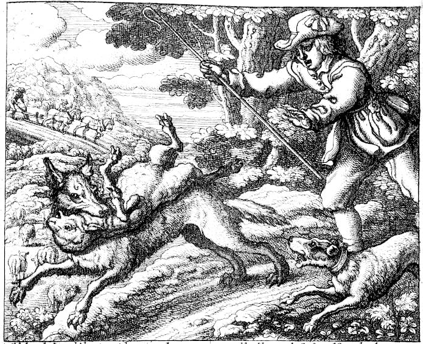

Boycriedwolfbarlow — Francis Barlow, Public domain

There was once a boy whose job was to watch the sheep on the hillside above his village. It was quiet work. All day the sheep ate grass, and all day there was nobody up there to talk to.

One afternoon he decided to make things less quiet. He ran down toward the village shouting, <em>Wolf! Wolf! A wolf is attacking the sheep!</em>

The villagers came running. The baker dropped his bread. The blacksmith dropped his hammer. They grabbed sticks and ran up the hill — and found the boy laughing. There was no wolf. There was only a boy who had been bored.

A few days later he did it again. <em>Wolf! Wolf!</em> Up the hill they came, angrier this time, and again there was nothing but the boy, holding his sides.

Then one evening a wolf really did come out of the trees. The boy shouted louder than he had ever shouted. <em>Wolf! WOLF! Please — a wolf!</em>

Down in the village, people looked up at the hill, and then back at what they were doing. <em>More of his games,</em> they said. Nobody went up.

The question

Once someone has lied to you, what would it take to believe them again?

After the story

The fable is about 2,500 years old, and in the oldest versions the boy does not lose sheep to a wolf at all. The villagers simply stop coming, and the story ends there. The wolf is a later addition, and it makes the story easier to take. With the wolf, the boy is punished. Without one, the punishment is only that nobody believes him any more, which is a stranger and more grown-up fear.

There is a second thing the moral skips. The boy's problem was not wickedness. It was boredom, and a job with nothing in it but sheep and weather. Trust is what the village spends, it is slow to rebuild, and the boy is not the only one who pays when it runs out. The sheep do too.

Aesop's fable usually ends with a moral: liars will not be believed even when they speak the truth. But it is worth stopping before the moral and asking whether you agree with the villagers.

The boy lied twice and learned his lesson the hard way. Should a lie cost him the sheep — and cost the villagers their sheep too? If someone you know lies to you once and is truly sorry, how many chances before the answer is <em>never again</em>?

A fable from ancient Greece, about 2,500 years old. Fables are short stories told to make a point — but the best ones leave you arguing about what the point really is.

# The North Wind and the Sun

Chapter 2 · Aesop, “The North Wind and the Sun” · ages 5–8

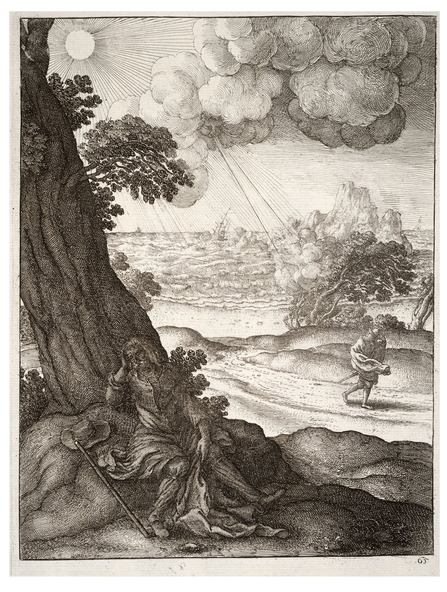

Wenceslas Hollar - The sun and the wind — Wenceslaus Hollar, Public domain

One day the North Wind and the Sun got into an argument about which of them was stronger. Below them, a traveller walked along a road, wearing a warm coat.

<em>That is all the proof we need,</em> said the Wind. <em>Whoever can make that man take off his coat is the stronger. Watch this.</em>

The Wind took a deep breath and blew. It pulled at the coat and flapped the man's hat, and the traveller — did the opposite of what the Wind wanted. He wrapped the coat tighter, buttoned it to the top, and bent into the wind, holding the whole thing shut with both hands.

The harder the Wind blew, the tighter the coat got. At last the Wind gave up, out of breath itself.

Then the Sun came out from behind a cloud. It did not blow. It did not pull. It just shone, gently, and the road grew warm. The traveller loosened his grip on the coat. The Sun shone a little warmer, and the man undid his buttons. A few steps further on, with his forehead damp, he took the coat off altogether and carried it over his arm.

The question

When you want someone to change what they're doing, what actually changes their mind?

After the story

Aesop told this one about 2,500 years ago and it has barely changed since, which is unusual for a story that old. It survives because it is small and complete: two forces, one man, and a result that can be argued about in either direction.

There is a fourth character nobody talks about, and it is the traveller's own reasons. He took his coat off because he was warm, not because he was persuaded. Neither the Wind nor the Sun asked him anything. So the story is not really about gentleness beating force. It is about two powers who never once considered that the man might have a view.

The moral people usually draw is: gentleness gets further than force. That is worth arguing with.

Force is sometimes exactly right — if a toddler is running into the road, you do not shine warmly and wait for them to decide. And notice something the moral skips: the traveller never agreed to any contest. The Wind and the Sun were arguing about how to move him, and nobody asked him. He was doing what he wanted all along.

So which is it — does warmth win because it is kinder, or because it tricks people more smoothly? And can someone else ever really change your mind, or do they just make it easier for you to change it yourself?

A Greek fable about two ways of getting what you want: force and warmth. It is one of the few old stories with no villain in it.

# The Bundle of Sticks

Chapter 3 · Aesop, “The Bundle of Sticks” · ages 6–9

Pater et Filii Litigantes — Jacob Gole

(Life time: 1660-1737), Public domain

A merchant had four sons who argued the way weather happens: constantly, and over everything. They argued about whose turn it was, whose fault it was, and whose idea had been best. The merchant worried that one day they would argue themselves apart.

One day he called them to the table and set down a bundle of sticks, tied with string.

<em>Break it,</em> he said to the eldest.

The son pulled. The bundle bent and did not break. He tried with both hands, then against his knee. Nothing. One by one the other sons tried, and one by one they failed. Four strong boys, and no match for a bundle of sticks.

The merchant untied the string and handed each of them a single stick. <em>Now.</em> Each stick snapped with a small, satisfying crack.

<em>You are the sticks,</em> he said. <em>Together, none of you can be broken. Apart, I could snap every one of you with my thumb.</em>

The question

What can your family, or your class, do together that nobody in it could do alone?

After the story

Aesop's fables include a version, and Plutarch tells a different one: a dying Scythian king called Scilurus hands his many sons a bundle of javelins and makes them try to break it. The story has been used by governments ever since, which should make you look at it twice. A story that powerful men like to tell children is doing a job.

And the bundle has a problem nobody mentions: it works by squeezing. Every stick is held in place by pressure from all the others, and the sticks in the middle do most of the holding. Nobody in the story asks whether the sticks wanted to be in a bundle, or what happens to the one that is weak, or whether being hard to break is the same as being well.

That is the story as it is always told, and the moral comes ready-made: stick together. But it is worth poking at.

A bundle holds because string squeezes every stick toward the others. What is the string in a family, or a class, or a country? And what happens to the stick that does all the holding while another one leans on it? A bundle is strong, all right — nobody says a bundle is fair.

So the story leaves two questions instead of one. What holds your people together? And when the bundle pulls tight, does every stick get a say?

A Greek fable about a merchant and his squabbling sons. Versions of the same story appear in India and in China, which suggests every place needed it.

# The Elephant and the Six Blind Men

Chapter 4 · An old Indian parable, written down in a Buddhist collection called the Udana · ages 6–9

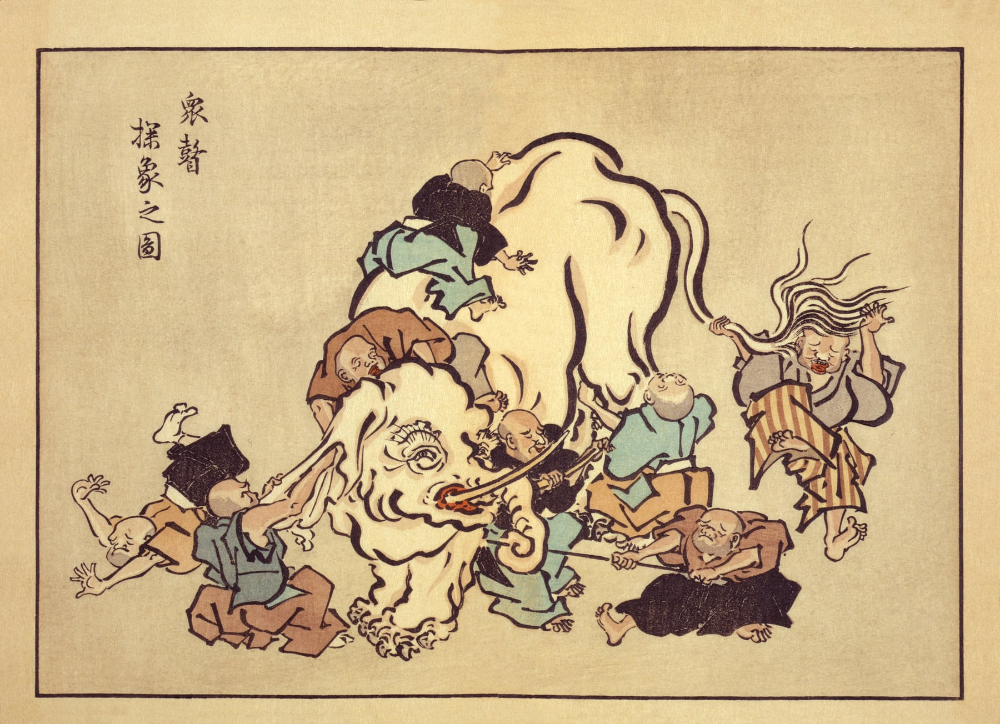

Blind monks examining an elephant — Hanabusa Itchō, Public domain

Some people in a village had never seen an elephant. One was brought to the edge of the town, and six men who could not see were taken to it, and each of them put out a hand.

The first one found the trunk, which was long and bendy and moved. "An elephant," he said, "is like a snake."

The second one found an ear, which was wide and flat and thin. "No," she said. "An elephant is like a fan."

The third one found a leg, which was thick and round and did not move at all. "You are both wrong. An elephant is like a pillar."

The fourth found the side of it, big and warm and solid. "It is like a wall."

The fifth found the tail, with a tuft on the end. "It is like a rope."

The sixth found a tusk, smooth and pointed and hard. "It is like a spear."

And then they argued, because each one of them was certain, and each one of them was describing something that was really there.

The question

Can everybody be partly right and still be wrong?

After the story

The story travelled a long way to reach you. Versions exist in India, Persia, China and Japan; in some the men are blind, in others simply in the dark; in the oldest Buddhist telling a king is mocking quarrelling teachers. Rumi, the Persian poet, turned it into a poem about how our senses only ever touch a piece of things.

But there is a twist the moral usually hides. If you say that everyone is partly right and nobody can see the whole, you have just claimed to see the whole. The only way to know that all six are describing one elephant is to stand where the elephant is visible, which is exactly the position the story says nobody is in.

The point of the story, in the old telling, is usually about people who are sure they are right and quarrel with everyone else. But there is a second layer, and it is worth noticing. Every one of the six was describing something true. That is exactly why it is hard: not one of them was making it up. They were all reporting honestly, from the small part of the animal they could reach — and none of them could tell, from where they were standing, that they were only touching a piece.

Told for well over two thousand years, in India and far beyond it. There are Jain versions, Sufi versions and Persian versions, all making the same point in slightly different ways.

# The Emperor's New Clothes

Chapter 5 · Hans Christian Andersen, 1837 · ages 6–10

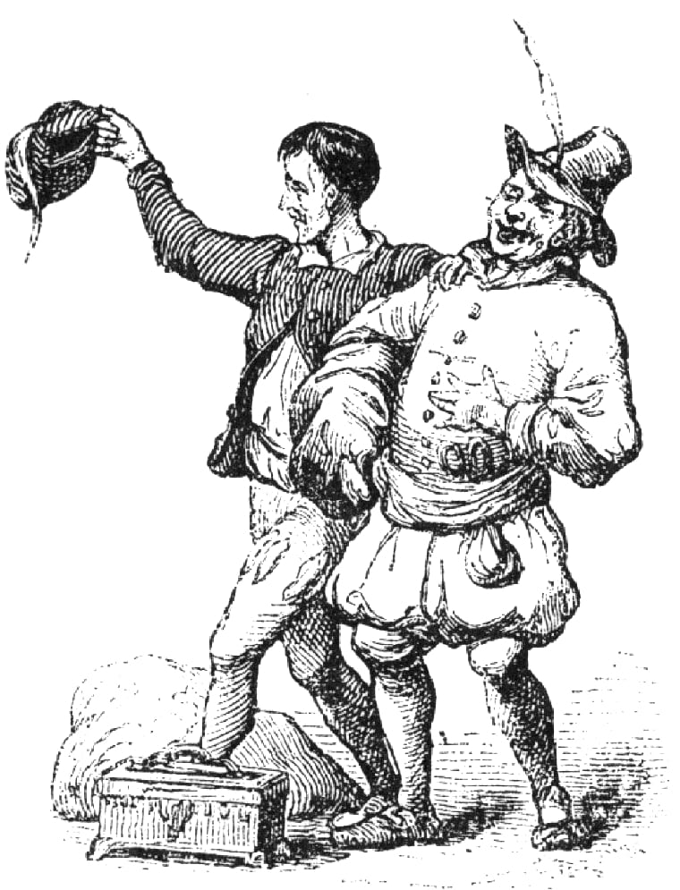

Vilhelm Pedersen, Kejserens nye klæder, ubt — Unknown, Public domain

An emperor loved new clothes more than anything else. He spent all his money on them and changed outfits every hour.

Two strangers arrived, claiming to be weavers. They said they could make the most beautiful cloth in the world — and then they explained the wonderful thing about it. The cloth, they said, was invisible to anyone who was stupid, or unfit for their job.

The emperor hired them on the spot. They set up two looms, asked for silk and gold thread, and put all of it in their own bags. Then they pretended to weave, late into the night, on empty looms.

The emperor sent his oldest, most trusted minister to look. The minister stared at the empty looms and saw nothing at all — and thought, if I say I see nothing, they will know I am stupid, and I will lose my job. So he came back and described the cloth in detail: the colours, the pattern, the beauty.

Then he sent another official, and the same thing happened. Then the emperor went himself, with his whole court. Everyone looked. Everyone saw nothing. Everyone said how magnificent it was.

So they dressed him. The weavers pretended to put on each garment, one after another, and the emperor turned this way and that in front of the mirror, and everyone agreed it suited him perfectly.

And he walked out into the street, and the whole town cheered, because not one person wanted to be the one who could not see it.

Until a small child, who had no job to lose and no idea he was supposed to be careful, said the obvious thing out loud.

He isn't wearing anything.

The question

Why is it so hard to say the true thing when everyone else is silent?

After the story

Hans Christian Andersen published this in 1837, and he did not invent it either. A Spanish prince, Don Juan Manuel, told a version five hundred years earlier, with a cloth that is invisible to men who are not the sons of their fathers, and a servant who has to pretend. The trap has been rebuilt in every century since. In this one it is invisible to anyone unfit for their job, which is a much better trap.

Notice that the emperor never has to say anything false. He looks, sees nothing, and says the cloth is beautiful, because the alternative is admitting he cannot see what everyone else claims to see. The lie does not begin with the weavers. It begins with the first person who decides that not seeing is a thing to be ashamed of.

Andersen wrote it as a fairy tale for adults as much as children. The two swindlers' trick only works because everybody is worried about what everyone else will think of them.

# The Fox and the Grapes

Chapter 6 · Aesop, “The Fox and the Grapes” · ages 6–9

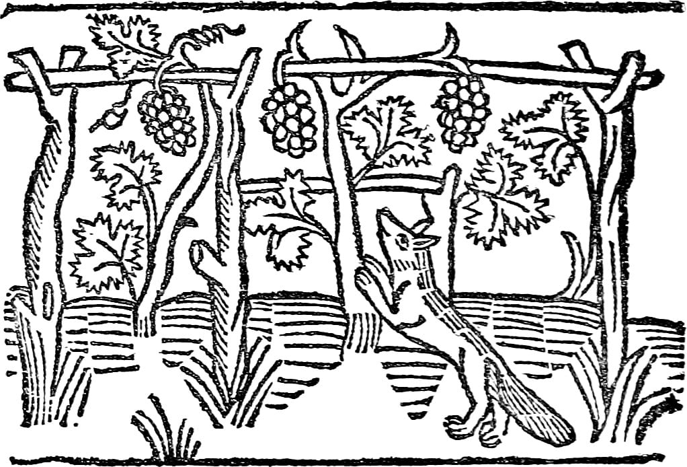

Caxton Aesop-114 — Unknown artist, from Caxton's Aesop (1484), Public domain

A fox was walking through the forest when he saw them: a bunch of grapes, fat and purple, hanging from a vine that had climbed up a tall branch.

His mouth watered. He backed up a few steps, ran, and jumped. He missed by a whisker.

He tried again, running faster, jumping higher. The grapes swung on their stem and stayed where they were. Again. Again. He was panting now, and the grapes were exactly as far away as when he started.

Finally the fox gave up. He turned up his nose, walked away, and said, just loudly enough for the forest to hear: <em>They were probably sour anyway. I never wanted them.</em>

The question

When we can't have what we want, is it better to change what we want — or to pretend we never wanted it?

After the story

That is the whole story. Here is what makes it strange: the grapes did not change. Not one of them got sourer while the fox was jumping. The only thing that changed between his first jump and his last words was the fox's <em>story</em> about the grapes.

So did the fox actually change his mind? Or did he only say he did — and which of those is worse?

Aesop's version is about two and a half thousand years old and takes four lines. Everything else, the running start, the panting, the remark aimed at the whole forest, is later telling. English took the phrase “sour grapes” from it, which is a sign the story worked: it gave us a name for something before most of us had noticed we did it.

There is a reason it is hard to catch yourself doing it. Wanting something you cannot have is uncomfortable, and the discomfort does not go away by being ignored. Changing the story is faster than changing the situation. The trouble is that the same move works in both directions: you can talk yourself out of wanting something silly, and you can talk yourself out of wanting something you should have fought for. From the inside, they feel identical.

Everyone does some version of this. The game you couldn't join was boring anyway. The party you weren't invited to would have been full of annoying people. Sometimes that is wisdom — letting go of something you can't have is a real skill. Sometimes it is just the fox.

The hard question is how you tell the difference from inside. When <em>you</em> stop wanting something, how do you know whether you truly moved on — or whether the grapes are still hanging there, as sweet as ever?

Another Greek fable — so short it fits in six lines, and still doing its job 2,500 years later. The phrase “sour grapes” comes straight from this story.

# The Man Who Dreamed He Was a Butterfly

Chapter 7 · Zhuangzi, chapter 2 · ages 6–9

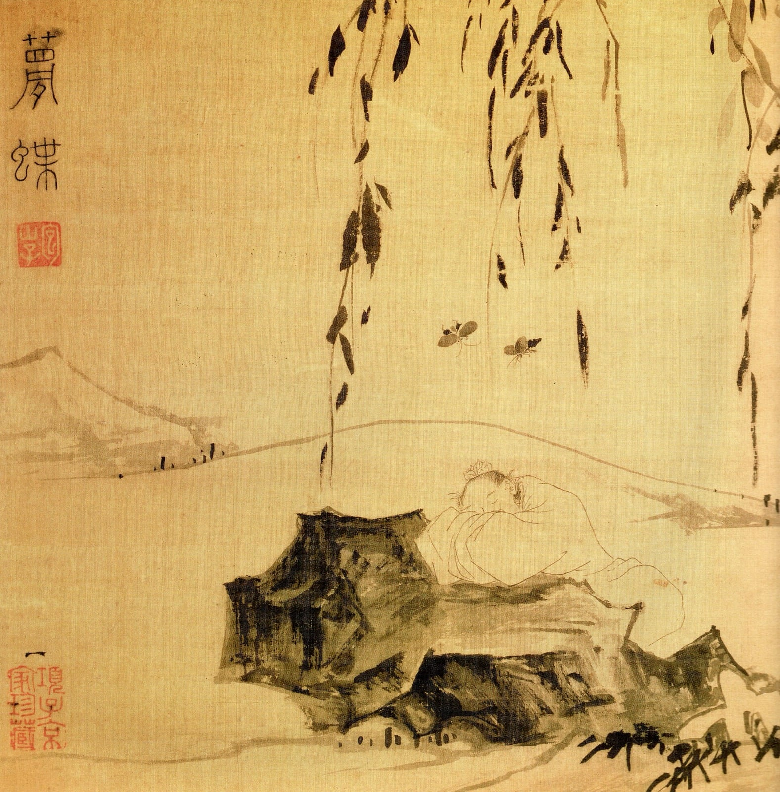

Dschuang-Dsi-Schmetterlingstraum-Zhuangzi-Butterfly-Dream — Lu Zhi, Public domain

Once, Zhuangzi dreamed he was a butterfly.

It was a very good dream. He was fluttering about, delighted with himself, going wherever he liked and not wondering about anything. He had no idea he was Zhuangzi. He was simply a butterfly, and that was all there was to it.

Then he woke up, and there he was: Zhuangzi. Solid. Lying in a bed, with a body, and a name, and things he had to do that day.

And he could not work out which one was true.

Was he a man who had fallen asleep and dreamed he was a butterfly?

Or was he a butterfly, right then, dreaming that he was a man?

The question

If you cannot tell, does it matter?

After the story

Zhuangzi lived about 2,300 years ago, in a time of constant war, and wrote in small strange stories instead of arguments. He is not trying to make you doubt everything. He is pointing at something narrower and worse: the feeling of being sure is identical in a dream and in a morning, and the feeling is all you ever have to go on.

You can test the shape of it. You have woken up relieved that something was not real, and you have dreamed something you were certain was happening. In both cases your evidence was exactly the same: it seemed to be happening. So what would count as proof that you are awake right now? Careful. Pinching yourself is something you can also dream.

He wrote it down and left it there, without an answer, and people have been picking at it for two thousand years. Descartes asked almost the same question in France, and found it frightening. Zhuangzi found it funny. Both of them noticed the same thing: while you are inside a dream, it is completely convincing, and you cannot step outside to check.

Which leaves a small question that is much harder than it looks. If a dream and a day feel the same from the inside, what exactly makes one of them real?

Written in China about 2,300 years ago. This is only three sentences long in the original — it is the whole of it, and it is enough.

# The Race Nobody Agreed On

Chapter 8 · Aesop, The Tortoise and the Hare · ages 6–9

Tortoise and hare rackham — Arthur Rackham, Public domain

A hare laughed at a tortoise for being slow. He did it in front of the other animals, because that is more fun.

The tortoise did not cry or hide. She said: <em>Alright. Race me.</em>

The hare thought this was the funniest thing he had ever heard. He agreed immediately, so that everyone could see how silly it was. The fox set a course and a finish line, and the other animals came to watch.

The race started, and the hare was gone. He was out of sight in the time it took the tortoise to leave her own shadow. Halfway along he thought: I have time for a nap. This is not arrogance, exactly, or not only arrogance. It is what happens when you have never had to try.

He lay in the long grass, in the sun, and slept.

The tortoise walked. She was not fast, and she was not clever, and she did not have a plan beyond the ordinary one: foot, foot, foot, the road, the heat, the dust.

The hare woke before the end. He saw the tortoise nearly at the line, ran, ran faster than he had ever run, and lost by a length.

The question

What counts as winning, and who decided where the finish line is?

After the story

Everyone knows the moral, and it is usually written down as "slow and steady wins the race", which is a comfortable thing to say to a slow child. But look at what actually happened. The hare did not lose because he was fast. He lost because he stopped. The tortoise did not win because she was slow. She won because she kept going, and because she was allowed to choose a race where keeping going was enough.

Now the awkward question that the fable skips. Who set that finish line? The fox. What would have happened on a race twice as long, or uphill, or with a fence? Did the hare actually want to win, or did he just want everyone to watch him run?

And the harder one: if you are faster than everyone in the room, is it fair to be told that the slowest wins?

One of Aesop's fables, told in Greece about 2,500 years ago and still told in every school. The version most people know is much newer than the story.

# The Boy With the Empty Pot

Chapter 9 · A Chinese folktale, retold for centuries · ages 7–10

Song Longquan Ware Celadon Jar — Gary Lee Todd, Ph.D., CC0

An emperor grew old and had no son he trusted, so he thought of a test.

He ordered every child in the kingdom to come to the palace. Each one was given a seed, and each was told the same thing: <em>Take this home. Plant it. Look after it. In one year, bring me what you have grown, and the child with the finest plant will be the next ruler.</em>

A boy called Ping went home with his seed and planted it in the best pot, with the best soil, and watered it every morning before school. He talked to it. He checked it before bed.

Nothing came up.

He moved it into the sun. He moved it out of the sun. He asked his father, who was a gardener, who said the soil was fine, and the pot was fine, and the watering was fine. Nothing came up.

A year passed. On the morning of the test, Ping walked to the palace with an empty pot, and he was the only child who was not carrying something green and enormous. Some of the plants were like small trees. Some had flowers nobody had ever seen. Ping stood in the courtyard holding his pot and wished the ground would open.

The emperor walked slowly along the row, looking at each plant, and saying nothing. When he reached Ping he stopped.

<em>Why is your pot empty?</em> he asked.

Ping's voice was very small. <em>I did everything you said. It never grew. I'm sorry.</em>

The emperor smiled, and then he laughed, and then he made the announcement.

<em>Every seed you were given,</em> he said, <em>was boiled. None of them could grow. These children have brought me plants I have never seen, grown from seeds that could not sprout. Only this boy told me the truth.</em>

The question

Would you hand in an empty pot?

After the story

It is a satisfying ending, and that is the problem. It is only satisfying because Ping's honesty gets rewarded within the hour, in public, by an emperor. Most honesty does not work like that. Most honesty costs you something and nobody claps.

So the real question is not whether Ping was right. It is: would you have done it? And would you have done it if the emperor had looked at your empty pot, said nothing at all, and moved on to the next child?

Nobody knows who told this first. It has been told in China for a very long time, and retold in many children's books in the last hundred years. This is our version of the old story.

# The Ship That Was Replaced

Chapter 10 · Plutarch, Life of Theseus · ages 7–10

Dionysus Crossing the Sea — Unknown authorUnknown author, Public domain

A young man sailed away to a far country and had a famous adventure. He came home. He became king.

To say thank you, the city kept his ship. They put it in a place where everyone could see it, and they took care of it, because it was the ship that had carried him and his friends safely home.

Ships are made of wood, and wood rots, and nothing can be done about that. So when a plank grew soft, they took it out and put in a new one. Every few years, another plank. Ropes were replaced. Oars were replaced. Slowly, over a long stretch of time, every single piece of the original ship was gone, and the ship that stood in the harbour was made of wood that had never been anywhere near that adventure.

They still called it the same ship. Of course they did.

But here is the question, and it has never been settled. Is it the same ship?

Some people say yes. It is the same ship because it is the same ship — the name, the place, the story, the people looking after it. What it is made of is not what it is.

Some people say no. It is a completely different ship wearing an old ship's name. If you had kept every old plank in a shed, then at the end you would have all the original wood, and you could build the real ship from it. And you cannot have two ships both being the one.

The question

What is it that makes something the same thing over time?

After the story

The story is about 1,900 years old, and it was already old when Plutarch wrote it down: the Athenians really did keep a ship they said was Theseus'. Plutarch noticed that philosophers had been arguing about it for centuries before him, and he mentions, almost in passing, that some people kept the old planks and reassembled them, which gave them two ships claiming to be one.

In 1655 Thomas Hobbes made it worse on purpose. Suppose somebody gathers all the removed planks and builds a second ship from them. Now which one is the ship of Theseus? The harbour one, repaired piece by piece, or the shed one, made of every original timber? Each answer sounds right, and they cannot both be. Hobbes was not confused. He was showing that "the same thing" is not one idea but several, and we use whichever suits us until someone puts them side by side.

And here is the part that is meant to catch you. You are made of things that are swapped out too. Cells, hair, skin, teeth, ideas, opinions. Most of what is you today was not you when you were four.

So: are you the same you?

Plutarch wrote this down about 1,900 years ago while describing an old ship the Athenians kept. Philosophers have been arguing about it ever since, and Thomas Hobbes made it harder in 1655.

# The Arrow You Won't Pull Out

Chapter 11 · The Buddha, Cūḷamālunkyovya Sutta · ages 8–12

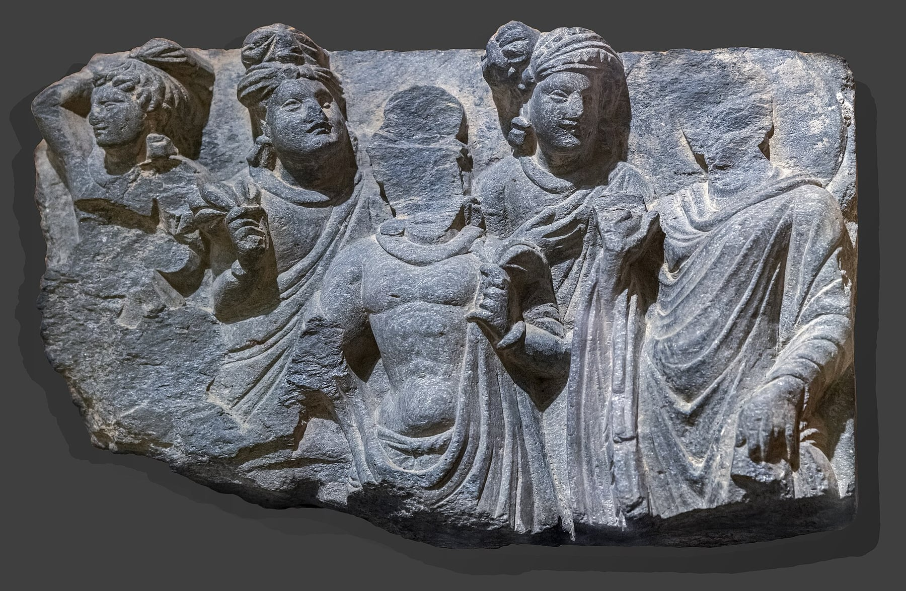

Labit - Buddha with four characters - Karkhi (Gandhara) - Greco-Buddhist art — Didier Descouens, Public domain

A man was shot by an arrow, and the arrow was poisoned, and it was in him.

A doctor arrived with tools. The man said: wait.

<em>First,</em> he said, <em>who shot me? Was he tall or short? Was he a soldier or a stranger? What kind of bow did he use, and what was the string made of, and was it a wooden arrow or a reed?</em>

The doctor said the arrow needed to come out.

<em>I haven't finished,</em> the man said. <em>What was the arrowhead made of? What feathers were on it? What kind of poison?</em>

And while he was asking, the poison did what poison does.

The question

Which questions must be answered now, and which ones can wait?

After the story

That is roughly how the Buddha told it, to a monk called Malunkyaputta. The monk had a list of questions he wanted answered before he would commit to the training. Is the world eternal? Is it not? Is the soul the same as the body? Does a person exist after death? And so on.

The Buddha did not say the questions were stupid. That is the part people skip. He said they were the kind of question that can eat a whole life, and that a man with an arrow in him has a more urgent job.

But here is the awkward bit, and it is worth sitting with. Sometimes the man with the arrow really does need to know who shot him. If the shooter is still out there, a second arrow is coming. A doctor who says <em>never mind that, hold still</em> is not always being wise. He might be hurrying.

So which questions are arrows, and which are the poison? And how would you tell the difference while the clock is running?

A teaching remembered by Buddhist monks for centuries before it was written down. The Buddha is answering a monk who wants the biggest questions settled before he starts.

# The Cave

Chapter 12 · Plato, The Republic, Book VII · ages 8–12

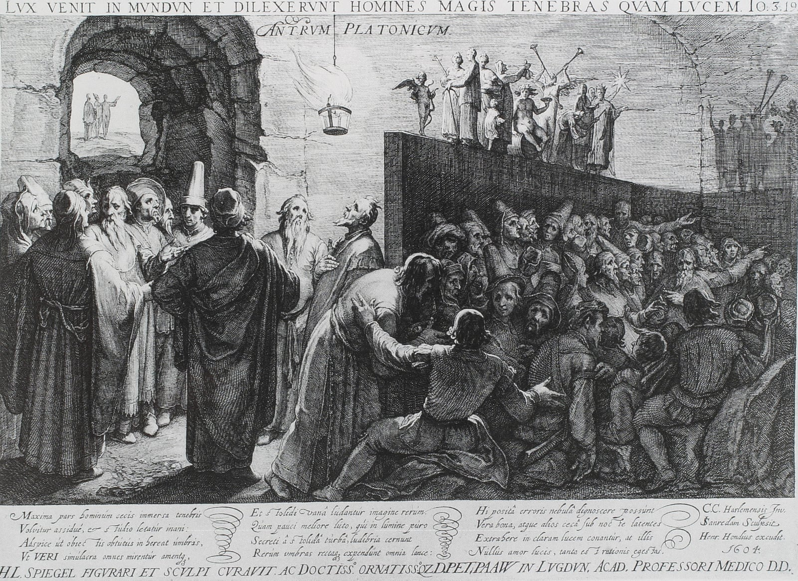

Platon Cave Sanraedam 1604 — Jan Saenredam, after Cornelis van Haarlem, Public domain

Imagine a cave underground, with a long tunnel leading up to the daylight.

Deep inside, some people have been prisoners since they were babies. Their legs and necks are held so they can only look at one wall. Behind them is a fire, and between the fire and the prisoners is a walkway where other people carry things past — a bowl, a jug, a little wooden horse. The prisoners cannot turn round. All they ever see, on the wall in front of them, are the shadows those things cast.

They give the shadows names. They argue about which shadows are which, and they are good at it — better than you would be. They know the order the shapes come in, and who is cleverest at guessing what comes next. They think the shadows are the whole world, because why wouldn't they.

One day a prisoner is set free. At first he is baffled. The people and the things he used to see as shadows are right there, in front of him, and they are solid. He is told he is seeing what is real, and he does not believe it. He wants to go back to the wall, where things made sense.

Then he is dragged up the tunnel, and the sunlight hurts. He cannot see anything for a while. Slowly, though, he gets used to it. He sees the sky, then the sun, and he works out that the sun is what makes everything else visible. And he thinks of the prisoners still down there, and how they would call him mad if he told them what he had found.

He goes back. And their eyes are used to the dark, and his are ruined by the light, and he cannot do the shadow-guessing any more. He stumbles.

So what do they say about him? Plato is blunt about it: they would say the trip outside ruined him, and if anyone tried to set them free and take them up that tunnel, they would kill him.

The question

Are you sure that everything you can see is everything there is?

After the story

Plato wrote this in the Republic, in a book about how a city should be run, and he was not being gentle about it. The prisoners are not stupid. They are educated in the only thing available to them, and their skill at reading shadows is real skill: they can name a shape faster than you could. What they lack is not intelligence. It is the chance to turn round.

There is a version you can test today. A screen shows you a world somebody chose for you, in an order designed to keep you watching, and you never see what was left out. The people arranging it are not villains either; they are paid to know what you will look at next. So the question is not whether you are in a cave. It is who decides which wall you face.

Written about 2,400 years ago. Plato says it is a picture of what learning is like — and of what people do to the person who learns something they did not want to hear.

# The Sword Above the Throne

Chapter 13 · Cicero, Tusculan Disputations, Book 5 · ages 8–12

WestallDamocles — Richard Westall, Public domain

There was a king called Dionysius, who ruled a city and was, by every account, not a gentle man. He had money, soldiers, a palace, and enemies who had a habit of dying.

One of his courtiers was called Damocles. Damocles spent a lot of time saying how wonderful the king's life must be. The gold, the power, the way people bowed. He said it often enough that the king decided to answer him.

<em>You think my life is sweet,</em> said Dionysius. <em>Then take it. Sit here for one day and see.</em>

They put Damocles on the throne. Servants brought him food on silver. Perfume was burned. People came and asked him for favours and laughed at his jokes. He was, for an afternoon, the happiest man in the city.

Then he looked up.

Above his head, hanging by a single hair from a horse's tail, was a sword. The point was a hand's width from his neck. It had been there the whole time. Nobody had mentioned it. Nobody had needed to.

Damocles stopped eating. He stopped laughing. He stopped hearing what people said to him. He asked, very politely, whether he might be excused, and he went home and never asked about the king's life again.

The question

Would you take the throne if you knew exactly what came with it?

After the story

The story is usually told as a warning about power: that a ruler lives under a threat he cannot put down. But look at where the sword is actually pointing. It does not hang over the throne. It hangs over whoever is sitting in it.

So here is the question the story leaves. Was Damocles wrong to want the throne, or wrong about what the throne was? And if you could have the good part — the silver, the bowing, the afternoon — while knowing about the sword, would you still sit down?

Cicero wrote this in Rome about two thousand years ago, while arguing about whether a king can be truly happy. It is one of the oldest stories about the price of power.

# When Is a Heap Not a Heap?

Chapter 14 · Eubulides of Miletus, the sorites paradox · ages 8–12

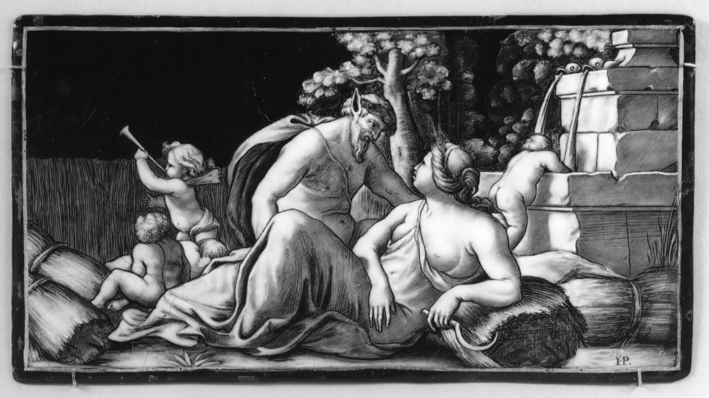

Hélie Poncet - Allegory of Summer - Walters 44173 — Hélie Poncet, Public domain

Here is a heap of rice. Ten thousand grains, at least. Nobody would argue with that.

Now take one grain away. Is what is left a heap? Of course. One grain cannot be the difference between a heap and not-a-heap — that would be absurd.

Take another. Still a heap — by the same argument. Another. Another. Each time, removing one grain changes nothing, and each time what is left is a heap.

But follow the argument to the end and you are standing in front of a single grain of rice on a table, which you have just agreed is a heap.

Somewhere in there, the heap went away. So: <em>which grain was the guilty one?</em>

The question

If every single step looks harmless, how does a big change ever happen?

After the story

This puzzle is more than two thousand years old, and the uncomfortable part is that no step in it looks wrong. It feels like there should be a line — 4,731 grains is a heap, 4,730 is not — but nobody could ever say where it is, and any line you draw looks made up.

Once you see the shape of the puzzle, it turns up everywhere. How many hairs does a person need before they are not bald? How many minutes late is it fair to say the bus is “late”? How many euros make someone rich? How many drops of water make a puddle? Our words feel solid — <em>heap, bald, rich, late</em> — and each of them has one grain of vagueness hiding inside it.

The puzzle comes from Eubulides, a Greek philosopher who lived about 2,400 years ago and was famous for arguments that ended in traps. He had a whole family of them. This one is about a heap; another is about a man who says he is lying. They are not jokes, though they are funny. They are tests of whether our words can carry the weight we put on them.

Philosophers have three main moves. One: there really is a line, and we simply do not know where it is. Two: vague words have no line, so many statements about heaps are neither true nor false. Three: truth comes in degrees, so “is a heap” can be nearly true. Each move fixes something and breaks something else. None of them tells you which grain it was.

Some philosophers say the lesson is that words are blunter than the world. Others say there really is a line, we just can't see it. One of them is wrong. Finding out which grain it is has kept philosophers busy since the time of the ancient Greeks — and they have not finished yet.

A puzzle from ancient Greece, about 2,300 years old. Sorites just means “of a heap”. Philosophers are still arguing about the answer, which is a good sign the puzzle is real.

# A Handful of Mustard Seed

Chapter 15 · Buddhist tradition, the story of Kisa Gotami · ages 9–12

Nava Jetavana Temple - Shravasti - 007 Kisagotami with her Dead Child (9244545544) — Photo Dharma from Penang, Malaysia, CC BY 2.0

A woman called Kisa Gotami had one child, a boy, and he was the whole of her days. When he was small he fell ill, and then he died, and she would not accept it.

She carried him from house to house in the village, asking for medicine. People looked away. Some of them told her the truth and she did not hear it. Eventually someone said: there is a teacher on the edge of town. Ask him.

She went to the Buddha and held out her son and asked him to make the boy well.

He did not argue with her. He said: <em>I can help. Bring me a handful of mustard seed. But it must come from a house where no one has ever died.</em>

She set off. Mustard seed was cheap and every kitchen had some. This would be quick.

At the first house the woman said yes, of course, take some. And then Kisa asked her question, and the woman stopped, and said: <em>we lost my mother in the spring.</em>

At the next house it was a brother. At the next, a baby, years ago. At the next, a grandfather, a husband, a child who would have been fourteen this year.

She went through the whole village. There was no house. Not one.

And she understood, in the way you understand a thing with your body rather than your thoughts, that she was not being punished, and not singled out, and not the only one. She buried her son. She came back to the teacher and told him what she had found.

The question

Does knowing that everyone grieves make grief easier, or heavier?

After the story

The story gets told as a lesson about accepting death, which is true and also a little convenient, because it is easy to say to someone else. What Kisa actually found was harder and stranger: that going door to door with her question made a room full of strangers into people who had the same wound.

So which helped her more: the teaching, or the doorways? And if it was the doorways, why does it take a dead child to make us knock?

A story remembered by Buddhist communities for centuries before anyone wrote it down, and told in many versions since. It is not a story about being brave.

# Achilles and the Tortoise

Chapter 16 · Zeno of Elea, as retold by Aristotle · ages 9–12

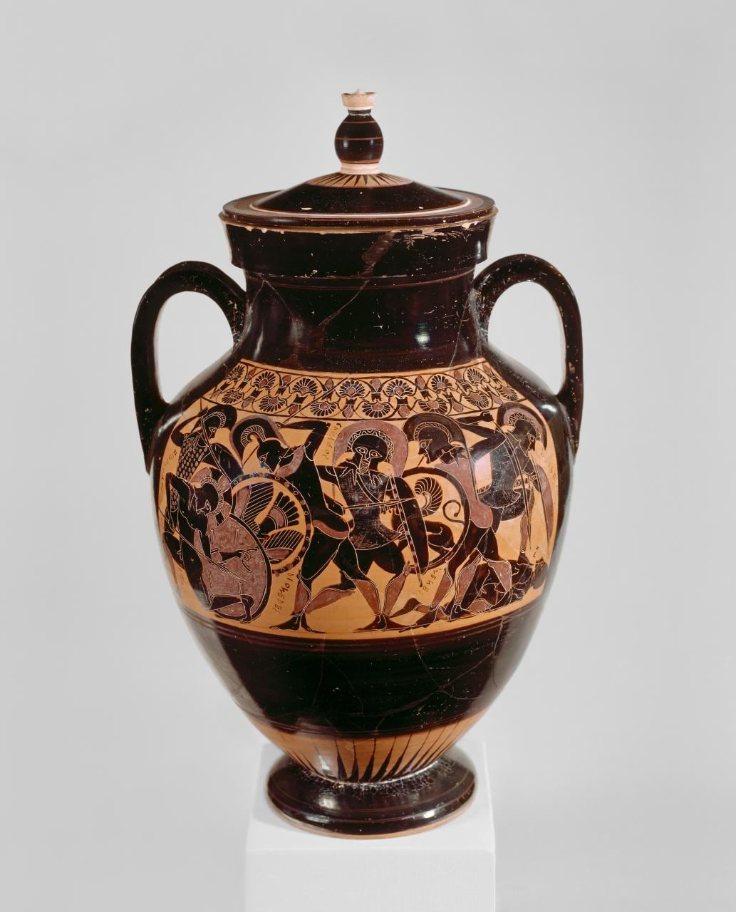

Psykter amphora Chalkidian black-figure ware attributed to the inscriptions painter Ba000023 — Attributed to the Inscriptions Painter, CC0

Achilles was the fastest runner alive. A tortoise is among the slowest things alive. So Zeno set them racing, and gave the tortoise a small head start — say, ten metres.

Here is Zeno's argument that Achilles can never catch it.

To catch up, Achilles must first reach the point where the tortoise started. Running at his speed, that takes him some time — and in that time, the tortoise has crawled a little further ahead, say one metre.

So now Achilles must reach <em>that</em> point. It takes less time than before, but it takes <em>some</em> time — and in that time the tortoise moves a little further. Ten centimetres, perhaps.

To that point, then, and in the meantime the tortoise moves again. The gap shrinks: half, then half, then half. It never quite disappears, because there is always another half to cross first. And you cannot be somewhere you have not yet reached. So the tortoise stays ahead — forever.

You know this argument is wrong, because runners pass tortoises every day. But watch how hard it is to say <em>where</em> it goes wrong. Every single step of the argument looked perfect.

The question

If there is always another half of a gap to cross first, how does anything ever arrive?

After the story

Zeno was not a fool playing with words. He was defending a serious idea: that if a distance can always be halved, crossing it would take infinitely many steps, and perhaps nothing ever arrives anywhere. For most of two thousand years the best reply was that he was obviously wrong, which is not a reply.

The mathematical part of the mystery took until about two thousand years after Zeno to settle: infinitely many steps can still add up to a finite distance. Half a gap, plus a quarter, plus an eighth, plus… gets closer and closer to the whole gap without ever passing it, and Achilles reaches it in a finite time. The steps run out of room.

But a puzzle is left, and it is not a maths puzzle. Zeno's real question was about what motion <em>is</em>: how can anything be “at” a place, mid-movement, if between any two places there are always more places? Everyone who has ever run knows the answer with their legs. Saying it with words is harder than it looks — which was exactly Zeno's point.

A race paradox from Greece, about 2,450 years old. Zeno meant it as an argument that motion is impossible. Motion is obviously possible. Finding the exact flaw in his argument took mathematicians over two thousand years.

# How Do You Know the Fish Is Happy?

Chapter 17 · Zhuangzi, Autumn Floods · ages 9–12

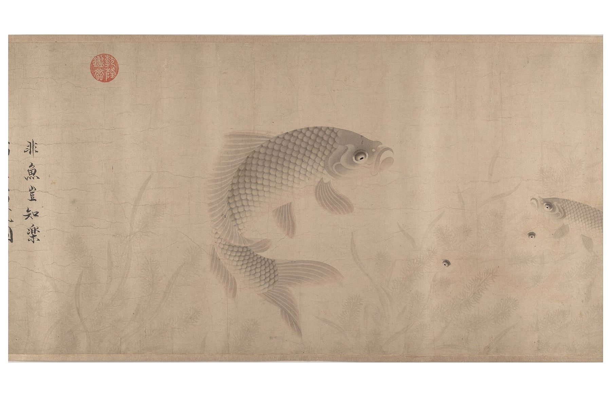

The Pleasures of Fishes (IA mma the pleasures of fishes 40393) — Zhou Dongqing, Public domain

Zhuangzi and his friend Huizi were walking along a river on a bridge. It was a good day. The water was clear.

<em>Look at the minnows,</em> said Zhuangzi. <em>They come out, they swim about, they go where they like. This is what it is to be a fish. They are happy.</em>

Huizi, who liked winning arguments more than he liked fish, said: <em>You are not a fish. How do you know what makes a fish happy?</em>

<em>You are not me,</em> said Zhuangzi. <em>How do you know that I don't know?</em>

<em>I am not you, so I do not know you,</em> Huizi said, pleased with himself. <em>And you are certainly not a fish, so you do not know fish. That settles it.</em>

Zhuangzi did not give up. <em>Let us go back to where we started,</em> he said. <em>You asked me how I know the fish are happy. That means you already accepted that I know it, and only wanted to hear how. Well: I know it from here. Standing on this bridge, looking at the water.</em>

The question

Can you ever really know what another creature is feeling?

After the story

That is where the story stops, which is a little rude of it.

Because Zhuangzi has not explained anything. He has only pointed at the river. And Huizi has not been answered either: he asked a fair question and got a joke.

You can try it yourself. A dog wags its tail. You say the dog is pleased. How do you know? Its mouth is open, its eyes are soft, its body is loose. But you have never been a dog. You have only ever seen dogs, and been you.

So what is happening when you look at a fish and feel sure? Are you reading the fish, or are you reading yourself and hoping it fits?

A story from a Chinese book named after its author, about 2,300 years old. Zhuangzi argued with his friend Huizi the way some people play chess.

# Stand Out of My Sunlight

Chapter 18 · Plutarch, Life of Alexander · ages 9–12

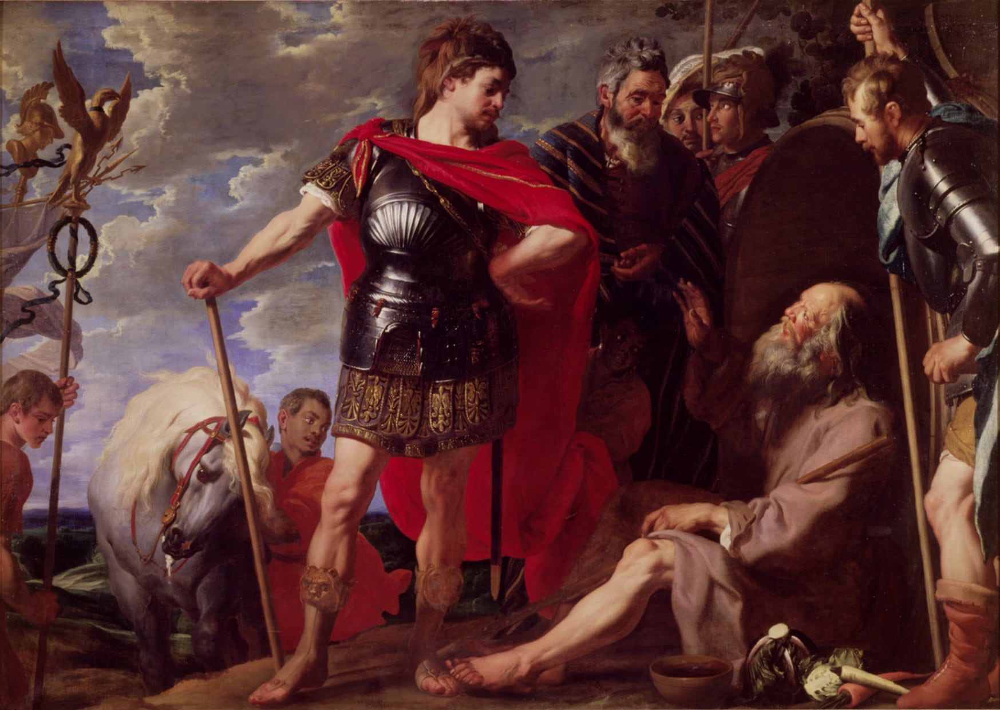

Caspar de Crayer Alexander and Diogenes — Gaspar de Crayer, Public domain

Diogenes lived in a barrel in the city of Corinth. Not an empty house, not a small room: a barrel. He owned a cloak, a stick, a bowl, and the habit of saying exactly what he thought.

He was not poor in the way you might imagine. He had chosen it. He had decided that most of what people worked for was noise, and that the way to be free was to want almost nothing. People found this annoying. People still find this annoying.

Alexander was the opposite in every way. He was young, he had taken an empire, and he had just been told by everyone around him that he was a god besides which mere men were small.

Alexander heard about Diogenes and wanted to meet him. So he came with his generals, and his guards, and the enormous machine of his progress, and he found the philosopher lying in the sun.

Alexander stood over him. <em>I am Alexander the Great,</em> he said. <em>Ask me for whatever you want, and it is yours.</em>

Diogenes, without sitting up: <em>Then stand a little out of my sun.</em>

The question

What do you actually need, and who decides what that is?

After the story

What is worth noticing is how badly Alexander takes it. He does not laugh. He does not have him arrested. He says, according to Plutarch, something like: <em>If I were not Alexander, I would wish to be Diogenes.</em> Which is not a compliment to Diogenes so much as an admission. The man who could have anything had just noticed that he could not have that.

But do not let the philosopher off too easily. Diogenes' freedom depended on a city that tolerated him, in a warm climate, where a man in a barrel did not freeze in the first winter. His need was small because other people were doing the needing for him.

So: was that freedom, or was it a trick of having nothing to lose? And if you stripped away everything you could not keep anyway, how much of you would still be there?

Plutarch wrote this about two thousand years ago, describing a meeting that happened in Corinth about 2,300 years ago. Alexander was the most powerful man alive. Diogenes owned a barrel.

# The Ring That Made Him Invisible

Chapter 19 · Plato, The Republic, Book II · ages 9–12

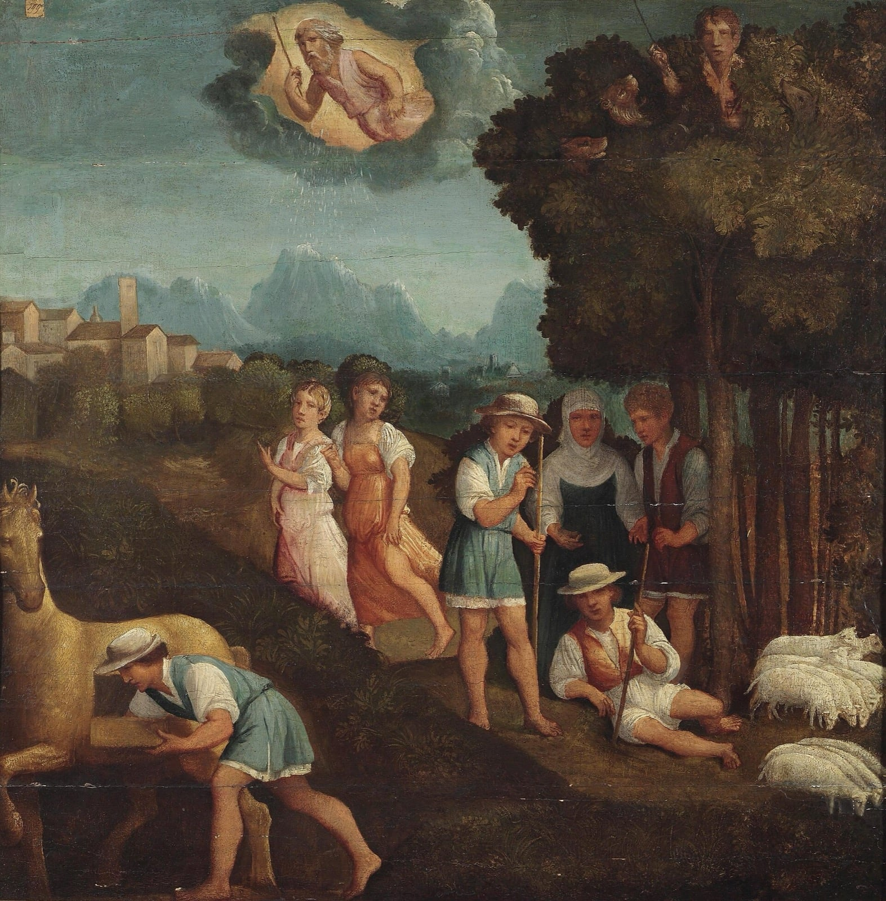

Der Ring des Gyges (Ferrara 16 Jh) — AnonymousUnknown author, Public domain

There was a shepherd called Gyges, long ago, in the service of the king.

One day a storm came, and an earthquake with it, and the ground split open where his flock was grazing. He looked down and saw a hole. He climbed in.

Inside, in the dark, there was a bronze horse with doors in its side. Gyges opened them and found a body lying there — larger than a man's, with a gold ring on its hand. He took the ring and climbed back out.

That evening, sitting with the other shepherds, he turned the ring around on his finger. And they began to talk about him as if he were not there.

He had found the trick. Turned one way, he was invisible. Turned the other, he was back. Nobody could see him, or hear him, or stop him.

Now: you are a shepherd, you are nobody, and there is a king's palace a day's walk away. What do you do?

This is what Gyges did. He got himself appointed as a messenger to the court. He used the ring to get close to the queen, and together they killed the king, and Gyges took the throne and the kingdom.

The question

Are you good, or are you just being watched?

After the story

Glaucon, who tells the story, is not really interested in Gyges. He is making a point to Socrates. Give anyone on earth that ring, he says, and you will find out what they are really like. And he asks Socrates to prove that justice — being fair even when it costs you — is worth having for its own sake, and not just because of getting caught.

The story is about 2,400 years old, and Plato did not invent it. Herodotus tells a near-identical tale about a different king and a different shepherd, with no magic at all, which suggests the Greeks had been passing it around long before anyone wrote it down. Plato's addition is the ring.

Glaucon's challenge is sharper than it looks. He is not saying people are wicked. He is saying that if being decent were never rewarded, and being cruel never punished, fairness would have nothing to recommend it except itself. Socrates has to show that justice is good for you from the inside, even when everyone believes you are a monster. Whether he manages it is still argued about, which is unusual for a question that old.

Plato spends the rest of the book trying. He is still working on it. So are we.

Glaucon tells this story to Socrates as a challenge — not as an example. He is arguing that people are only good because they are watched.

# The Tree Nobody Could Use

Chapter 20 · Zhuangzi, In the World of Men · ages 9–12

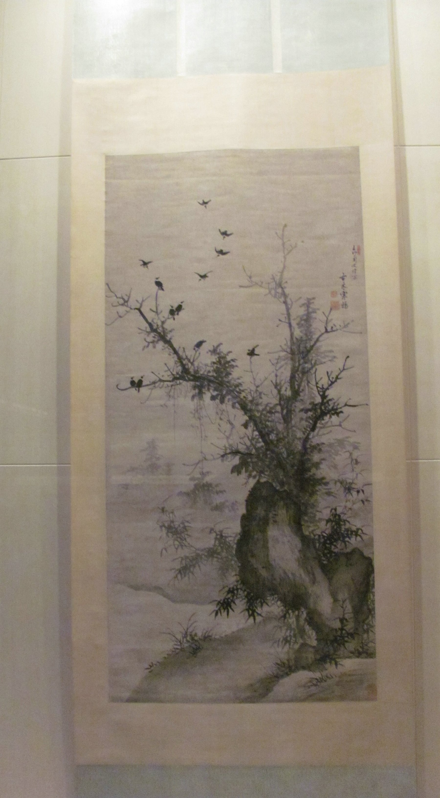

Gumuhanyatu — Ciked, Public domain

A carpenter was walking to a job with his apprentice, and they came to a tree so big that a thousand cows could stand in its shade. It stood beside a shrine, and people came from villages around to look at it.

The carpenter walked past without turning his head.

His apprentice stopped. <em>Master,</em> he said, <em>I have never seen timber like this in my life. Why won't you even look?</em>

<em>Because it is good for nothing,</em> the carpenter said. <em>Make a boat from it and it sinks. Make a door and it warps. Make a beam and it bends. It rots before it is seasoned. It is a bad tree. That is why it is old.</em>

That night the carpenter dreamed about the tree, and the tree talked to him.

<em>You compare me to other trees,</em> it said. <em>The pear, the orange, the apple: they are useful, and the moment they are useful somebody strips them, and breaks their branches, and they do not live out their years. The same for the useful woods. They are cut for being good. I have been trying to be no use at all for a very long time, and now I am this.</em>

The carpenter woke up and told his apprentice, who did not entirely believe him.

The question

Is it better to be useful and used up, or useless and left standing?

After the story

There is a version of this story with a twist. Later, Zhuangzi's friend asks him: if you had to be a goose, would you rather be the one that cackles and is kept, or the one that doesn't and gets cooked? Zhuangzi says he would be neither, and refuses to choose. Which is not an answer, and he knows it.

So the tree survives by being useless. But being useless is not a plan you can choose the way you choose a hat, and a forest of useless trees is still a forest somebody owns.

Which is better: to be good at something and worn down by it, or to be overlooked and left alone? And who gets to decide what counts as useful in the first place?

Another story from the same Chinese book, about 2,300 years old. Zhuangzi liked trees, and he liked people who were no use to anyone.

# Picture credits

- Boycriedwolfbarlow — Francis Barlow, Public domain (Wikimedia Commons)
- Wenceslas Hollar - The sun and the wind — Wenceslaus Hollar, Public domain (Wikimedia Commons)
- Pater et Filii Litigantes — Jacob Gole

(Life time: 1660-1737), Public domain (Wikimedia Commons)
- Blind monks examining an elephant — Hanabusa Itchō, Public domain (Wikimedia Commons)
- Vilhelm Pedersen, Kejserens nye klæder, ubt — Unknown, Public domain (Wikimedia Commons)
- Caxton Aesop-114 — Unknown artist, from Caxton's Aesop (1484), Public domain (Wikimedia Commons)
- Dschuang-Dsi-Schmetterlingstraum-Zhuangzi-Butterfly-Dream — Lu Zhi, Public domain (Wikimedia Commons)
- Tortoise and hare rackham — Arthur Rackham, Public domain (Wikimedia Commons)
- Song Longquan Ware Celadon Jar — Gary Lee Todd, Ph.D., CC0 (Wikimedia Commons)
- Dionysus Crossing the Sea — Unknown authorUnknown author, Public domain (Wikimedia Commons)
- Labit - Buddha with four characters - Karkhi (Gandhara) - Greco-Buddhist art — Didier Descouens, Public domain (Wikimedia Commons)
- Platon Cave Sanraedam 1604 — Jan Saenredam, after Cornelis van Haarlem, Public domain (Wikimedia Commons)
- WestallDamocles — Richard Westall, Public domain (Wikimedia Commons)
- Hélie Poncet - Allegory of Summer - Walters 44173 — Hélie Poncet, Public domain (Wikimedia Commons)
- Nava Jetavana Temple - Shravasti - 007 Kisagotami with her Dead Child (9244545544) — Photo Dharma from Penang, Malaysia, CC BY 2.0 (Wikimedia Commons)
- Psykter amphora Chalkidian black-figure ware attributed to the inscriptions painter Ba000023 — Attributed to the Inscriptions Painter, CC0 (Wikimedia Commons)
- The Pleasures of Fishes (IA mma the pleasures of fishes 40393) — Zhou Dongqing, Public domain (Wikimedia Commons)
- Caspar de Crayer Alexander and Diogenes — Gaspar de Crayer, Public domain (Wikimedia Commons)
- Der Ring des Gyges (Ferrara 16 Jh) — AnonymousUnknown author, Public domain (Wikimedia Commons)
- Gumuhanyatu — Ciked, Public domain (Wikimedia Commons)

Every picture is a public-domain or openly licensed work from Wikimedia Commons, credited above and linked on the website. Nothing here was generated.

# Where these stories come from

Nothing in this book is invented. Each story is a retelling of something older — a Greek fable, a Chinese parable, a thought experiment from Plato, a Buddhist teaching, a folktale with no author left to thank. The words are ours; the stories are not. Every chapter names its source, and the website links the edition used.

little-thinker.browserstay.com — free, no accounts, no adverts, nothing collected.
