# How to use this book

This is one book in three parts. The stories come first: old tales, told plainly, each ending in the question it was invented to ask. Then the thinkers. Then the questions themselves.

Read one aloud. Stop at the question. Then wait — the waiting is the part that works.

# Part One · Stories

## The Boy Who Cried Wolf

Story 1 · Aesop, “The Boy Who Cried Wolf” · ages 5–8

There was once a boy whose job was to watch the sheep on the hillside above his village. It was quiet work. All day the sheep ate grass, and all day there was nobody up there to talk to.

One afternoon he decided to make things less quiet. He ran down toward the village shouting, <em>Wolf! Wolf! A wolf is attacking the sheep!</em>

The villagers came running. The baker dropped his bread. The blacksmith dropped his hammer. They grabbed sticks and ran up the hill — and found the boy laughing. There was no wolf. There was only a boy who had been bored.

A few days later he did it again. <em>Wolf! Wolf!</em> Up the hill they came, angrier this time, and again there was nothing but the boy, holding his sides.

Then one evening a wolf really did come out of the trees. The boy shouted louder than he had ever shouted. <em>Wolf! WOLF! Please — a wolf!</em>

Down in the village, people looked up at the hill, and then back at what they were doing. <em>More of his games,</em> they said. Nobody went up.

The question

Once someone has lied to you, what would it take to believe them again?

After the story

The fable is about 2,500 years old, and in the oldest versions the boy does not lose sheep to a wolf at all. The villagers simply stop coming, and the story ends there. The wolf is a later addition, and it makes the story easier to take. With the wolf, the boy is punished. Without one, the punishment is only that nobody believes him any more, which is a stranger and more grown-up fear.

There is a second thing the moral skips. The boy's problem was not wickedness. It was boredom, and a job with nothing in it but sheep and weather. Trust is what the village spends, it is slow to rebuild, and the boy is not the only one who pays when it runs out. The sheep do too.

Aesop's fable usually ends with a moral: liars will not be believed even when they speak the truth. But it is worth stopping before the moral and asking whether you agree with the villagers.

The boy lied twice and learned his lesson the hard way. Should a lie cost him the sheep — and cost the villagers their sheep too? If someone you know lies to you once and is truly sorry, how many chances before the answer is <em>never again</em>?

A fable from ancient Greece, about 2,500 years old. Fables are short stories told to make a point — but the best ones leave you arguing about what the point really is.

## The North Wind and the Sun

Story 2 · Aesop, “The North Wind and the Sun” · ages 5–8

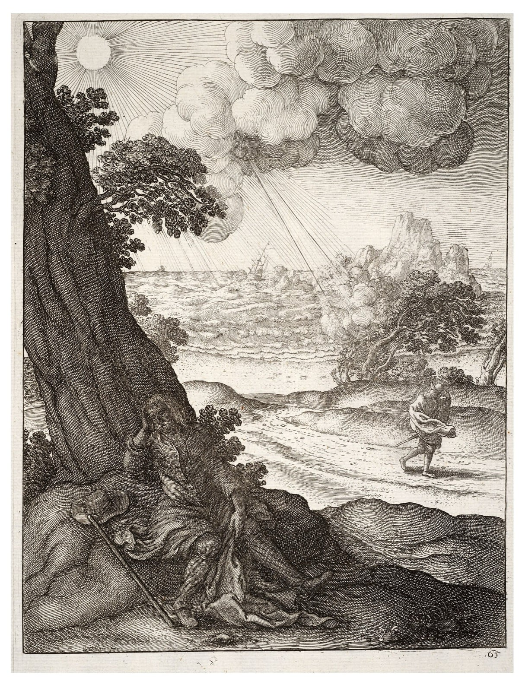

One day the North Wind and the Sun got into an argument about which of them was stronger. Below them, a traveller walked along a road, wearing a warm coat.

<em>That is all the proof we need,</em> said the Wind. <em>Whoever can make that man take off his coat is the stronger. Watch this.</em>

The Wind took a deep breath and blew. It pulled at the coat and flapped the man's hat, and the traveller — did the opposite of what the Wind wanted. He wrapped the coat tighter, buttoned it to the top, and bent into the wind, holding the whole thing shut with both hands.

The harder the Wind blew, the tighter the coat got. At last the Wind gave up, out of breath itself.

Then the Sun came out from behind a cloud. It did not blow. It did not pull. It just shone, gently, and the road grew warm. The traveller loosened his grip on the coat. The Sun shone a little warmer, and the man undid his buttons. A few steps further on, with his forehead damp, he took the coat off altogether and carried it over his arm.

The question

When you want someone to change what they're doing, what actually changes their mind?

After the story

Aesop told this one about 2,500 years ago and it has barely changed since, which is unusual for a story that old. It survives because it is small and complete: two forces, one man, and a result that can be argued about in either direction.

There is a fourth character nobody talks about, and it is the traveller's own reasons. He took his coat off because he was warm, not because he was persuaded. Neither the Wind nor the Sun asked him anything. So the story is not really about gentleness beating force. It is about two powers who never once considered that the man might have a view.

The moral people usually draw is: gentleness gets further than force. That is worth arguing with.

Force is sometimes exactly right — if a toddler is running into the road, you do not shine warmly and wait for them to decide. And notice something the moral skips: the traveller never agreed to any contest. The Wind and the Sun were arguing about how to move him, and nobody asked him. He was doing what he wanted all along.

So which is it — does warmth win because it is kinder, or because it tricks people more smoothly? And can someone else ever really change your mind, or do they just make it easier for you to change it yourself?

A Greek fable about two ways of getting what you want: force and warmth. It is one of the few old stories with no villain in it.

## The Bundle of Sticks

Story 3 · Aesop, “The Bundle of Sticks” · ages 6–9

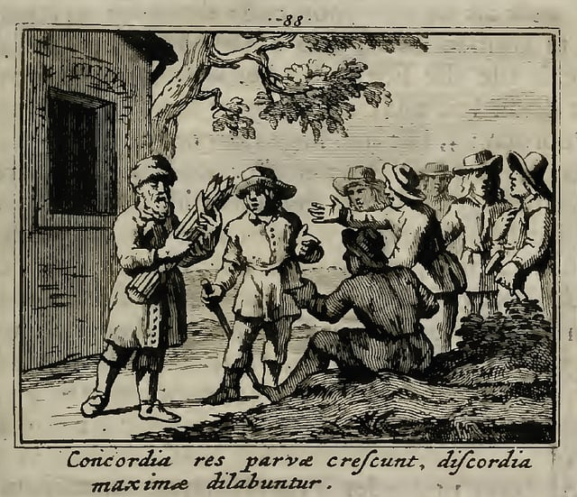

A merchant had four sons who argued the way weather happens: constantly, and over everything. They argued about whose turn it was, whose fault it was, and whose idea had been best. The merchant worried that one day they would argue themselves apart.

One day he called them to the table and set down a bundle of sticks, tied with string.

<em>Break it,</em> he said to the eldest.

The son pulled. The bundle bent and did not break. He tried with both hands, then against his knee. Nothing. One by one the other sons tried, and one by one they failed. Four strong boys, and no match for a bundle of sticks.

The merchant untied the string and handed each of them a single stick. <em>Now.</em> Each stick snapped with a small, satisfying crack.

<em>You are the sticks,</em> he said. <em>Together, none of you can be broken. Apart, I could snap every one of you with my thumb.</em>

The question

What can your family, or your class, do together that nobody in it could do alone?

After the story

Aesop's fables include a version, and Plutarch tells a different one: a dying Scythian king called Scilurus hands his many sons a bundle of javelins and makes them try to break it. The story has been used by governments ever since, which should make you look at it twice. A story that powerful men like to tell children is doing a job.

And the bundle has a problem nobody mentions: it works by squeezing. Every stick is held in place by pressure from all the others, and the sticks in the middle do most of the holding. Nobody in the story asks whether the sticks wanted to be in a bundle, or what happens to the one that is weak, or whether being hard to break is the same as being well.

That is the story as it is always told, and the moral comes ready-made: stick together. But it is worth poking at.

A bundle holds because string squeezes every stick toward the others. What is the string in a family, or a class, or a country? And what happens to the stick that does all the holding while another one leans on it? A bundle is strong, all right — nobody says a bundle is fair.

So the story leaves two questions instead of one. What holds your people together? And when the bundle pulls tight, does every stick get a say?

A Greek fable about a merchant and his squabbling sons. Versions of the same story appear in India and in China, which suggests every place needed it.

## The Elephant and the Six Blind Men

Story 4 · An old Indian parable, written down in a Buddhist collection called the Udana · ages 6–9

Some people in a village had never seen an elephant. One was brought to the edge of the town, and six men who could not see were taken to it, and each of them put out a hand.

The first one found the trunk, which was long and bendy and moved. "An elephant," he said, "is like a snake."

The second one found an ear, which was wide and flat and thin. "No," she said. "An elephant is like a fan."

The third one found a leg, which was thick and round and did not move at all. "You are both wrong. An elephant is like a pillar."

The fourth found the side of it, big and warm and solid. "It is like a wall."

The fifth found the tail, with a tuft on the end. "It is like a rope."

The sixth found a tusk, smooth and pointed and hard. "It is like a spear."

And then they argued, because each one of them was certain, and each one of them was describing something that was really there.

The question

Can everybody be partly right and still be wrong?

After the story

The story travelled a long way to reach you. Versions exist in India, Persia, China and Japan; in some the men are blind, in others simply in the dark; in the oldest Buddhist telling a king is mocking quarrelling teachers. Rumi, the Persian poet, turned it into a poem about how our senses only ever touch a piece of things.

But there is a twist the moral usually hides. If you say that everyone is partly right and nobody can see the whole, you have just claimed to see the whole. The only way to know that all six are describing one elephant is to stand where the elephant is visible, which is exactly the position the story says nobody is in.

The point of the story, in the old telling, is usually about people who are sure they are right and quarrel with everyone else. But there is a second layer, and it is worth noticing. Every one of the six was describing something true. That is exactly why it is hard: not one of them was making it up. They were all reporting honestly, from the small part of the animal they could reach — and none of them could tell, from where they were standing, that they were only touching a piece.

Told for well over two thousand years, in India and far beyond it. There are Jain versions, Sufi versions and Persian versions, all making the same point in slightly different ways.

## The Emperor's New Clothes

Story 5 · Hans Christian Andersen, 1837 · ages 6–10

An emperor loved new clothes more than anything else. He spent all his money on them and changed outfits every hour.

Two strangers arrived, claiming to be weavers. They said they could make the most beautiful cloth in the world — and then they explained the wonderful thing about it. The cloth, they said, was invisible to anyone who was stupid, or unfit for their job.

The emperor hired them on the spot. They set up two looms, asked for silk and gold thread, and put all of it in their own bags. Then they pretended to weave, late into the night, on empty looms.

The emperor sent his oldest, most trusted minister to look. The minister stared at the empty looms and saw nothing at all — and thought, if I say I see nothing, they will know I am stupid, and I will lose my job. So he came back and described the cloth in detail: the colours, the pattern, the beauty.

Then he sent another official, and the same thing happened. Then the emperor went himself, with his whole court. Everyone looked. Everyone saw nothing. Everyone said how magnificent it was.

So they dressed him. The weavers pretended to put on each garment, one after another, and the emperor turned this way and that in front of the mirror, and everyone agreed it suited him perfectly.

And he walked out into the street, and the whole town cheered, because not one person wanted to be the one who could not see it.

Until a small child, who had no job to lose and no idea he was supposed to be careful, said the obvious thing out loud.

He isn't wearing anything.

The question

Why is it so hard to say the true thing when everyone else is silent?

After the story

Hans Christian Andersen published this in 1837, and he did not invent it either. A Spanish prince, Don Juan Manuel, told a version five hundred years earlier, with a cloth that is invisible to men who are not the sons of their fathers, and a servant who has to pretend. The trap has been rebuilt in every century since. In this one it is invisible to anyone unfit for their job, which is a much better trap.

Notice that the emperor never has to say anything false. He looks, sees nothing, and says the cloth is beautiful, because the alternative is admitting he cannot see what everyone else claims to see. The lie does not begin with the weavers. It begins with the first person who decides that not seeing is a thing to be ashamed of.

Andersen wrote it as a fairy tale for adults as much as children. The two swindlers' trick only works because everybody is worried about what everyone else will think of them.

## The Fox and the Grapes

Story 6 · Aesop, “The Fox and the Grapes” · ages 6–9

A fox was walking through the forest when he saw them: a bunch of grapes, fat and purple, hanging from a vine that had climbed up a tall branch.

His mouth watered. He backed up a few steps, ran, and jumped. He missed by a whisker.

He tried again, running faster, jumping higher. The grapes swung on their stem and stayed where they were. Again. Again. He was panting now, and the grapes were exactly as far away as when he started.

Finally the fox gave up. He turned up his nose, walked away, and said, just loudly enough for the forest to hear: <em>They were probably sour anyway. I never wanted them.</em>

The question

When we can't have what we want, is it better to change what we want — or to pretend we never wanted it?

After the story

That is the whole story. Here is what makes it strange: the grapes did not change. Not one of them got sourer while the fox was jumping. The only thing that changed between his first jump and his last words was the fox's <em>story</em> about the grapes.

So did the fox actually change his mind? Or did he only say he did — and which of those is worse?

Aesop's version is about two and a half thousand years old and takes four lines. Everything else, the running start, the panting, the remark aimed at the whole forest, is later telling. English took the phrase “sour grapes” from it, which is a sign the story worked: it gave us a name for something before most of us had noticed we did it.

There is a reason it is hard to catch yourself doing it. Wanting something you cannot have is uncomfortable, and the discomfort does not go away by being ignored. Changing the story is faster than changing the situation. The trouble is that the same move works in both directions: you can talk yourself out of wanting something silly, and you can talk yourself out of wanting something you should have fought for. From the inside, they feel identical.

Everyone does some version of this. The game you couldn't join was boring anyway. The party you weren't invited to would have been full of annoying people. Sometimes that is wisdom — letting go of something you can't have is a real skill. Sometimes it is just the fox.

The hard question is how you tell the difference from inside. When <em>you</em> stop wanting something, how do you know whether you truly moved on — or whether the grapes are still hanging there, as sweet as ever?

Another Greek fable — so short it fits in six lines, and still doing its job 2,500 years later. The phrase “sour grapes” comes straight from this story.

## The Man Who Dreamed He Was a Butterfly

Story 7 · Zhuangzi, chapter 2 · ages 6–9

Once, Zhuangzi dreamed he was a butterfly.

It was a very good dream. He was fluttering about, delighted with himself, going wherever he liked and not wondering about anything. He had no idea he was Zhuangzi. He was simply a butterfly, and that was all there was to it.

Then he woke up, and there he was: Zhuangzi. Solid. Lying in a bed, with a body, and a name, and things he had to do that day.

And he could not work out which one was true.

Was he a man who had fallen asleep and dreamed he was a butterfly?

Or was he a butterfly, right then, dreaming that he was a man?

The question

If you cannot tell, does it matter?

After the story

Zhuangzi lived about 2,300 years ago, in a time of constant war, and wrote in small strange stories instead of arguments. He is not trying to make you doubt everything. He is pointing at something narrower and worse: the feeling of being sure is identical in a dream and in a morning, and the feeling is all you ever have to go on.

You can test the shape of it. You have woken up relieved that something was not real, and you have dreamed something you were certain was happening. In both cases your evidence was exactly the same: it seemed to be happening. So what would count as proof that you are awake right now? Careful. Pinching yourself is something you can also dream.

He wrote it down and left it there, without an answer, and people have been picking at it for two thousand years. Descartes asked almost the same question in France, and found it frightening. Zhuangzi found it funny. Both of them noticed the same thing: while you are inside a dream, it is completely convincing, and you cannot step outside to check.

Which leaves a small question that is much harder than it looks. If a dream and a day feel the same from the inside, what exactly makes one of them real?

Written in China about 2,300 years ago. This is only three sentences long in the original — it is the whole of it, and it is enough.

## The Race Nobody Agreed On

Story 8 · Aesop, The Tortoise and the Hare · ages 6–9

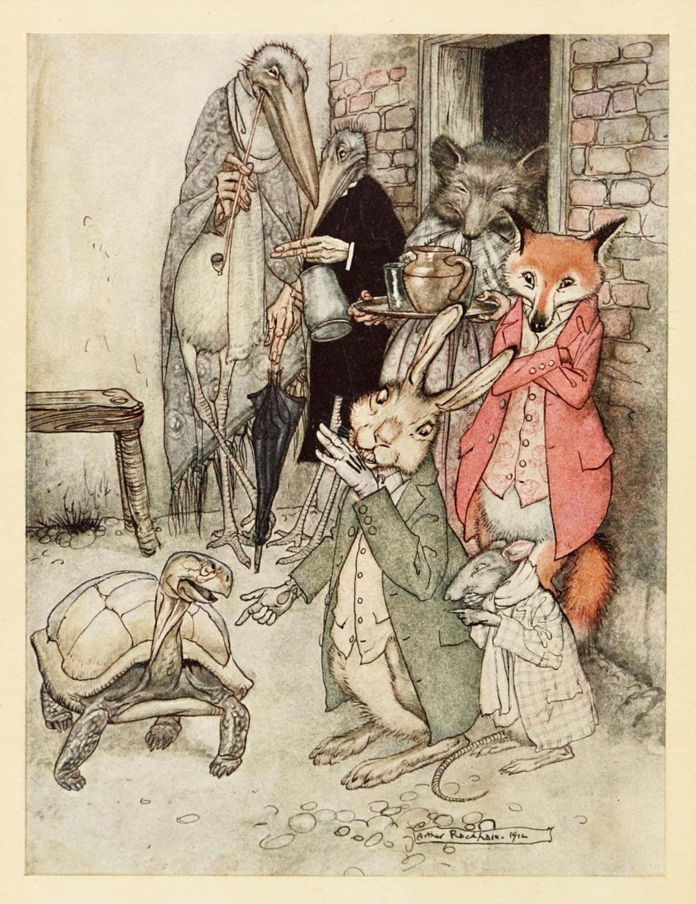

A hare laughed at a tortoise for being slow. He did it in front of the other animals, because that is more fun.

The tortoise did not cry or hide. She said: <em>Alright. Race me.</em>

The hare thought this was the funniest thing he had ever heard. He agreed immediately, so that everyone could see how silly it was. The fox set a course and a finish line, and the other animals came to watch.

The race started, and the hare was gone. He was out of sight in the time it took the tortoise to leave her own shadow. Halfway along he thought: I have time for a nap. This is not arrogance, exactly, or not only arrogance. It is what happens when you have never had to try.

He lay in the long grass, in the sun, and slept.

The tortoise walked. She was not fast, and she was not clever, and she did not have a plan beyond the ordinary one: foot, foot, foot, the road, the heat, the dust.

The hare woke before the end. He saw the tortoise nearly at the line, ran, ran faster than he had ever run, and lost by a length.

The question

What counts as winning, and who decided where the finish line is?

After the story

Everyone knows the moral, and it is usually written down as "slow and steady wins the race", which is a comfortable thing to say to a slow child. But look at what actually happened. The hare did not lose because he was fast. He lost because he stopped. The tortoise did not win because she was slow. She won because she kept going, and because she was allowed to choose a race where keeping going was enough.

Now the awkward question that the fable skips. Who set that finish line? The fox. What would have happened on a race twice as long, or uphill, or with a fence? Did the hare actually want to win, or did he just want everyone to watch him run?

And the harder one: if you are faster than everyone in the room, is it fair to be told that the slowest wins?

One of Aesop's fables, told in Greece about 2,500 years ago and still told in every school. The version most people know is much newer than the story.

## The Boy With the Empty Pot

Story 9 · A Chinese folktale, retold for centuries · ages 7–10

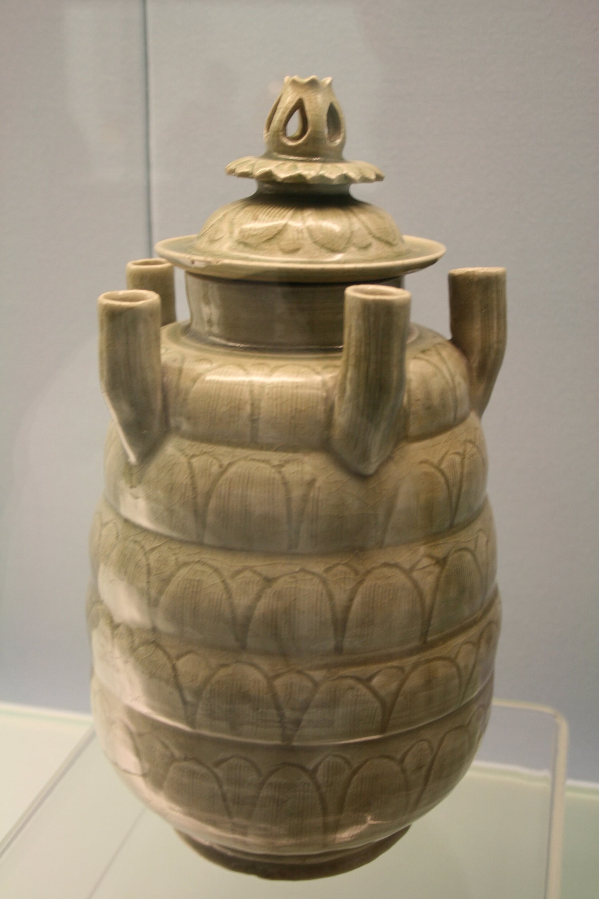

An emperor grew old and had no son he trusted, so he thought of a test.

He ordered every child in the kingdom to come to the palace. Each one was given a seed, and each was told the same thing: <em>Take this home. Plant it. Look after it. In one year, bring me what you have grown, and the child with the finest plant will be the next ruler.</em>

A boy called Ping went home with his seed and planted it in the best pot, with the best soil, and watered it every morning before school. He talked to it. He checked it before bed.

Nothing came up.

He moved it into the sun. He moved it out of the sun. He asked his father, who was a gardener, who said the soil was fine, and the pot was fine, and the watering was fine. Nothing came up.

A year passed. On the morning of the test, Ping walked to the palace with an empty pot, and he was the only child who was not carrying something green and enormous. Some of the plants were like small trees. Some had flowers nobody had ever seen. Ping stood in the courtyard holding his pot and wished the ground would open.

The emperor walked slowly along the row, looking at each plant, and saying nothing. When he reached Ping he stopped.

<em>Why is your pot empty?</em> he asked.

Ping's voice was very small. <em>I did everything you said. It never grew. I'm sorry.</em>

The emperor smiled, and then he laughed, and then he made the announcement.

<em>Every seed you were given,</em> he said, <em>was boiled. None of them could grow. These children have brought me plants I have never seen, grown from seeds that could not sprout. Only this boy told me the truth.</em>

The question

Would you hand in an empty pot?

After the story

It is a satisfying ending, and that is the problem. It is only satisfying because Ping's honesty gets rewarded within the hour, in public, by an emperor. Most honesty does not work like that. Most honesty costs you something and nobody claps.

So the real question is not whether Ping was right. It is: would you have done it? And would you have done it if the emperor had looked at your empty pot, said nothing at all, and moved on to the next child?

Nobody knows who told this first. It has been told in China for a very long time, and retold in many children's books in the last hundred years. This is our version of the old story.

## The Ship That Was Replaced

Story 10 · Plutarch, Life of Theseus · ages 7–10

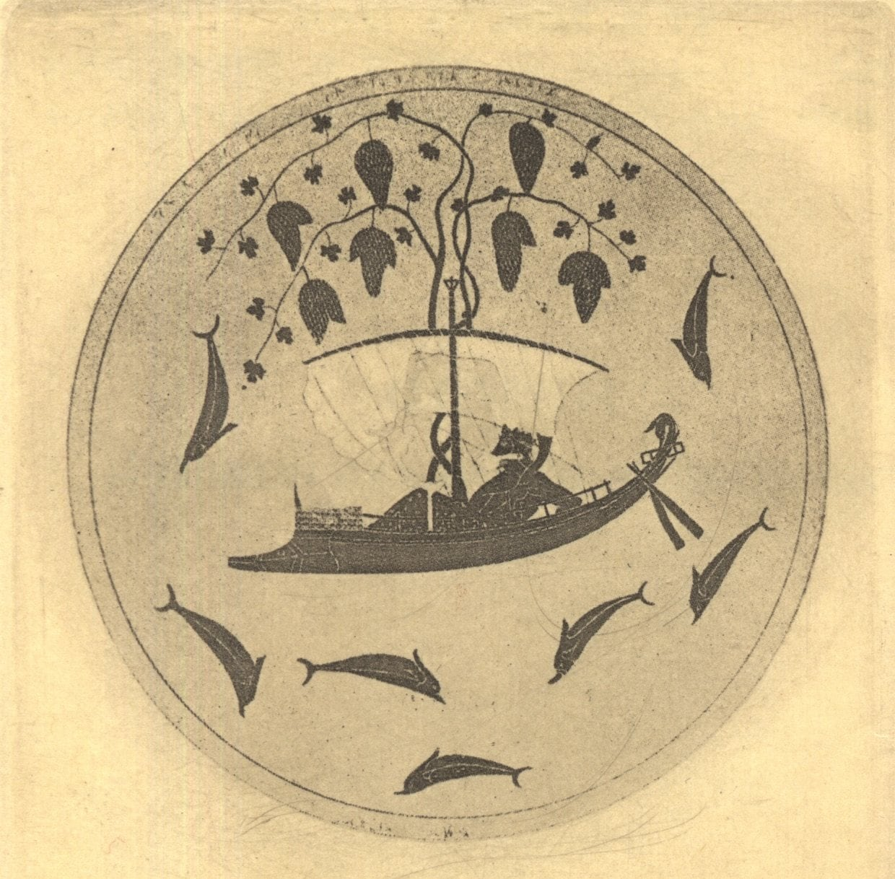

A young man sailed away to a far country and had a famous adventure. He came home. He became king.

To say thank you, the city kept his ship. They put it in a place where everyone could see it, and they took care of it, because it was the ship that had carried him and his friends safely home.

Ships are made of wood, and wood rots, and nothing can be done about that. So when a plank grew soft, they took it out and put in a new one. Every few years, another plank. Ropes were replaced. Oars were replaced. Slowly, over a long stretch of time, every single piece of the original ship was gone, and the ship that stood in the harbour was made of wood that had never been anywhere near that adventure.

They still called it the same ship. Of course they did.

But here is the question, and it has never been settled. Is it the same ship?

Some people say yes. It is the same ship because it is the same ship — the name, the place, the story, the people looking after it. What it is made of is not what it is.

Some people say no. It is a completely different ship wearing an old ship's name. If you had kept every old plank in a shed, then at the end you would have all the original wood, and you could build the real ship from it. And you cannot have two ships both being the one.

The question

What is it that makes something the same thing over time?

After the story

The story is about 1,900 years old, and it was already old when Plutarch wrote it down: the Athenians really did keep a ship they said was Theseus'. Plutarch noticed that philosophers had been arguing about it for centuries before him, and he mentions, almost in passing, that some people kept the old planks and reassembled them, which gave them two ships claiming to be one.

In 1655 Thomas Hobbes made it worse on purpose. Suppose somebody gathers all the removed planks and builds a second ship from them. Now which one is the ship of Theseus? The harbour one, repaired piece by piece, or the shed one, made of every original timber? Each answer sounds right, and they cannot both be. Hobbes was not confused. He was showing that "the same thing" is not one idea but several, and we use whichever suits us until someone puts them side by side.

And here is the part that is meant to catch you. You are made of things that are swapped out too. Cells, hair, skin, teeth, ideas, opinions. Most of what is you today was not you when you were four.

So: are you the same you?

Plutarch wrote this down about 1,900 years ago while describing an old ship the Athenians kept. Philosophers have been arguing about it ever since, and Thomas Hobbes made it harder in 1655.

## The Arrow You Won't Pull Out

Story 11 · The Buddha, Cūḷamālunkyovya Sutta · ages 8–12

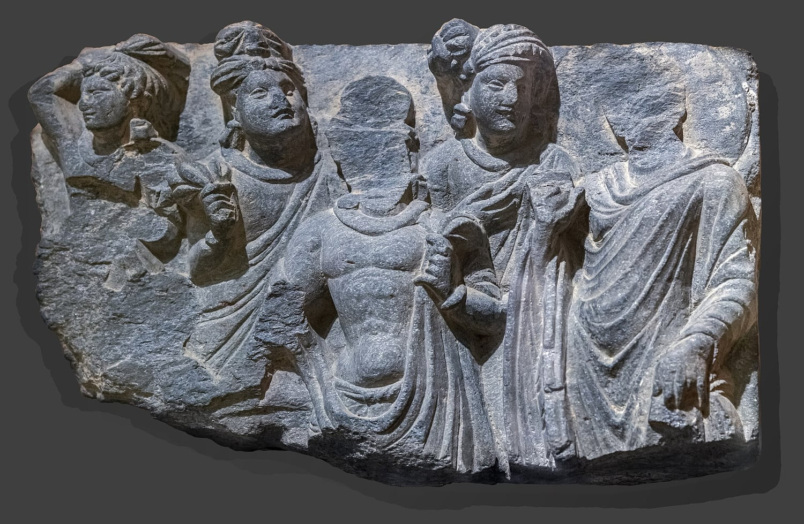

A man was shot by an arrow, and the arrow was poisoned, and it was in him.

A doctor arrived with tools. The man said: wait.

<em>First,</em> he said, <em>who shot me? Was he tall or short? Was he a soldier or a stranger? What kind of bow did he use, and what was the string made of, and was it a wooden arrow or a reed?</em>

The doctor said the arrow needed to come out.

<em>I haven't finished,</em> the man said. <em>What was the arrowhead made of? What feathers were on it? What kind of poison?</em>

And while he was asking, the poison did what poison does.

The question

Which questions must be answered now, and which ones can wait?

After the story

That is roughly how the Buddha told it, to a monk called Malunkyaputta. The monk had a list of questions he wanted answered before he would commit to the training. Is the world eternal? Is it not? Is the soul the same as the body? Does a person exist after death? And so on.

The Buddha did not say the questions were stupid. That is the part people skip. He said they were the kind of question that can eat a whole life, and that a man with an arrow in him has a more urgent job.

But here is the awkward bit, and it is worth sitting with. Sometimes the man with the arrow really does need to know who shot him. If the shooter is still out there, a second arrow is coming. A doctor who says <em>never mind that, hold still</em> is not always being wise. He might be hurrying.

So which questions are arrows, and which are the poison? And how would you tell the difference while the clock is running?

A teaching remembered by Buddhist monks for centuries before it was written down. The Buddha is answering a monk who wants the biggest questions settled before he starts.

## The Cave

Story 12 · Plato, The Republic, Book VII · ages 8–12

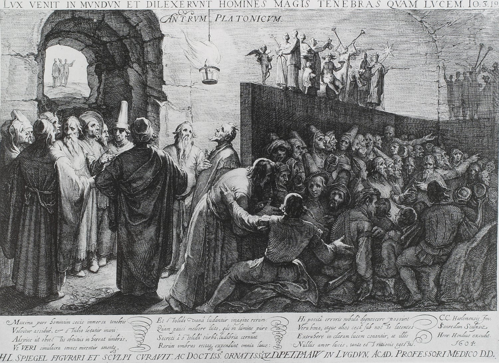

Imagine a cave underground, with a long tunnel leading up to the daylight.

Deep inside, some people have been prisoners since they were babies. Their legs and necks are held so they can only look at one wall. Behind them is a fire, and between the fire and the prisoners is a walkway where other people carry things past — a bowl, a jug, a little wooden horse. The prisoners cannot turn round. All they ever see, on the wall in front of them, are the shadows those things cast.

They give the shadows names. They argue about which shadows are which, and they are good at it — better than you would be. They know the order the shapes come in, and who is cleverest at guessing what comes next. They think the shadows are the whole world, because why wouldn't they.

One day a prisoner is set free. At first he is baffled. The people and the things he used to see as shadows are right there, in front of him, and they are solid. He is told he is seeing what is real, and he does not believe it. He wants to go back to the wall, where things made sense.

Then he is dragged up the tunnel, and the sunlight hurts. He cannot see anything for a while. Slowly, though, he gets used to it. He sees the sky, then the sun, and he works out that the sun is what makes everything else visible. And he thinks of the prisoners still down there, and how they would call him mad if he told them what he had found.

He goes back. And their eyes are used to the dark, and his are ruined by the light, and he cannot do the shadow-guessing any more. He stumbles.

So what do they say about him? Plato is blunt about it: they would say the trip outside ruined him, and if anyone tried to set them free and take them up that tunnel, they would kill him.

The question

Are you sure that everything you can see is everything there is?

After the story

Plato wrote this in the Republic, in a book about how a city should be run, and he was not being gentle about it. The prisoners are not stupid. They are educated in the only thing available to them, and their skill at reading shadows is real skill: they can name a shape faster than you could. What they lack is not intelligence. It is the chance to turn round.

There is a version you can test today. A screen shows you a world somebody chose for you, in an order designed to keep you watching, and you never see what was left out. The people arranging it are not villains either; they are paid to know what you will look at next. So the question is not whether you are in a cave. It is who decides which wall you face.

Written about 2,400 years ago. Plato says it is a picture of what learning is like — and of what people do to the person who learns something they did not want to hear.

## The Sword Above the Throne

Story 13 · Cicero, Tusculan Disputations, Book 5 · ages 8–12

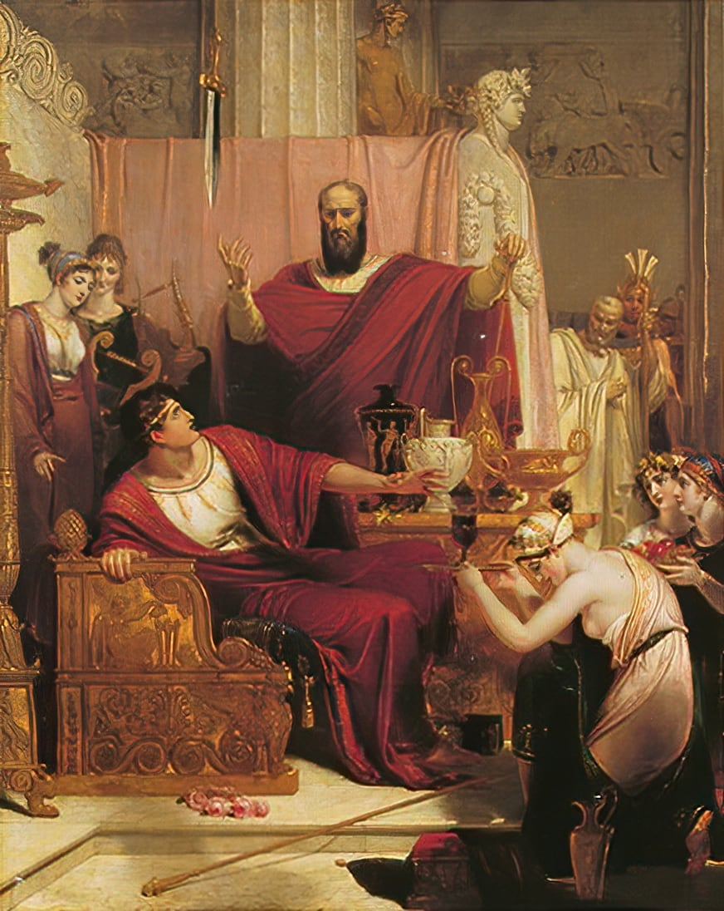

There was a king called Dionysius, who ruled a city and was, by every account, not a gentle man. He had money, soldiers, a palace, and enemies who had a habit of dying.

One of his courtiers was called Damocles. Damocles spent a lot of time saying how wonderful the king's life must be. The gold, the power, the way people bowed. He said it often enough that the king decided to answer him.

<em>You think my life is sweet,</em> said Dionysius. <em>Then take it. Sit here for one day and see.</em>

They put Damocles on the throne. Servants brought him food on silver. Perfume was burned. People came and asked him for favours and laughed at his jokes. He was, for an afternoon, the happiest man in the city.

Then he looked up.

Above his head, hanging by a single hair from a horse's tail, was a sword. The point was a hand's width from his neck. It had been there the whole time. Nobody had mentioned it. Nobody had needed to.

Damocles stopped eating. He stopped laughing. He stopped hearing what people said to him. He asked, very politely, whether he might be excused, and he went home and never asked about the king's life again.

The question

Would you take the throne if you knew exactly what came with it?

After the story

The story is usually told as a warning about power: that a ruler lives under a threat he cannot put down. But look at where the sword is actually pointing. It does not hang over the throne. It hangs over whoever is sitting in it.

So here is the question the story leaves. Was Damocles wrong to want the throne, or wrong about what the throne was? And if you could have the good part — the silver, the bowing, the afternoon — while knowing about the sword, would you still sit down?

Cicero wrote this in Rome about two thousand years ago, while arguing about whether a king can be truly happy. It is one of the oldest stories about the price of power.

## When Is a Heap Not a Heap?

Story 14 · Eubulides of Miletus, the sorites paradox · ages 8–12

Here is a heap of rice. Ten thousand grains, at least. Nobody would argue with that.

Now take one grain away. Is what is left a heap? Of course. One grain cannot be the difference between a heap and not-a-heap — that would be absurd.

Take another. Still a heap — by the same argument. Another. Another. Each time, removing one grain changes nothing, and each time what is left is a heap.

But follow the argument to the end and you are standing in front of a single grain of rice on a table, which you have just agreed is a heap.

Somewhere in there, the heap went away. So: <em>which grain was the guilty one?</em>

The question

If every single step looks harmless, how does a big change ever happen?

After the story

This puzzle is more than two thousand years old, and the uncomfortable part is that no step in it looks wrong. It feels like there should be a line — 4,731 grains is a heap, 4,730 is not — but nobody could ever say where it is, and any line you draw looks made up.

Once you see the shape of the puzzle, it turns up everywhere. How many hairs does a person need before they are not bald? How many minutes late is it fair to say the bus is “late”? How many euros make someone rich? How many drops of water make a puddle? Our words feel solid — <em>heap, bald, rich, late</em> — and each of them has one grain of vagueness hiding inside it.

The puzzle comes from Eubulides, a Greek philosopher who lived about 2,400 years ago and was famous for arguments that ended in traps. He had a whole family of them. This one is about a heap; another is about a man who says he is lying. They are not jokes, though they are funny. They are tests of whether our words can carry the weight we put on them.

Philosophers have three main moves. One: there really is a line, and we simply do not know where it is. Two: vague words have no line, so many statements about heaps are neither true nor false. Three: truth comes in degrees, so “is a heap” can be nearly true. Each move fixes something and breaks something else. None of them tells you which grain it was.

Some philosophers say the lesson is that words are blunter than the world. Others say there really is a line, we just can't see it. One of them is wrong. Finding out which grain it is has kept philosophers busy since the time of the ancient Greeks — and they have not finished yet.

A puzzle from ancient Greece, about 2,300 years old. Sorites just means “of a heap”. Philosophers are still arguing about the answer, which is a good sign the puzzle is real.

## A Handful of Mustard Seed

Story 15 · Buddhist tradition, the story of Kisa Gotami · ages 9–12

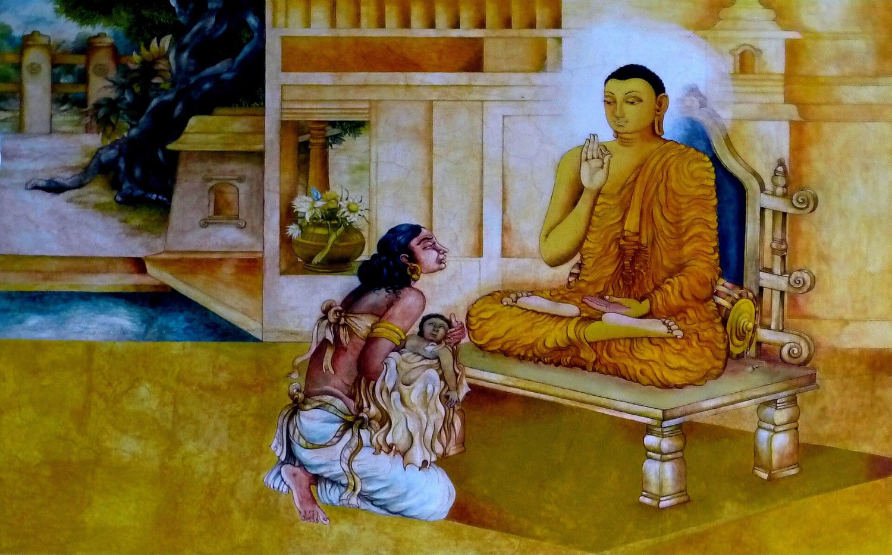

A woman called Kisa Gotami had one child, a boy, and he was the whole of her days. When he was small he fell ill, and then he died, and she would not accept it.

She carried him from house to house in the village, asking for medicine. People looked away. Some of them told her the truth and she did not hear it. Eventually someone said: there is a teacher on the edge of town. Ask him.

She went to the Buddha and held out her son and asked him to make the boy well.

He did not argue with her. He said: <em>I can help. Bring me a handful of mustard seed. But it must come from a house where no one has ever died.</em>

She set off. Mustard seed was cheap and every kitchen had some. This would be quick.

At the first house the woman said yes, of course, take some. And then Kisa asked her question, and the woman stopped, and said: <em>we lost my mother in the spring.</em>

At the next house it was a brother. At the next, a baby, years ago. At the next, a grandfather, a husband, a child who would have been fourteen this year.

She went through the whole village. There was no house. Not one.

And she understood, in the way you understand a thing with your body rather than your thoughts, that she was not being punished, and not singled out, and not the only one. She buried her son. She came back to the teacher and told him what she had found.

The question

Does knowing that everyone grieves make grief easier, or heavier?

After the story

The story gets told as a lesson about accepting death, which is true and also a little convenient, because it is easy to say to someone else. What Kisa actually found was harder and stranger: that going door to door with her question made a room full of strangers into people who had the same wound.

So which helped her more: the teaching, or the doorways? And if it was the doorways, why does it take a dead child to make us knock?

A story remembered by Buddhist communities for centuries before anyone wrote it down, and told in many versions since. It is not a story about being brave.

## Achilles and the Tortoise

Story 16 · Zeno of Elea, as retold by Aristotle · ages 9–12

Achilles was the fastest runner alive. A tortoise is among the slowest things alive. So Zeno set them racing, and gave the tortoise a small head start — say, ten metres.

Here is Zeno's argument that Achilles can never catch it.

To catch up, Achilles must first reach the point where the tortoise started. Running at his speed, that takes him some time — and in that time, the tortoise has crawled a little further ahead, say one metre.

So now Achilles must reach <em>that</em> point. It takes less time than before, but it takes <em>some</em> time — and in that time the tortoise moves a little further. Ten centimetres, perhaps.

To that point, then, and in the meantime the tortoise moves again. The gap shrinks: half, then half, then half. It never quite disappears, because there is always another half to cross first. And you cannot be somewhere you have not yet reached. So the tortoise stays ahead — forever.

You know this argument is wrong, because runners pass tortoises every day. But watch how hard it is to say <em>where</em> it goes wrong. Every single step of the argument looked perfect.

The question

If there is always another half of a gap to cross first, how does anything ever arrive?

After the story

Zeno was not a fool playing with words. He was defending a serious idea: that if a distance can always be halved, crossing it would take infinitely many steps, and perhaps nothing ever arrives anywhere. For most of two thousand years the best reply was that he was obviously wrong, which is not a reply.

The mathematical part of the mystery took until about two thousand years after Zeno to settle: infinitely many steps can still add up to a finite distance. Half a gap, plus a quarter, plus an eighth, plus… gets closer and closer to the whole gap without ever passing it, and Achilles reaches it in a finite time. The steps run out of room.

But a puzzle is left, and it is not a maths puzzle. Zeno's real question was about what motion <em>is</em>: how can anything be “at” a place, mid-movement, if between any two places there are always more places? Everyone who has ever run knows the answer with their legs. Saying it with words is harder than it looks — which was exactly Zeno's point.

A race paradox from Greece, about 2,450 years old. Zeno meant it as an argument that motion is impossible. Motion is obviously possible. Finding the exact flaw in his argument took mathematicians over two thousand years.

## How Do You Know the Fish Is Happy?

Story 17 · Zhuangzi, Autumn Floods · ages 9–12

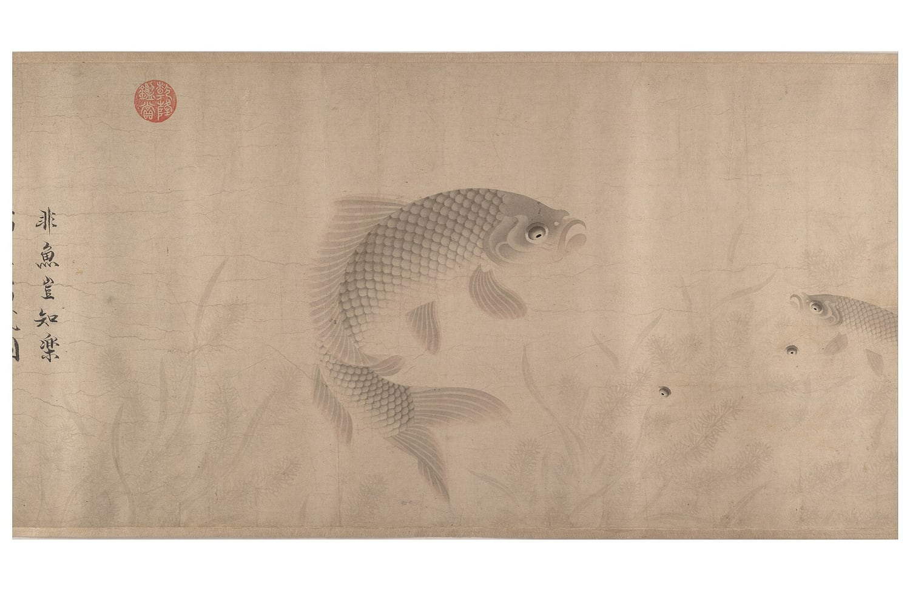

Zhuangzi and his friend Huizi were walking along a river on a bridge. It was a good day. The water was clear.

<em>Look at the minnows,</em> said Zhuangzi. <em>They come out, they swim about, they go where they like. This is what it is to be a fish. They are happy.</em>

Huizi, who liked winning arguments more than he liked fish, said: <em>You are not a fish. How do you know what makes a fish happy?</em>

<em>You are not me,</em> said Zhuangzi. <em>How do you know that I don't know?</em>

<em>I am not you, so I do not know you,</em> Huizi said, pleased with himself. <em>And you are certainly not a fish, so you do not know fish. That settles it.</em>

Zhuangzi did not give up. <em>Let us go back to where we started,</em> he said. <em>You asked me how I know the fish are happy. That means you already accepted that I know it, and only wanted to hear how. Well: I know it from here. Standing on this bridge, looking at the water.</em>

The question

Can you ever really know what another creature is feeling?

After the story

That is where the story stops, which is a little rude of it.

Because Zhuangzi has not explained anything. He has only pointed at the river. And Huizi has not been answered either: he asked a fair question and got a joke.

You can try it yourself. A dog wags its tail. You say the dog is pleased. How do you know? Its mouth is open, its eyes are soft, its body is loose. But you have never been a dog. You have only ever seen dogs, and been you.

So what is happening when you look at a fish and feel sure? Are you reading the fish, or are you reading yourself and hoping it fits?

A story from a Chinese book named after its author, about 2,300 years old. Zhuangzi argued with his friend Huizi the way some people play chess.

## Stand Out of My Sunlight

Story 18 · Plutarch, Life of Alexander · ages 9–12

Diogenes lived in a barrel in the city of Corinth. Not an empty house, not a small room: a barrel. He owned a cloak, a stick, a bowl, and the habit of saying exactly what he thought.

He was not poor in the way you might imagine. He had chosen it. He had decided that most of what people worked for was noise, and that the way to be free was to want almost nothing. People found this annoying. People still find this annoying.

Alexander was the opposite in every way. He was young, he had taken an empire, and he had just been told by everyone around him that he was a god besides which mere men were small.

Alexander heard about Diogenes and wanted to meet him. So he came with his generals, and his guards, and the enormous machine of his progress, and he found the philosopher lying in the sun.

Alexander stood over him. <em>I am Alexander the Great,</em> he said. <em>Ask me for whatever you want, and it is yours.</em>

Diogenes, without sitting up: <em>Then stand a little out of my sun.</em>

The question

What do you actually need, and who decides what that is?

After the story

What is worth noticing is how badly Alexander takes it. He does not laugh. He does not have him arrested. He says, according to Plutarch, something like: <em>If I were not Alexander, I would wish to be Diogenes.</em> Which is not a compliment to Diogenes so much as an admission. The man who could have anything had just noticed that he could not have that.

But do not let the philosopher off too easily. Diogenes' freedom depended on a city that tolerated him, in a warm climate, where a man in a barrel did not freeze in the first winter. His need was small because other people were doing the needing for him.

So: was that freedom, or was it a trick of having nothing to lose? And if you stripped away everything you could not keep anyway, how much of you would still be there?

Plutarch wrote this about two thousand years ago, describing a meeting that happened in Corinth about 2,300 years ago. Alexander was the most powerful man alive. Diogenes owned a barrel.

## The Ring That Made Him Invisible

Story 19 · Plato, The Republic, Book II · ages 9–12

There was a shepherd called Gyges, long ago, in the service of the king.

One day a storm came, and an earthquake with it, and the ground split open where his flock was grazing. He looked down and saw a hole. He climbed in.

Inside, in the dark, there was a bronze horse with doors in its side. Gyges opened them and found a body lying there — larger than a man's, with a gold ring on its hand. He took the ring and climbed back out.

That evening, sitting with the other shepherds, he turned the ring around on his finger. And they began to talk about him as if he were not there.

He had found the trick. Turned one way, he was invisible. Turned the other, he was back. Nobody could see him, or hear him, or stop him.

Now: you are a shepherd, you are nobody, and there is a king's palace a day's walk away. What do you do?

This is what Gyges did. He got himself appointed as a messenger to the court. He used the ring to get close to the queen, and together they killed the king, and Gyges took the throne and the kingdom.

The question

Are you good, or are you just being watched?

After the story

Glaucon, who tells the story, is not really interested in Gyges. He is making a point to Socrates. Give anyone on earth that ring, he says, and you will find out what they are really like. And he asks Socrates to prove that justice — being fair even when it costs you — is worth having for its own sake, and not just because of getting caught.

The story is about 2,400 years old, and Plato did not invent it. Herodotus tells a near-identical tale about a different king and a different shepherd, with no magic at all, which suggests the Greeks had been passing it around long before anyone wrote it down. Plato's addition is the ring.

Glaucon's challenge is sharper than it looks. He is not saying people are wicked. He is saying that if being decent were never rewarded, and being cruel never punished, fairness would have nothing to recommend it except itself. Socrates has to show that justice is good for you from the inside, even when everyone believes you are a monster. Whether he manages it is still argued about, which is unusual for a question that old.

Plato spends the rest of the book trying. He is still working on it. So are we.

Glaucon tells this story to Socrates as a challenge — not as an example. He is arguing that people are only good because they are watched.

## The Tree Nobody Could Use

Story 20 · Zhuangzi, In the World of Men · ages 9–12

A carpenter was walking to a job with his apprentice, and they came to a tree so big that a thousand cows could stand in its shade. It stood beside a shrine, and people came from villages around to look at it.

The carpenter walked past without turning his head.

His apprentice stopped. <em>Master,</em> he said, <em>I have never seen timber like this in my life. Why won't you even look?</em>

<em>Because it is good for nothing,</em> the carpenter said. <em>Make a boat from it and it sinks. Make a door and it warps. Make a beam and it bends. It rots before it is seasoned. It is a bad tree. That is why it is old.</em>

That night the carpenter dreamed about the tree, and the tree talked to him.

<em>You compare me to other trees,</em> it said. <em>The pear, the orange, the apple: they are useful, and the moment they are useful somebody strips them, and breaks their branches, and they do not live out their years. The same for the useful woods. They are cut for being good. I have been trying to be no use at all for a very long time, and now I am this.</em>

The carpenter woke up and told his apprentice, who did not entirely believe him.

The question

Is it better to be useful and used up, or useless and left standing?

After the story

There is a version of this story with a twist. Later, Zhuangzi's friend asks him: if you had to be a goose, would you rather be the one that cackles and is kept, or the one that doesn't and gets cooked? Zhuangzi says he would be neither, and refuses to choose. Which is not an answer, and he knows it.

So the tree survives by being useless. But being useless is not a plan you can choose the way you choose a hat, and a forest of useless trees is still a forest somebody owns.

Which is better: to be good at something and worn down by it, or to be overlooked and left alone? And who gets to decide what counts as useful in the first place?

Another story from the same Chinese book, about 2,300 years old. Zhuangzi liked trees, and he liked people who were no use to anyone.

# Part Two · Thinkers

## Laozi

Thinker 1 · c. 6th–4th century BCE · China

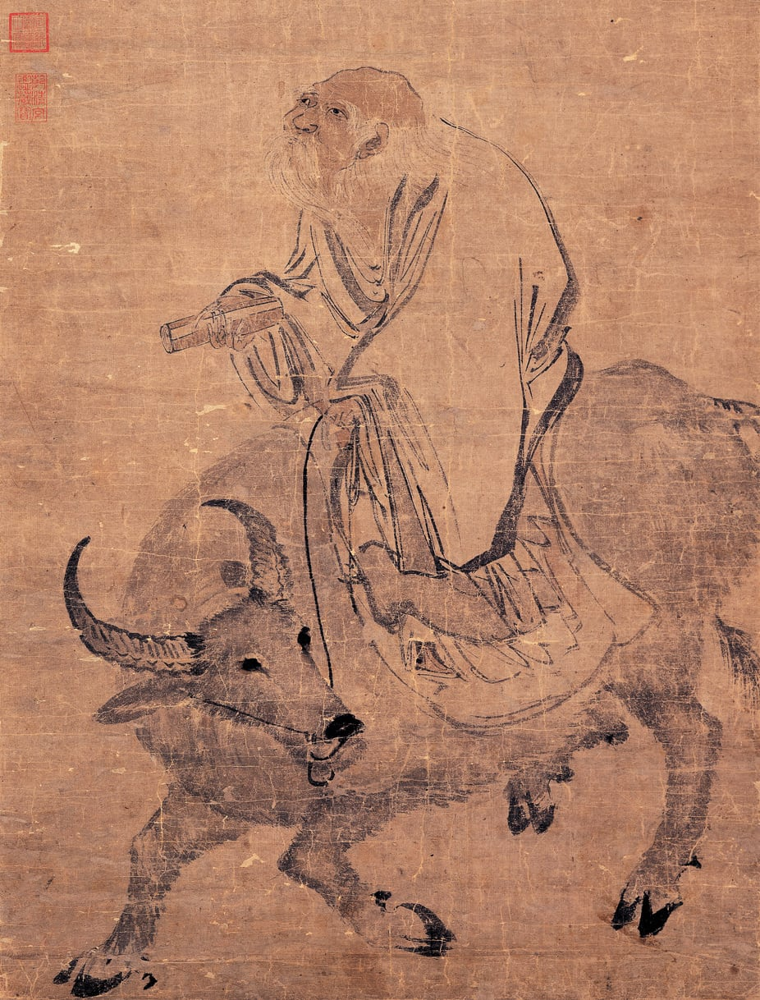

He said the strongest thing in the world is soft, and that the best way to lead is to get out of the way.

Laozi's idea is easy to state and hard to live: the soft beats the hard, and the person who stops shoving usually gets further.

Water is his example. Push it and it moves aside. Hold it and it runs through your fingers. And yet a river carves a canyon. Nothing is weaker, and nothing wears down stone. So he asked why we spend our lives being hard — insisting, arguing, forcing — when the soft thing wins in the end anyway.

He applied this to people, including people in charge. The best ruler, he wrote, is barely noticed: the work gets done, the seasons turn, and when it is over the people say they did it themselves. He called it wu wei, which is usually translated as not-doing, though a closer idea is not forcing.

There is an obvious objection, which is that some things do need pushing. A tooth needs brushing. A wrong needs answering. Laozi's reply is not that you should do nothing, it is that effort spent fighting the shape of a problem is wasted, and that acting with the grain rather than against it is not laziness but skill. You can decide for yourself whether that is wisdom or an excuse.

> “The softest thing in the world overruns the hardest.”
>
> From the Dao De Jing. Water is his example: it yields to everything and wears down rock.

The question

Is it better to push, or to let things happen?

- Almost nothing is known about him as a person. Even his dates are guesswork across two centuries, and some scholars doubt he was one man.
- The book credited to him, the Dao De Jing, is about five thousand characters long and has been translated more often than almost any book except the Bible.
- He was said to have left China on a water buffalo after deciding people would not listen — which is itself an argument about effort.

Try this

Pick something you are pushing hard at — a puzzle, a person, a habit. Try the opposite for one day: stop pushing and see what happens on its own. Write down which result surprised you.

## Confucius

Thinker 2 · 551–479 BCE · Lu, China

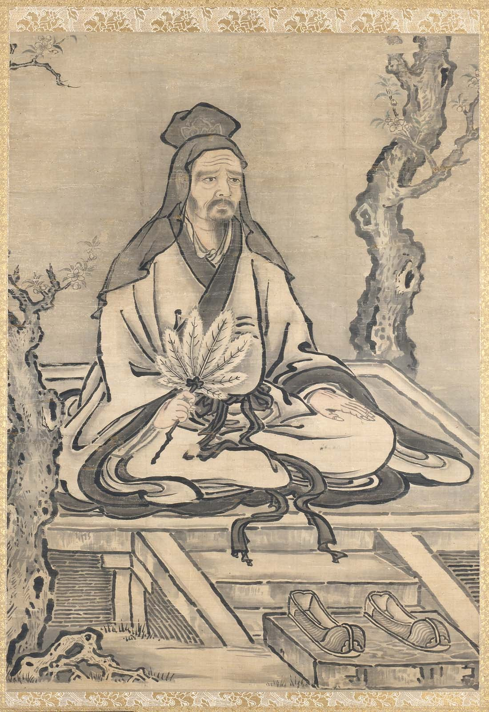

He thought the smallest everyday manners could hold a whole country together.

Confucius lived in a time of endless wars between small states. He wanted to know: what makes a society stop falling apart? His answer was surprising. Not armies. Not walls. Manners.

He said that how you greet your grandmother, how you listen to a friend, how you keep a promise - these tiny acts are the bricks that a good society is built from. Fix the small things and the big things follow.

He wandered for years looking for a ruler who would try it, and mostly did not find one. But he taught students, and their notes became one of the most-read books in history.

> “Do not do to others what you would not want done to you.”
>
> Some version of this idea shows up in almost every culture on Earth - a clue that it is doing real work.

The question

How should we live well together?

- His students collected his sayings in a book called the <em>Analects</em>.
- He said you should treat your friends the way you treat your own family - and your family the way you treat a guest.
- He thought learning was not about exams, but about becoming a better person.

Try this

Try one 'small courtesy' challenge for a week: every time someone talks to you, finish your game or your thought and look at them properly. Notice if anything changes.

## Mozi

Thinker 3 · c. 470–391 BCE · China

He argued you should care about strangers as much as your own family, and he tested every rule by asking what it actually does.

Mozi was born soon after Confucius died and disagreed with him about almost everything, in a way that is still useful.

Confucius taught that you should love your own family most, then your neighbours, then outward in decreasing circles. Mozi said that this is exactly the mechanism that produces war: if your loyalty narrows as it goes out, then the people far away are always less than people, and armies are just the extreme version of thinking that. His alternative, jian ai, is that you should care for another person's family as you care for your own — impartial care, all the way out.

He was not sentimental about it. His argument was consequentialist: test a rule by whether it brings benefit and reduces harm. That test made him oppose offensive war, expensive funerals, elaborate music and wasteful ceremony, on the grounds that the resources had somewhere better to go. His followers were known for marching long distances to defend cities, which is a strange look for people who opposed war — until you notice they were always on the defending side.

The obvious objection is that impartial care is impossible. Almost nobody can feel for a distant stranger what they feel for their own child, and pretending otherwise is a lie that makes you useless when your own child is hungry. That is a strong objection. It is also why the argument never went away: if caring more about your own is a natural fact, it does not follow that it is a fair basis for running anything larger than a family.

> “If everyone cared for others as they care for their own, there would be no war.”
>
> A summary of his doctrine of jian ai, commonly translated as impartial care or universal love.

The question

Should you care about everyone equally?

- He was an engineer as well as a philosopher, and he designed the siege defences — then travelled to defend cities against the very armies he had armed.
- He thought a rule earns its place by the benefit it produces, which makes him one of the earliest thinkers to test morality by consequences.
- His followers were famous for walking barefoot across whole provinces to stop a war between two rulers who had never heard of them.

Try this

Choose one thing you would do for a friend that you would not do for a stranger. Now write an argument for why the difference is right — and then write Mozi's reply to it.

## Socrates

Thinker 4 · 469–399 BCE · Athens, Greece

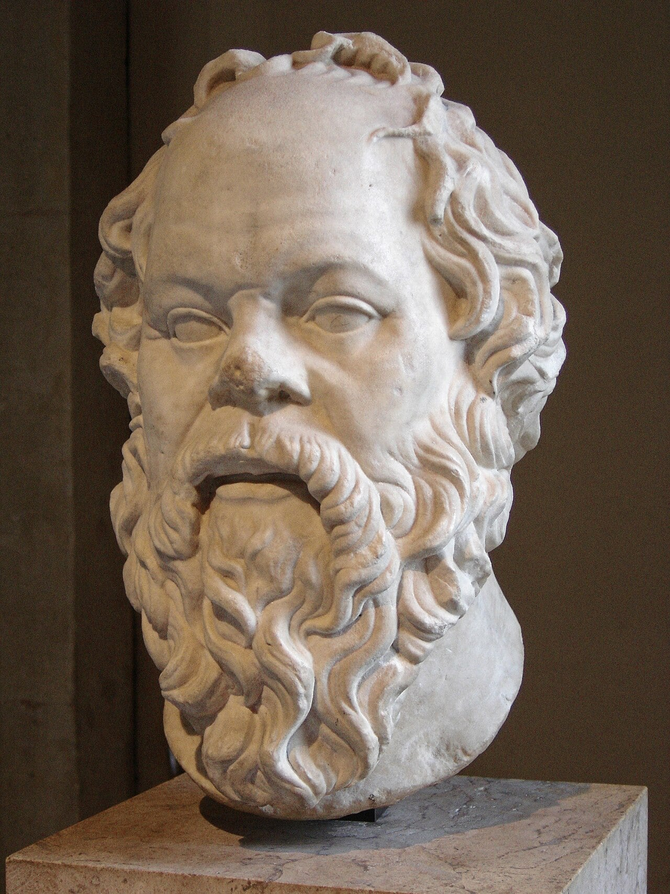

The man who asked so many questions that it got him into trouble.

Socrates did not write anything down. He walked around Athens and asked people questions. He asked shopkeepers, soldiers and politicians: <em>what is courage? what is fair? how do you know?</em>

Most people thought they knew the answers. Then Socrates asked three or four more questions and - slowly, politely - they discovered they were not so sure. He said the only thing he knew was that he did not know much.

Some people loved him for it. Others found it annoying. In the end he was put on trial and told to stop. He would not stop asking, so he was given a cup of poison. Even his last conversation was a question.

> “The unexamined life is not worth living.”
>
> He meant: a life you never stop and think about is a life you are not really steering.

The question

What does it mean to live a good life?

- He never wrote a single book. We know him through his students.
- He said his mother's job - helping babies be born - was his job too, but for ideas.
- His method has a name: the Socratic method. It means teaching by asking, not telling.

Try this

Pick one word you use a lot - <em>fair</em>, <em>brave</em>, <em>kind</em>. Ask three people what it means. Write down where their answers disagree. Congratulations: you just did philosophy.

## Plato

Thinker 5 · c. 427–347 BCE · Athens, Greece

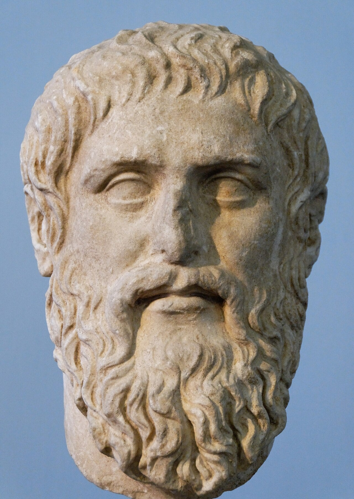

He asked whether the world we see is the whole story, or just a shadow of it.

Plato was Socrates' student, and he wrote the questions down. He built a school called the Academy, where people argued about ideas for 900 years.

His most famous picture is the <strong>cave</strong>. Imagine people chained in a cave facing a wall. Behind them is a fire, and puppets walk in front of the fire. All the prisoners ever see are shadows, and they think shadows are everything there is.

One prisoner gets free. He walks out and is blinded by the sun. Slowly he sees trees that are <em>more real</em> than the shadows. Plato's question for you: how do you know you are not still in the cave?

> “Philosophy begins in wonder.”
>
> The word 'wonder' here means being curious about things nobody is making you think about.

The question

Is what we see all that is real?

- Almost every word for a library, an academy or a university traces back to his school.
- He thought honest arguing was the best way to find out what is true.
- His student, Aristotle, disagreed with him a lot - and they stayed friends in the way only philosophers can.

Try this

Shine a torch on your hand and look at its shadow on the wall. Which is more real, the hand or the shadow? Now try to explain your answer without saying 'because you can touch it'.

## Diogenes

Thinker 6 · c. 413–323 BCE · Sinope &amp; Athens, Greece

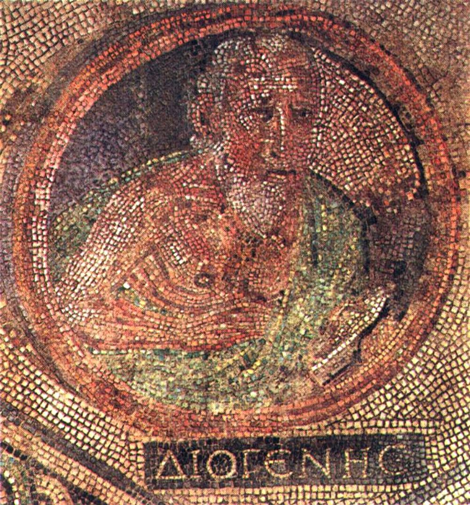

He owned almost nothing, slept in a clay jar, and said he was happier than the people who owned everything.

Diogenes decided that most of what people chase — money, reputation, comfortable furniture — was a trap. Not because he was gloomy, but because he had noticed something: the more you own, the more you have to look after, and the more you have to look after, the less you are free to do.

So he gave things up, one at a time, until there was almost nothing left. He moved into a clay jar, wore one cloak winter and summer, and ate whatever came his way. When people threw stones at his jar, he did not move. When a rich man invited him to dinner and told him not to spit on the floor, Diogenes spat in the rich man's face — he said it was the only dirty place he could find.

He was not a nice man. He was a useful one. Everything he did was a demonstration: *look at how little you need*. He called himself a citizen of the world, which meant he refused to belong to one city or one group. And when Alexander the Great — the most powerful person alive — stood over him and offered him anything, Diogenes looked up and said the only thing he actually wanted: please move, you are blocking my sun.

> “I am a citizen of the world.”
>
> Someone asked him where he was from. That was his answer — and in a city that cared a great deal about where you were from, it was a rude one.

The question

How little do you need to be happy?

- He lived in a large clay storage jar in the market square of Athens — not as a punishment, but on purpose.
- He walked around in daylight carrying a lamp, saying he was looking for an honest man.
- When Alexander the Great came to meet him and offered him anything he wanted, Diogenes asked him to stand out of his sunlight.

Try this

Pick the thing you would keep if you could keep only five. Then four. Then three. Notice which ones were easy to give up and which one hurt — that one is telling you something about yourself.

## Aristotle

Thinker 7 · 384–322 BCE · Stagira &amp; Athens, Greece

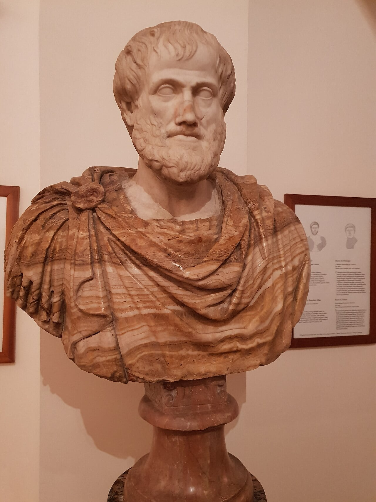

He thought you learn more from one careful look than from a hundred guesses.

Aristotle was a student of Plato, then tutor to Alexander the Great, then the founder of a school called the Lyceum. He also collected animals, and he wrote down exactly what he saw them do.

He said: do not float above the world thinking about perfect invisible things - go and cut open a squid, keep bees, watch how a chick forms inside an egg. Look first. Then think.

He also asked what makes a person good, and answered with habits. Being brave is not a feeling; it is something you practise until it becomes automatic.

> “We are what we repeatedly do.”
>
> So a habit is not a small thing. It is the factory where your character gets made.

The question

How do we find out how things really work?

- He described hundreds of species by hand, centuries before microscopes.
- He taught that courage sits in the middle between recklessness and cowardice - the 'golden mean'.
- People call him the first scientist for the way he insisted on evidence.

Try this

Choose one thing you can watch: a plant, a pet, a candle, a cloud. Watch it for five minutes without doing anything else and write two sentences about what changed that you had never noticed before.

## Kautilya

Thinker 8 · c. 375–283 BCE · Magadha, India

He wrote the first manual of statecraft, without pretending that rulers are nicer than they are.

Kautilya wrote a book about power that does not flatter power, and that separates him from almost everyone else who has written about government.

The Arthashastra is a practical manual: how to collect taxes without emptying the countryside, how to build roads and settle new land, how to keep weights honest, how to manage a treasury, how to run spies, how to handle a neighbour who is stronger than you. The advice is often uncomfortable and always specific. He has no interest in pretending that rulers are better than other people; his question is what arrangements make a state survive anyway, including a bad ruler.

What makes him worth reading rather than just cataloguing is the standard he sets. In the happiness of his subjects lies the king's happiness — which means the ruler's own interest and the people's well-being are wired together, not opposed. Famine is a security problem. Unfair taxes are a security problem. A king who governs without being seen to govern well is simply building the rebellion that will replace him.

He also thought hard about a problem that has never gone away: how do you run a large group of people without trusting anyone personally? His answer was systems — records, inspections, written rules, competing officials who check each other. That is recognisably the machinery of a modern state, written down two thousand three hundred years ago.

> “In the happiness of his subjects lies the king's happiness; in their welfare his welfare.”
>
> From the Arthashastra — a book that also contains cold advice about spies, which is why the line is worth reading carefully.

The question

What does it take to hold a country together?

- He is credited with helping a young ruler build the Mauryan empire, the largest state in Indian history at that point.
- His book, the Arthashastra, covers taxes, roads, mines, weights, agriculture, spies, diplomacy and the treatment of conquered peoples in about six thousand short rules.
- It is unusual among ancient books on government in admitting openly that a ruler's first concern is the ruler's own survival.

Try this

Invent a small country of ten people with one rule to keep it working. Now make it a hundred, then a thousand. Notice at what size your rule stops being enough, and what you have to add.

## Mencius

Thinker 9 · c. 372–289 BCE · Zou, China

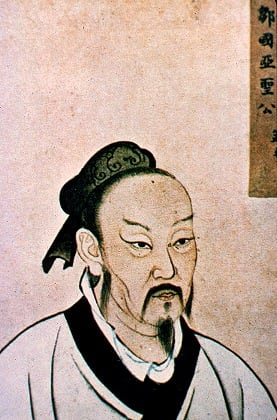

He argued that people are born good, and that the work of a life is not to become good but to stop losing it.

Mencius was born a century after Confucius and spent his life arguing with people about human nature. Another thinker, Xunzi, said people are born selfish and need to be trained into decency. Mencius said the opposite: we come with four beginnings, and the job is not to install them but to keep them alive.

His proof is a small thought experiment. Imagine you suddenly see a child about to fall into a well. You lurch. You do it before you have worked out whether anyone is watching, before you calculate anything. Mencius says that lurch is the evidence — the beginning of compassion, built in, not taught.

Then comes the harder half of his argument, which people who quote the first half tend to forget. A sprout is not a tree. If you do not water it, or if you pull it up to make it grow faster, it dies. He thought most people are not bad; they are untended. Goodness is lost slowly, by neglect, and found again the same way.

He also had a message for rulers, and it was not a polite one. If a king makes his people's lives impossible and then wonders why they do not love him, Mencius thought he had misunderstood his own job. A ruler who is not nourishing the people growing under him is not a king being failed by his subjects.

> “The feeling of commiseration is the beginning of humaneness.”
>
> His test is the child at the well: anyone would lurch towards a drowning child, before any thought of reward.

The question

Are people born good?

- His test case for human goodness is the child at the edge of a well: everyone, he says, would rush to stop it — not for thanks, not for reward, just because.
- He said that feeling is only a sprout, and that a sprout needs watering for years. Goodness is potential, not achievement.
- He spent decades visiting rulers to argue that a king who governs by force has already lost, and mostly they did not listen.

Try this

Watch for one unplanned reaction in yourself today — the flinch when someone else is hurt before you have had time to decide anything. That reaction is what Mencius is talking about.

## Zhuangzi

Thinker 10 · c. 369–286 BCE · Song, China

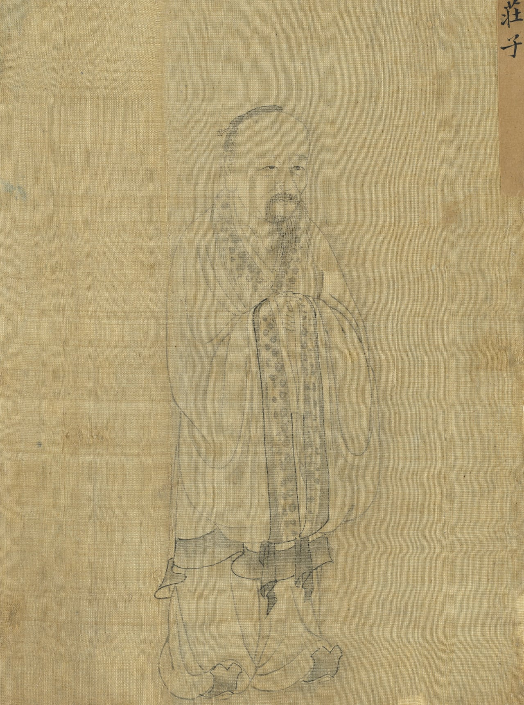

He answered the big questions with jokes, and argued that the most useful thing in the world is what seems useless.

Zhuangzi is the funniest important philosopher, which is itself an argument. Where Plato wrote dialogues aiming at definitions, Zhuangzi wrote about a butcher whose knife never blunts and a man who is not sure whether he is a butterfly. His reader is expected to laugh and then notice the ground has moved.

Take the useless tree. A carpenter walks past one, sniffs, and says it is good for nothing. Zhuangzi's answer is that this is why it is still standing, three hundred years old, while the useful trees are furniture. Usefulness to somebody else is not the same as mattering. Every child who has been told they are not good at the thing that gets prizes knows the shape of this argument already.

His deepest move is about the difference between what is real and what is certain. The butterfly passage is not really about dreams. It is about the fact that when you are asleep you are as convinced as you are now, and you cannot step outside both states to check which one you are in — so your conviction is not evidence. Descartes reached the same place and treated it as a crisis to be argued through. Zhuangzi treats it as a joke, and the joke lands harder.

> “I do not know whether I was a man dreaming I was a butterfly, or a butterfly now dreaming I am a man.”
>
> From the butterfly chapter. He is not asking you to doubt everything, he is asking how you would ever check.

The question

Is a dream less real than a day?

- His book is mostly stories about people who are odd — a butcher who cuts up an ox without ever sharpening his knife, a cripple everyone admires, a man who talks to a skull.
- He pointed out that a tree with a knobbly, useless trunk is the one that survives, because no carpenter wants it.
- He turned down a job as a minister, comparing the life to being a sacred turtle kept in a box after death.

Try this

Pick something you own that has no use at all. Keep it where you can see it for a week and notice how often you feel you should get rid of it. That feeling is what Zhuangzi was arguing with.

## Thiruvalluvar

Thinker 11 · dates unknown; often placed c. 300 BCE–300 CE · Tamil country, South India

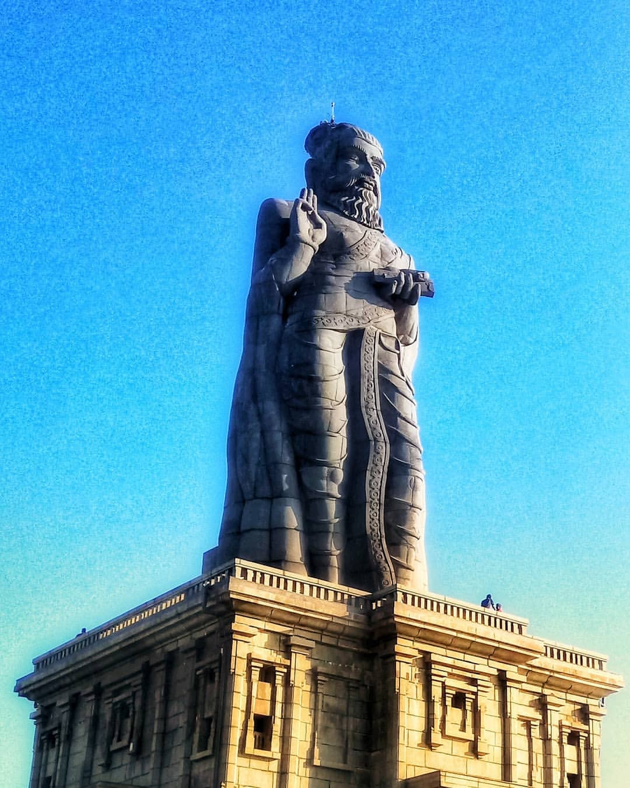

He put a whole ethics into 1,330 two-line verses, and made kindness the first thing worth having.

Every tradition has one short book that people carry in a pocket. In Tamil, that book is the Tirukkural: 1,330 couplets, two lines each, and between them they manage to cover an entire ethics.

The structure is unusual and worth noticing. Book one is about virtue, book two about wealth and statecraft — earning, friendship, keeping promises, running a household — and book three about love. He does not treat these as three separate subjects with religion in the first and life in the others. He treats ordinary competence and ordinary affection as part of the same task.

His ethics starts with not harming, and he gives the reasoning in a way that is hard to argue with: everything that is born will suffer, so anyone who understands that will not add to it deliberately. From that he builds outward — kindness, gratitude, self-control, truthfulness, patience with people who are rude. None of it is complicated. All of it is difficult.

What makes him worth including in a philosophy library for children is the length. He is a demonstration that careful thought does not require length. You can hold the whole position in your head, which means you can act on it in the two seconds before you decide whether to be unkind.

> “All that is born must suffer; so the wise do not do harm.”
>
> His verses are couplets, and translations differ a great deal. The theme throughout is that avoiding harm comes before everything else.

The question

What is the shortest way to say how to live?

- Almost nothing is known about him, including whether Thiruvalluvar is a name or a title meaning something like 'the respected weaver'.
- The Tirukkural is 1,330 short couplets, arranged in three books: doing right, earning well, and loving well.
- It has been translated into dozens of languages, and it deliberately avoids naming gods, so it can be read by people of any belief.

Try this

Write five rules for living in exactly ten words each. Then cut each to seven. Whatever you lose in the cutting is what you were using words to hide behind.

## Marcus Aurelius

Thinker 12 · 121–180 CE · Rome

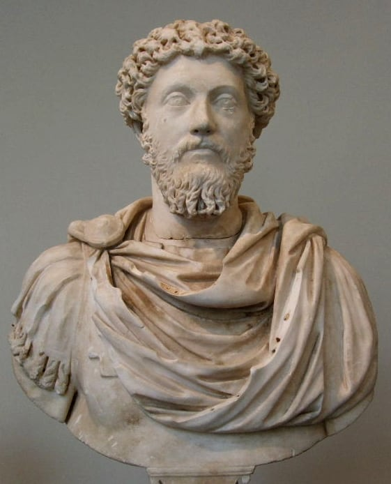

The most powerful person in the world kept a notebook telling himself to stop worrying about things he could not control.

Marcus Aurelius was the most powerful man alive, and his private notebook is one long argument with himself about how little that was worth.

The notebook — we call it Meditations, though he never gave it a title — is not philosophy written to impress anyone. He wrote it in Greek, in fragments, between campaigns, as a set of reminders: that fame fades, that most of what he was afraid of was inside his own head, that losing his temper with a difficult person is a decision he makes, not something that happens to him. The Stoics he followed taught that there are two kinds of thing in the world: what is up to you, and what is not. Your opinions, your choices, your character: those are yours. Your health, your reputation, the weather, other people, whether you live or die: not yours.

Read the whole of it and a strange picture comes through. He is not serene. He is clearly tired, often annoyed, frequently reminding himself of things he already knew, because he kept forgetting them. The book is a man arguing himself into patience over and over again, in the middle of a war, with the plague going around.

He wrote near the end: use what is in your power like a free person, instead of wanting what is not in your power like a slave. It is advice he was giving himself, and by the evidence of the notebook, it kept needing to be given.

> “Is it not better to use what is in thy power like a free man than to desire in a slavish and abject way what is not in thy power?”
>
> He wrote it in Greek, to himself, in a war camp near a river. He never meant anyone to read it, which is exactly why it is honest.

The question

What is actually up to you?

- He was Roman emperor for nineteen years, and spent much of that time away from Rome, fighting on the northern frontier.
- Meditations is not a book he wrote for readers. It is a private notebook, full of reminders to himself, in no order at all.
- He had the most power a person could have, and his notebook is mostly about how little of what happens is actually up to him.

Try this

Draw a line down a page. On one side write what is up to you, on the other what is not. Put five things from today into the two columns, honestly. Most people are surprised by how short the first column is.

## Nagarjuna

Thinker 13 · c. 150–250 CE · South India

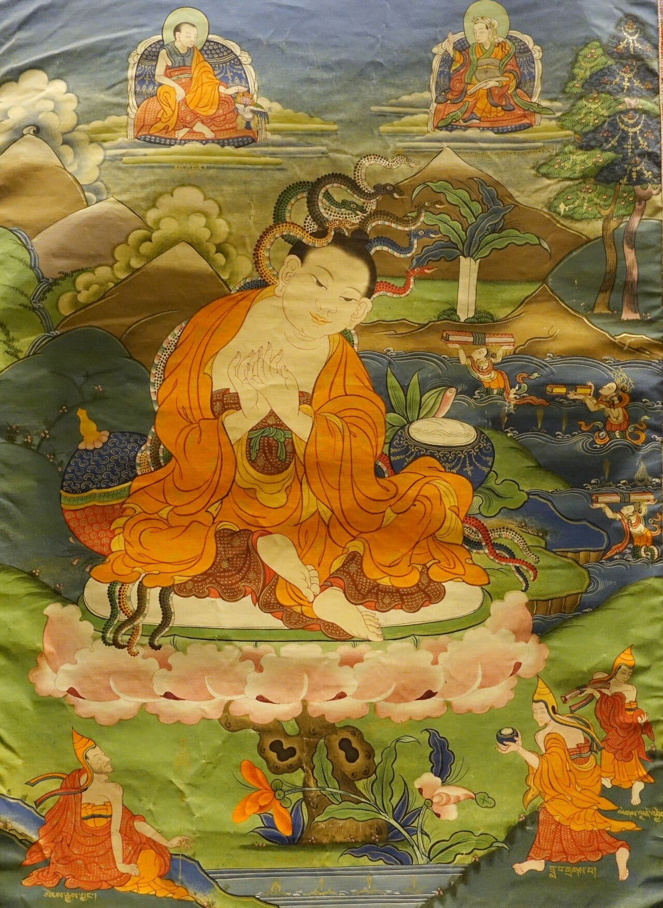

He argued that nothing exists on its own — everything is what it is because of everything else.

Nagarjuna's question sounds strange at first: what is a thing, apart from everything it depends on?

Look at a wooden table. Take away the tree, the carpenter, the saw, the forest, the rain that grew the tree — take away every one of those, and what is left? Nothing you could point at. Nagarjuna said this is not just true of tables. It is true of everything, including you. A thing has no independent core, no little solid self inside it. He called that emptiness: not empty as in *nothing there*, but empty as in *nothing there on its own*.

This worried people in his own time and it worries people now. If nothing exists on its own, isn't everything just an illusion? Nagarjuna said no, and this is the careful part. Things are real enough to walk into. They are just not what we assume they are: permanent, separate, self-powered. He called his position the middle way, because it sits between saying things really exist and saying they do not exist at all.

He also said something that makes the mind wobble if you hold it: the idea of emptiness is itself empty. It is not a secret fact about the universe you can cling to. It is a tool for noticing what you had been assuming — and then you put the tool down.

> “We call that which is dependent origination emptiness. That, being a dependent designation, is itself the middle way.”
>
> Hard words for a simple thought: a thing has no fixed self of its own, because it is made of its relationships to everything else.

The question

If everything depends on something else, what holds it all up?

- We know very little for certain about his life — no reliable dates, no reliable birthplace. What survived is the argument, not the biography.
- His Root Verses on the Middle Way are still studied today in Sanskrit, Chinese, Tibetan, Korean and Japanese.
- He did not say that nothing exists. He said that nothing exists *by itself* — and that this is not a sad fact but a freeing one.

Try this

Pick up something you own. Ask what it is made of, who made those parts, who grew or dug them. Follow it back as far as you can. Try to find the one thing in the chain that does not depend on anything else.

## Hypatia

Thinker 14 · c. 350–415 CE · Alexandria, Egypt

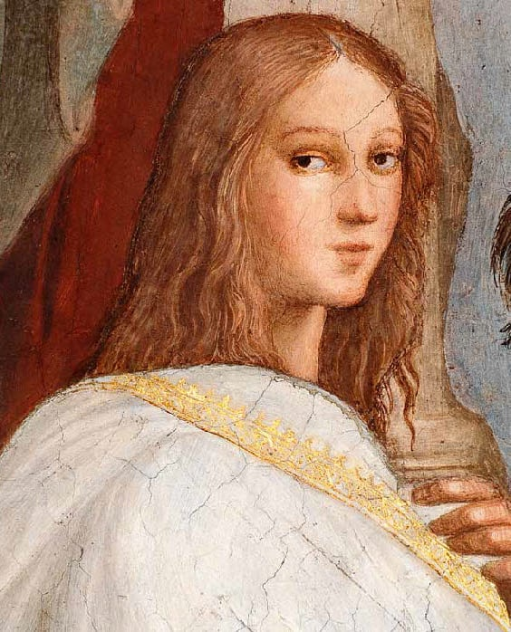

A mathematician who taught that clean thinking and the night sky belong together.

Hypatia was the head of a school in Alexandria, in Egypt. She taught astronomy, mathematics and philosophy, and students came from all over the empire to hear her.

She wrote about how the planets move, worked on the algebra of her time, and invented tools for measuring the sky. She also insisted that you should question your teachers - including her.

In 415 CE a dangerous political fight broke out in the city, and she was caught up in it and killed by a mob. Because of that, most of her writing has been lost. What survived is her students' memory of how she taught.

> “Reserve your right to think, for even to think wrongly is better than not to think at all.”
>
> Being wrong on your own is more useful than being right only because someone told you.

The question

Can numbers explain the sky?

- She was one of the first women in history recorded as a teacher of advanced mathematics.
- She was famous for teaching at the front of the room wearing her teacher's cloak - she owned her authority.
- Her story became a symbol for everyone who is told that thinking is not for them.

Try this

Build a shadow-gnomon: stick a pencil upright in clay or dough outside, and mark its shadow at the same time every hour. At the end of the day you will have drawn a clock made of sunlight.

## Adi Shankara

Thinker 15 · c. 788–820 CE · Kalady, India

He argued that the deepest self in you is not your body, your feelings or your thoughts — and that this is not a loss but the end of fear.

Shankara's question is the one Descartes and Ibn Sina asked, arriving in India from a different direction: what is it that is actually here, underneath the things I call me?

His answer is startling if you take it seriously. The body is not you, because it changes and you can watch it change. Feelings are not you, for the same reason. Thoughts are not you — you can notice a thought, and the thing noticing it is not the thought. Peel all of it away and what is left, he said, is not nothing. It is the one thing that was never absent.

He called it not-two, which is what Advaita means. His claim is that the deepest thing in a person is the same as the deepest thing in everything, so the ordinary sense of being a separate self locked inside a body is a mistake — not a small one, but the mistake that generates most suffering. Fear, he noticed, needs a boundary. Something has to be outside you before you can be frightened of losing what is inside.

The obvious objection is that this sounds like an enormous claim with no way to check it. Shankara's answer was that it is not something to believe; it is something to look at. Nobody can do the looking for you, and if you look and find only more thoughts, that finding is also part of the investigation.

> “Brahman is real; the world is appearance. The self is that Brahman, and you already are it.”
>
> This is a summary of his position rather than a sentence he wrote. He argued it at length, and it is the foundation of Advaita Vedanta.

The question

If you strip away everything you call yourself, what is left?

- He is said to have travelled the length of India on foot, arguing with anyone who would argue, and to have died in his early thirties.
- Advaita means not-two: his claim was that the self and the ground of everything are not separate things.
- He wrote extensive commentaries on older texts, and almost all of his surviving work is argument rather than poetry.

Try this

Sit for two minutes and watch your thoughts arrive. Now ask: who is noticing them? Try to describe that noticer. Notice how every description you reach for is itself another thought.

## Ibn Sina (Avicenna)

Thinker 16 · 980–1037 CE · Bukhara &amp; Isfahan, Persia

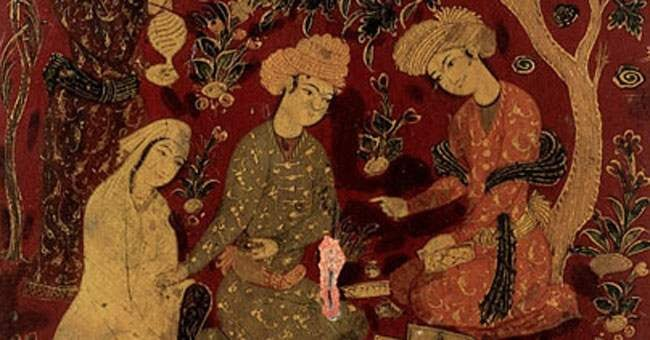

He asked whether your mind is the same thing as your body - and used a floating person to test it.

Ibn Sina had memorised the whole Qur'an by ten and was running a hospital as a teenager. He wrote an enormous medical book, the *Canon*, used in universities for six hundred years.

Among his thought experiments is the <strong>floating man</strong>. Picture a person created in mid-air, eyes covered, unable to touch or hear anything. Would that person still know that they exist? Ibn Sina said yes - and that this shows the mind is not just the body.

He was also convinced the two are tangled together, which is why the argument is still being had today, in brain scanners instead of daydreams.

> “The mind is not a thing we can point at.”
>
> He did not mean it does not exist - only that you cannot find it the way you find a foot.

The question

Are you your mind, or your body, or both?

- He wrote over a hundred books, some of them on a sickbed.
- His <em>Canon of Medicine</em> was a standard textbook in Europe until around 1650.
- He described how to test a medicine: give it to several people, in the same conditions, and watch. That is a clinical trial, a thousand years early.

Try this

Try the floating-person test on yourself. Close your eyes for one minute and take away every sound and touch. Is there still something in there that just... <em>is you</em>? Describe it without using the word 'I'.

## Al-Ghazali

Thinker 17 · 1058–1111 CE · Tus, Persia &amp; Baghdad

He lost his certainty in everything, went away to be alone, and came back saying doubt is not the enemy of understanding.

Al-Ghazali had everything a thinker could want: the best teaching post in Baghdad, a reputation, students who came from far away. Then he stopped being sure of anything.

He did not lose his faith in the usual way. He lost the ground underneath it — he found that when he pushed on what he believed, it moved. The senses can be fooled, so they cannot be the final court of appeal. Reason, which was going to correct the senses, could also make mistakes. Where do you stand if nothing is certain, including the memory of why you thought so in the first place?

He left. He gave away his position, travelled, and lived quietly for years, mostly alone. What he came back with was not a proof but a difference: certainty of the demonstrative kind is rarer than philosophers claim, and the things that actually hold a life together are habits of the whole self rather than arguments. He wrote that he had been trying to understand by looking, when the understanding he wanted was not the kind you can look at.

His argument with the philosophers of his day was precise. He did not say they were wrong about everything — he said they claimed a certainty they did not have, and then used that claim as a weapon. What they offered as proof, he said, was mostly a habit of thought dressed as a demonstration. Whether he was right is still live ground, which is why he is worth arguing with rather than simply admiring.

> “I examined what I believed, and found nothing that would not fall when I pushed it.”
>
> A summary of the crisis he describes in his own account of his intellectual life, Deliverance from Error, rather than a single sentence of it.

The question

What do you do when you stop being sure?

- He was the most famous teacher of his generation in Baghdad, with the most prestige anyone could want, and he walked away from it.
- He described a collapse of certainty so complete that he could not be sure the things in front of him were real — and wrote that the senses cannot be their own judge.
- He wrote The Incoherence of the Philosophers, arguing that philosophers who claimed certainty were doing something shakier than they admitted.

Try this

Choose one thing you are completely sure of. Now try to give three reasons for it that do not depend on someone telling you. Notice how many of your certainties turn out to be borrowed.

## Ibn Tufayl

Thinker 18 · c. 1105–1185 · Andalusia &amp; Marrakesh

He wrote the thought experiment as a story: a boy alone on an island, working everything out for himself.

Ibn Tufayl did something that philosophers almost never do: instead of arguing that reason alone can find out how things work, he wrote a story in which someone does it.

A child, Hayy, is alone on an island. He is raised by a deer. He has no language, no books, no teacher, no religion. Over seven-year stretches he notices fire, observes animals, dissects, compares, generalises; he works out that the world has a structure, that he has a self, and eventually that there must be something on which all of this depends. He gets there by looking and thinking, with nobody telling him anything.

Written as a philosophy book, that claim sounds like a boast. Written as a story, it is a test you can apply: at each stage, ask whether a person really could have got from the previous step to this one with nothing but observation and reasoning. Sometimes the answer is convincingly yes and sometimes the story is doing work the argument should be doing — which is itself instructive about how much of what we know depends on other people.

The point that survives is a question about education. Everything you believe came either from your own looking or from being told. Ibn Tufayl suggests that the gap between those two is far larger than we admit, and that most of what feels like knowledge is really testimony — reliable, useful, and not the same thing.

> “A child alone on an island, with no teacher, might come to understand the world by looking at it.”
>
> The premise of his book Hayy ibn Yaqdhan, a thought experiment written as a story rather than as an argument.

The question

How much could you work out with no one to teach you?

- His book tells of Hayy, raised by a deer on a deserted island, who grows up observing, testing and reasoning his way to an understanding of nature.
- It was translated into Latin, then English, and read in Europe as an argument that reason alone could reach deep truths.
- He served as a court official and a physician, and is said to have introduced the works of Ibn Rushd to the ruler he served.

Try this

Pick something you know because an adult told you. Now imagine you had never been told. How much of it could you get by watching? Write down the steps you would need.

## Ibn Rushd

Thinker 19 · 1126–1198 · Córdoba, Andalusia

He argued that reason and faith are not rivals, and that doing one properly cannot damage the other.

Ibn Rushd's whole position can be put in three words: truth does not contradict truth. If reasoning leads somewhere and something else also seems true, then either the reasoning is faulty or the other thing has been misread. One of them has to give, and it is the philosopher's job to find out which.

This is why he spent years answering Al-Ghazali's attack on philosophy rather than dismissing it. Al-Ghazali had argued that the philosophers claimed a certainty they did not have. Ibn Rushd's reply was that they had been sloppy in places and right in others, and that attacking philosophy with bad arguments gives nobody permission to stop reasoning. He was happy to admit his side had made mistakes; what he would not accept was the conclusion that inquiry should stop.

He gave a distinctive answer to whom each route is for. Some people are persuaded by arguments, some by images and stories, some by the plain sense of the text. He thought all three were legitimate, and that the mistake was demanding the same form of proof from everybody — that is how you get arguments in which nobody is addressing anybody.

He is one of the clearest cases of philosophy as a genuinely connected conversation rather than a set of separate national traditions. He read Greek, argued with a Persian, wrote in Arabic, was read in Latin, and made Aristotle available to medieval Europe. A thousand years separate him from the Greeks and a continent from the Europeans, and the argument is continuous.

> “Truth does not contradict truth.”
>
> A summary of his central claim that reason and revelation are two routes to the same truth, so neither can refute the other.

The question

Can thinking and believing disagree?

- He was a judge as well as a philosopher, working in law and medicine as well as in philosophy, and served as a court physician.
- He wrote detailed commentaries on Aristotle that were translated into Latin and taught in European universities for centuries.
- He wrote a reply to Al-Ghazali — The Incoherence of the Incoherence — and spent years dismantling an argument rather than ignoring it.

Try this

Take two things you believe that seem to pull against each other. Write down what each one is actually claiming. Often the quarrel disappears once both are said plainly.

## Zhu Xi

Thinker 20 · 1130–1200 · Fujian, China

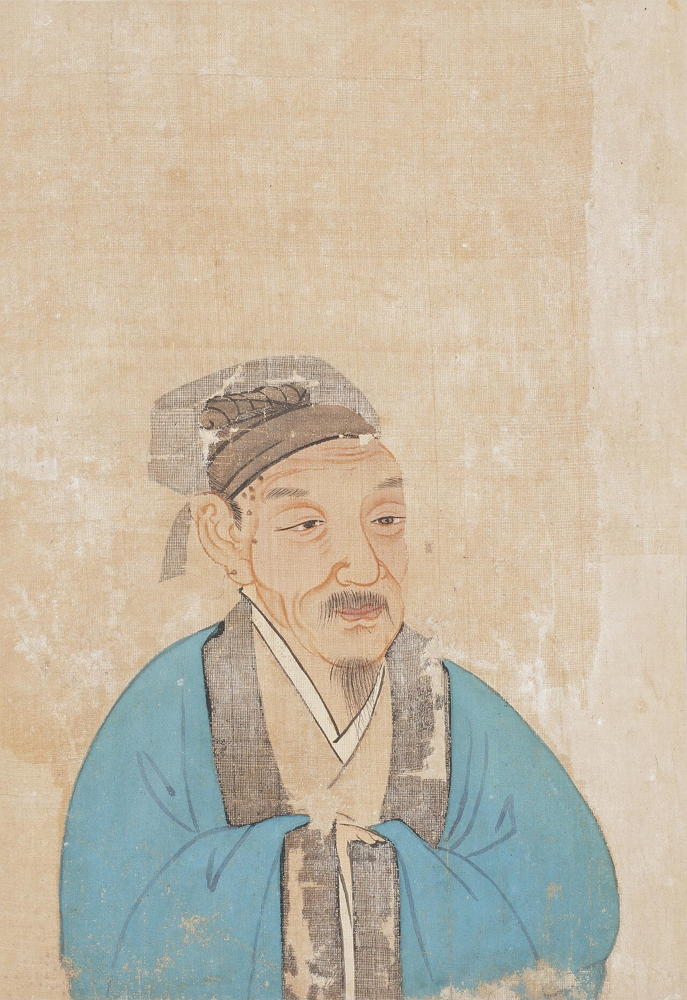

He said understanding comes from looking closely at ordinary things, one at a time, for years.

Zhu Xi's method is the least exciting and most useful in this library. He said the way to understand anything was to investigate particular things carefully — one object, one plant, one event, one conversation at a time — and to let the understanding accumulate.

It sounds obvious. It was not, then or now. Two tempting alternatives were available. One was to sit still and wait for a sudden insight into everything at once. The other was to memorise what the great texts said and stop there. Zhu Xi tried the second, badly, when he was young, and then changed his mind and spent the rest of his life arguing for the slow route: examine the thing in front of you, in detail, and see what pattern it shares with other things you have examined.

He put this in a framework with its own vocabulary. Principle is what a thing is — the structure it follows. Material stuff is what it is made of. You cannot reach the principle by thinking about principles; you reach it by looking at the stuff until the structure shows through. His metaphor was water in a riverbed: the shape of the channel is real, and the water is where you find it.

His influence went well beyond philosophy. The four books he chose and annotated became the exam syllabus of an empire for six centuries, which makes him one of the few philosophers whose reading list was genuinely compulsory.

> “Investigate the things around you, and extend your knowledge one thing at a time.”
>
> The doctrine of gewu, drawn from an older text and made central by Zhu Xi and his followers.

The question

How do you find out how things work?

- He selected four older books, wrote commentaries on them, and those commentaries became the basis of the Chinese civil service examinations for six hundred years.
- His method was unfashionably unglamorous: study one thing carefully, then the next, rather than waiting for a single flash of understanding.
- He distinguished principle, the way a thing works, from its material stuff — and argued that you meet the principle by examining the stuff.

Try this

Pick one ordinary object and study it properly for a week — how it works, what it is made of, who made it and why. Notice how much of the world it drags in behind it.

## Dogen

Thinker 21 · 1200–1253 · Kyoto &amp; Fukui, Japan

He said that paying attention to one ordinary thing, properly, is not practice for the real thing — it is the whole thing.

Dogen wanted to know whether time is something that happens to you or something you are. That sounds abstract until you notice how you actually live it: most of the present is spent as a corridor to somewhere else. Washing up is getting to the end of washing up. Being nine is getting to being ten.

His argument is that this is a mistake with real consequences. When you cook, you are not practising cooking to become a good cook; the cooking is the thing. Paying attention is not preparation for life. There is nothing left over once you subtract the paying of attention.

He also had a warning about meditation, which is odd for a man who spent his life doing it. He said: do not sit down to become a Buddha, because that treats the sitting as a means and the awakening as a prize, and the whole shape of the thing is wrong. Sit, and that is what it is. If you sit down being certain that attention will pay off later, you have turned it into a transaction, which is exactly what he was arguing against.

It is a hard position to hold honestly, because it sounds like a reason to stop trying to improve at anything. The reply Dogen gives is that attention is not passivity — it is the whole effort, moved from the future into the present, which is the only place it could ever have been applied.

> “To study the way is to study the self. To study the self is to forget the self.”
>
> From the opening of his Genjokoan. He meant attention as a discipline, not a mood.

The question

Is now just the way you get to later?

- He travelled to China and came back saying the thing he had been looking for was not in the books he had been studying.
- He was famous for insisting on ordinary practice — sitting, cooking, washing — done with complete attention rather than as a step towards something else.
- He wrote that time is not something you move through, and that a moment of attention is not a small piece of a larger whole.

Try this

Wash one plate as if it were the only thing in the world. Then wash the next one badly, on purpose. Compare the two. You will have learned something a description cannot give you.

## Ibn Khaldun

Thinker 22 · 1332–1406 · Tunis &amp; Cairo

He tried to work out why groups of people rise and fall, and invented the first careful science of societies to do it.

Ibn Khaldun asked a question nobody had asked in quite that form: not what happened, but why people's lives together have a shape.

His answer starts with something he called asabiyya — usually translated as group feeling, or solidarity. A group with strong asabiyya will do hard things together in a desert or a crisis; they take risks because they trust each other. That is how dynasties get started. Then they win. Then they live in cities, in comfort, with wealth and softness and disagreements about who is owed what. And the feeling that got them there fades, because nobody needs it any more. Then somebody hungrier arrives.

He was careful to say he was not describing fate. He was describing a pattern he had watched three times in person, and he wanted it tested against evidence rather than repeated as a story. The opening of his book is a lecture to historians about how to check a claim: could this really have happened, given the size of the army, the state of the roads, the taxes needed to pay for it?

What makes him unusual is the combination. He was not a moralist telling rulers to be virtuous, and not a religious writer describing providence. He was looking for the machinery — what materially makes societies hold together and come apart. A great deal of modern sociology and economics is still arguing with him, six centuries later.

> “History is a record of human society — and it is full of errors, so it must be tested.”
>
> A summary of the argument that opens his Muqaddimah, where he sets out rules for checking whether a reported event is even possible.

The question

Why do strong groups fall apart?

- His main book opens by telling historians that most of what they repeat is untrue, and setting out rules for checking it.
- He argued cities and dynasties rise on the back of a shared solidarity he called asabiyya, and then soften and fall once they get comfortable.
- He served as an adviser to rulers in several countries, was imprisoned at least once, and wrote much of his work while living quietly in a castle under the protection of a tribe.

Try this

Pick a friend group, a club or a family and draw its story as a curve with three points: where it started, where it is now, and where you think it goes next. Then say what would have to happen to change the last point.

## Wang Yangming

Thinker 23 · 1472–1529 · Zhejiang, China

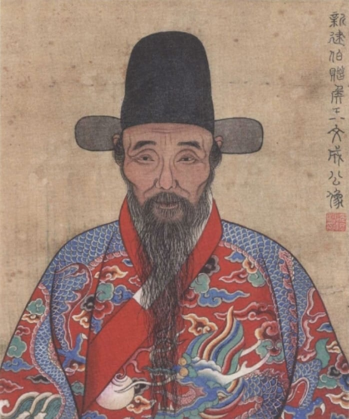

He argued that knowing the right thing and doing it are not two steps but one — and that if you know and do not do, you did not really know.

Wang Yangming's claim is short and it makes people uncomfortable: knowing and doing are not two things. If you genuinely know that something is right, you do it. If you know and do not do, you did not know — you had an opinion about it.

This attacks a very comfortable arrangement. Almost everyone holds, in practice, that understanding is one job and acting is another: first you learn what is right, then, if you are good, you do it. That story explains failure as weakness of will, and it lets you keep your self-image while doing nothing. Wang's version gives you no such exit. The thing you did not do becomes evidence about what you actually understood.

The background is a disagreement within Chinese philosophy about where to look for guidance. Some held that you learn the right way by studying the world — investigating things, exactly as Zhu Xi had taught. Wang said the standard is already inside you, an innate ability to recognise right from wrong, and that the problem is never a shortage of it but an accumulation of self-interest, habit and noise covering it up.

He was not writing from an armchair. He was beaten, exiled and later given military commands, and he ran them the same way: act from the clear judgement you have, and distrust any sophistication that lets you wait.

> “There is no knowledge apart from action; knowing and doing are one.”
>
> A summary of his doctrine of the unity of knowledge and action, argued against the prevailing view that understanding comes first and practice follows.

The question

If you know what is right, why don't you do it?

- He was a general as well as a philosopher, and put down a major rebellion — an unusual credential for someone writing about inner knowing.
- He arrived at his central insight while living in exile in a remote province, having been beaten and demoted for criticising people in power.
- He taught that everyone already has a capacity to tell right from wrong, and that the task is to stop clouding it rather than to acquire it.

Try this

Think of something you say you know is right and habitually do not do. Instead of trying harder, ask whether you actually believe it. The gap you find is the thing he was talking about.

## René Descartes

Thinker 24 · 1596–1650 · France &amp; Sweden

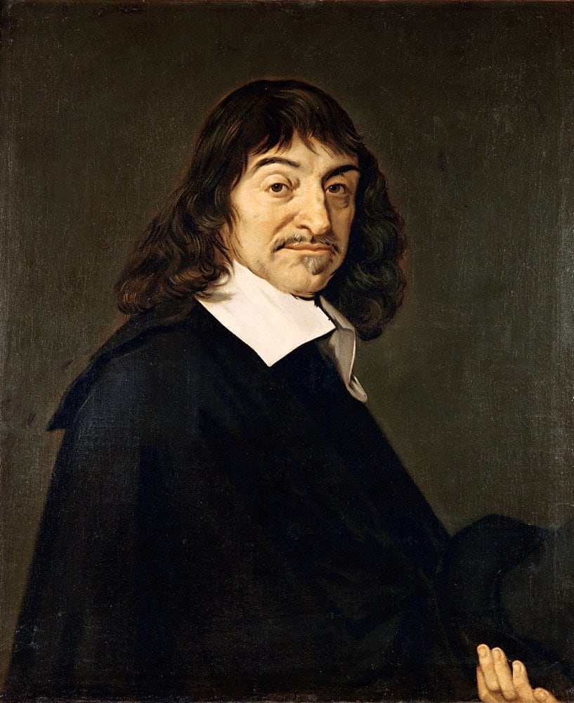

He doubted everything, and found one thing he could not doubt.

Descartes decided to throw out everything he believed and start again, keeping only what he could prove. To make it fair, he even pretended that a sneaky demon was putting fake pictures into his head.

Everything crumbled. How do you know your memories are real? How do you know the room is there? Then he noticed something: whatever the demon does, someone is being tricked. Someone is <em>thinking</em>.

So: <strong>I think, therefore I am.</strong> That was his one unshakeable stone. He then tried to build the rest of knowledge on top of it - a fair bit of it collapsed, and that was useful too.

> “I think, therefore I am.”
>
> Not 'I am clever', and not 'I am right'. Only: something is going on in here, so there must be a here.

The question

How do you know you are really thinking right now?

- He invented the graph grid you use in maths - that is why they are called Cartesian coordinates.
- He liked to think in bed until late morning; a queen dragged him out of it to teach her at 5am, which may have killed him.
- His trick of doubting on purpose is now the most-used method in philosophy.

Try this

Play 'doubt three things'. Choose three things you are sure of ('my shoes exist', 'Tuesday comes after Monday', 'my friend likes me') and for each, ask: how do I know? If you can defend one of them, you have done better than Descartes.

## Zera Yacob

Thinker 25 · 1599–1692 · Aksum &amp; Enfraz, Ethiopia

He went to live in a cave and worked out for himself what he thought was true — while Descartes was doing the same thing four thousand kilometres away.

In Ethiopia in the 1630s, the emperor had converted to Catholicism, and the country fought over it. Zera Yacob refused to go along with the side that was winning, so he took some gold, a book of psalms, and left. He found a cave near a river and lived in it for two years.

He did not spend the time being miserable. He spent it thinking — and, unusually for his time, he did not start from what he had been taught. He started from what he could work out. He decided that reason, which he called the light of intelligence, was something every person has: a way of seeing the difference between true and false, and between good and evil, that does not require a priest to operate. He wrote that an action is right if it increases harmony in the world and wrong if it breaks it.

Then he asked whether all the holy books could be true, since they disagreed, and concluded that they could not all be. Most of his neighbours would have found that dangerous. He wrote it down anyway — thirty years later, when a student of his asked him to.

Two things about him are worth holding together. One: he lived at the same time as Descartes, asked almost the same question — what can I know for certain? — and answered it in a cave in Ethiopia. Two: whether the book is really his is still disputed. That second thing is not a footnote. It is the whole problem of history: how do you know who wrote anything?

> “I have learnt more while living alone in a cave than when I was living with scholars.”
>
> He wrote that down about himself, years after the cave. The cave was not the point. The thinking was.

The question

Can you work out what is right without being told?

- He fled a war over religion in Ethiopia and spent two years alone in a cave near the Tekezé river.
- In about 1667 he wrote down his inquiry — and argued that a husband and wife are equal in marriage, which almost nobody was arguing then.
- Scholars still argue about whether the book really is his. Historians who doubt it think a European monk wrote it later. How to tell the difference is itself a philosophical question.

Try this

Take one thing you have always been told — something ordinary, like when bedtime should be. Ask why. Then ask why to that answer. Keep going until you reach something you either believe or cannot defend. Either ending is a real result.

## Sor Juana Inés de la Cruz

Thinker 26 · 1648–1695 · New Spain (Mexico)

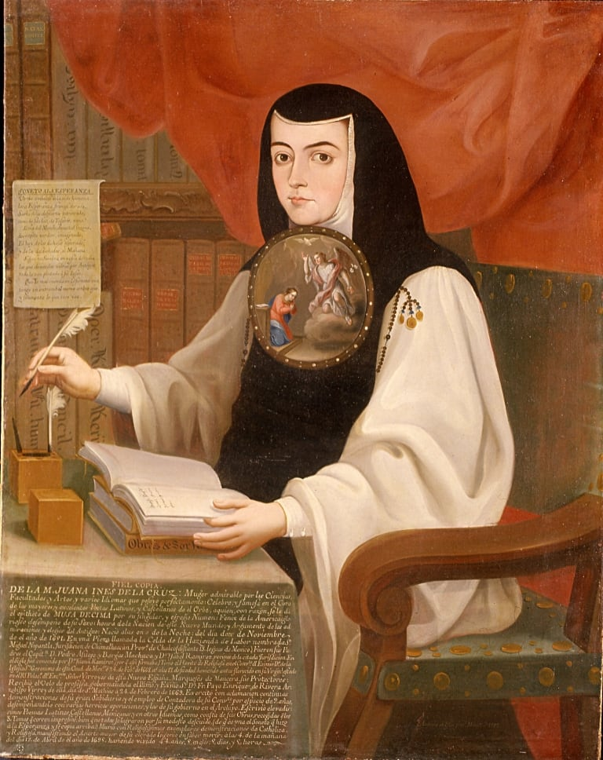

A nun in Mexico who taught herself everything, argued with a bishop, and asked why girls were not allowed to learn.

Juana Inés de la Cruz was born on a farm outside Mexico City and grew up with a problem: she wanted to know everything, and everyone around her agreed that this was not what girls were for.

She solved it by teaching herself, reading her grandfather's books until she ran out of them. She was famous by sixteen for her mind, and the only place she could keep studying was a convent — so she became a nun, because at least a convent had a library. She wrote poetry, plays, science, and arguments. She collected musical and scientific instruments. She wrote a great deal that was about nothing more religious than wanting to understand how things worked.

Then she criticised a famous sermon, and a bishop — writing under a woman's name — told her publicly to leave off secular learning and mind her prayers. Her answer, the Respuesta a Sor Filotea, did not apologise. She listed the educated women she could think of, from the Bible onwards, to show the bishop the size of the tradition he wanted her to ignore. She pointed out that if women were taught nothing, of course they would seem to have learned nothing. And, most effectively, she observed that thinking is not something you need a study for: you can perfectly well philosophize while cooking supper.

She was made to give up her books in the end. She died a few years later, nursing other nuns through an epidemic.

> “One can perfectly well philosophize while cooking supper.”
>
> A bishop had told her to stop studying. This was her reply — she was quoting an older poet, and she meant every word of it.

The question

Why were girls not allowed to learn?

- She wanted to study at university, so as a girl she asked to be dressed as a boy to get in. She was refused.
- She learned to read in a library her grandfather owned and taught herself Latin, philosophy and science, and wrote in both Spanish and Nahuatl, the language of the people around her.
- Her reply to a bishop in 1691 — the Respuesta — is one of the first great arguments in the Americas for a woman's right to be educated.

Try this

Next time you wash up, sweep, or walk somewhere boring, keep half your mind on one question that interests you. Afterwards write down whatever turned up. Thinking does not need a desk.

## Mary Wollstonecraft

Thinker 27 · 1759–1797 · London, England

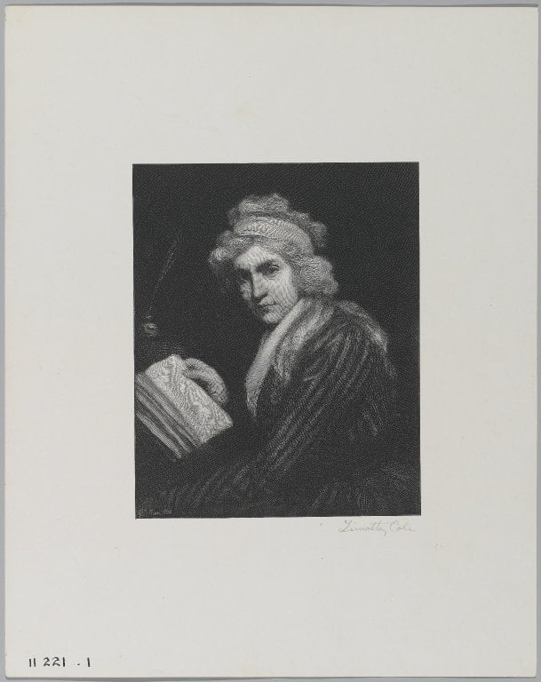

She argued that girls deserve exactly the same education as boys - and that a fair society needs it.

Mary Wollstonecraft grew up in a house where her father spent the family money and her mother was told to be quiet. She saw how strongly people decided what a girl could become.

She read the big arguments of her day about freedom and equality, and noticed something missing: women. So she wrote *A Vindication of the Rights of Woman* (1792) and asked a sharp question - how can you call a country free if half of it is not allowed to think for itself?

She said being educated - being able to reason - is what makes a person a person. Deny someone that and you are not just being unfair, you are making the whole society weaker.

> “I do not wish women to have power over men, but over themselves.”
>
> She was not asking to swap places. She was asking to be in charge of her own mind.

The question

Should everyone get the same chance to learn?

- She ran a school and worked as a translator to support herself - unusual for a woman of her time.
- Her daughter, Mary Shelley, wrote <em>Frankenstein</em>, a book crowded with the same questions about who deserves to be treated as a person.
- She argued that 'pretty and helpless' is not a compliment; it is a trap.

Try this

Look at five adverts or five book covers for children. Count how many show girls being brave and clever, and how many show them looking nice. If you were the boss, what would you change?

## John Stuart Mill

Thinker 28 · 1806–1873 · London, England

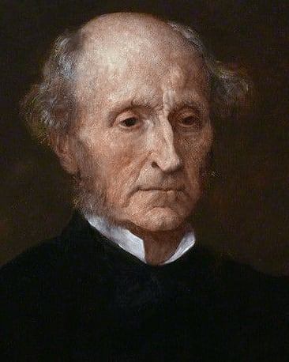

He tried to answer the question every child asks: why shouldn't I do what I want?

Why shouldn't you do what you want? The usual answers are: because it's against the rules, or because it's wrong, or because someone bigger says so. John Stuart Mill thought all of those were the wrong kind of answer, and he tried to find one rule to replace them.

Here it is. You should be free to do anything you like, and nobody — not the government, not your neighbours, not the majority, not even your friends — should stop you, *unless what you are doing harms someone else*. That is it. Not offends. Not annoys. Not disagrees with. Harms. He was blunt that your own good is not a good enough reason to interfere with you: other people do not get to stop you from doing something they think is bad for you, because it is your life and you are the one living it.

Mill knew the hard questions were all at the edges. What if it harms someone slowly, or harms many people a little, or harms someone who cannot complain? What if the harm is that you have stopped someone else being free? What counts as harm, and who gets to decide? He did not settle those questions. He just drew the line in a new place, and made everyone argue about it there.

He also insisted on the other half of the idea, which people who quote him forget: because a harmed person is the only thing that justifies stopping you, a society that never lets anyone be wrong about anything is a society that has stopped thinking. If you are never allowed to try something and find out it was a mistake, you never find out anything.

> “The only purpose for which power can be rightfully exercised over any member of a civilised community, against his will, is to prevent harm to others.”
>
> He called this one very simple principle. It has kept lawyers busy ever since, mostly because nobody agrees on what counts as harm.

The question

How much freedom should you have?

- His father taught him Greek at three and kept him away from other children on purpose, to see what education alone could do. It worked, and it left him in a crisis by twenty.
- He wrote On Liberty in 1859, in which the harm principle appears.
- He argued in Parliament for giving women the vote, in 1867. It was voted down, 196 to 73.

Try this

Take an argument you have actually had. Write down who was harmed — really harmed, not annoyed, not offended, not embarrassed. If the honest answer is nobody, that is interesting. If it is somebody, say exactly how.

## W. E. B. Du Bois

Thinker 29 · 1868–1963 · United States &amp; Ghana

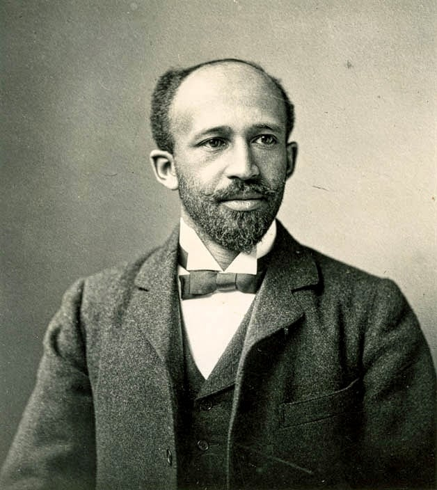

He described what it is to see yourself through the eyes of people who look down on you — and wrote it as one of the first to do so.

Du Bois asked a question that most philosophers of his time had not noticed was a question. If you grow up where everything around you says your kind of person is lesser — the newspapers, the schools, the pictures on the walls, the tone of voice in a shop — what happens to your sense of who you are?

His answer was double consciousness. You do not simply see yourself; you see yourself being seen, continuously, through eyes that were built to look down on you. You are two things at once: what you know yourself to be, and the mannered, permanent image handed to you by a society that does not ask. He described the feeling not as weakness but as a permanent, exhausting second job.

It is a philosophical idea in the strict sense: a claim about the structure of self-knowledge, and about how much of your identity is not yours to determine. It also dissolves a common assumption — that being free is simply the absence of being stopped. You can be stopped by nothing and still spend your whole life translating yourself.

He did not stop there, which is what makes him a useful figure rather than a saint. He argued all his life about what to do with the position: separate development, integration, protest, research, organising. He changed his mind, publicly, more than once, and went on arguing — the double consciousness was a fact to be understood and a machine to be dismantled, not a fate.

> “It is a strange sensation, this double consciousness — always looking at oneself through the eyes of others.”
>
> A paraphrase of the opening of The Souls of Black Folk, where he sets out seeing yourself through the eyes of a society that dismisses you.

The question

Who are you when other people see you wrongly?

- He was the first African American to earn a doctorate at Harvard, and he had already studied in Berlin.
- He wrote The Souls of Black Folk in 1903, mixing essays, history, songs and stories — a book that made its argument partly by being written in several voices.
- He spent his life as a researcher, an editor, an organiser and finally an exile, moving to Ghana in 1961 and dying there in 1963.

Try this

Draw two pictures of yourself: one as you see yourself, one as you think a stranger sees you on first sight. Then write what happens in the gap between them.

## Nishida Kitaro

Thinker 30 · 1870–1945 · Japan

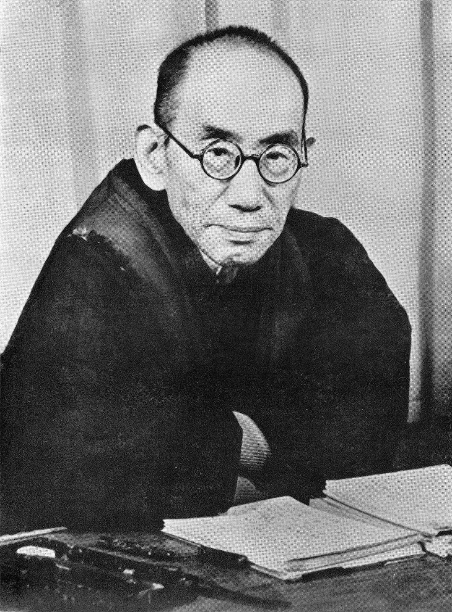

He tried to describe experience before it gets divided into a self and a world, and built a whole philosophy from that starting point.

Most philosophy starts with a self over here looking at a world over there, and then asks how the two are connected. Nishida began somewhere else, and the move is worth understanding even if you never accept it.

Take the sound you are hearing right now. There is the sound. Then there is the fact that you labelled it, and a you who did the labelling, and a thing that was labelled. Nishida pointed out that the first moment — the sound before the split into one who hears and something heard — is where experience actually begins. He called it pure experience, not because it is mystical, but because it is prior to the division we normally take as given.

He then had to explain why we ever leave that state, and his answer is that we do it to get things done. When you are absorbed in a task, the split disappears; the split appears when something goes wrong, or when you have to think about yourself. So the everyday sense of being a separate self is not the foundation of experience. It is something we construct, for practical reasons, out of something that was not divided.

This is a genuinely different starting point from almost everything in the European tradition, and it produces different questions. Descartes began by proving that he existed. Nishida began by suggesting that the question of whether you exist only arises after you have already left the interesting place.

> “Pure experience is experience just as it is, before any division into subject and object.”
>
> The opening idea of his first book, An Inquiry into the Good — a description of experience prior to the categories we usually add to it.

The question

What is happening before you divide things into you and everything else?

- He taught in provincial schools for years before getting a university post, and wrote his first book while still teaching secondary school.
- He founded the Kyoto School, an attempt to think through Western philosophy while starting from Zen practice rather than from Greek problems.
- His career was shadowed by politics: he was pressed into service explaining Japanese expansionism, argued against some of it, and died shortly after the war ended.

Try this

Listen to a sound without naming it. The moment you think 'a bird', something has been added. Try for ten seconds to hear it before the naming starts, and notice what that is like.

## B. R. Ambedkar

Thinker 31 · 1891–1956 · India

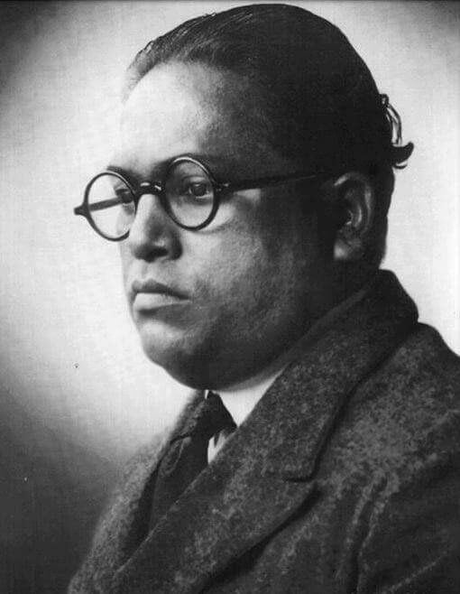

He argued that a society can be built so that people are sorted at birth — and then spent his life dismantling that arrangement in law.

Ambedkar's question is one that a lot of philosophy skips: what if the unfairness is not a bad decision that can be corrected, but the structure of the society itself?

Caste, as he analysed it, is not a division of labour — a society where different people do different jobs is ordinary enough. It is a division of labourers: which job you may do, who you may marry, who may touch your food, is decided at birth and cannot be changed by effort or talent. And it is defended twice, once by custom and once by a story about why the arrangement is natural. That double defence is what makes it so hard to dislodge, because the person at the bottom is asked to accept that the bottom is where they belong.

He refused the polite version of the argument. Others argued for gradual reform, or for improving conditions within the system. He argued that the system itself was the problem, and then did something unusual for a philosopher — he went into the machinery. He wrote in law, drafted a constitution, founded organisations, published arguments, and finally used mass public conversion to make the departure visible.

Which is why he belongs in a library for children. He is the clearest case of a thinker who did not treat understanding and action as separate jobs, and who took an argument all the way into institutions rather than stopping at a book.

> “Caste is not a division of labour; it is a division of labourers.”
>
> His central claim against the defence that caste is simply people doing different jobs — the difference being that one is chosen and the other is inherited.

The question

Is an unequal society stable, or only quiet?

- He was born into a caste treated as untouchable, was the first member of it to attend an Indian university, and went on to earn doctorates in New York and London.
- He chaired the committee that drafted the constitution of independent India, and the equality and rights clauses in it carry his fingerprints.
- In 1956 he and hundreds of thousands of followers publicly left Hinduism for Buddhism, in a decision he described as being about dignity rather than belief.

Try this

Find one rule where you live — in school, sport or law — that is technically the same for everyone and in practice is not. Write how it works on the person it favours and on the person it does not.

## Hannah Arendt

Thinker 32 · 1906–1975 · Germany &amp; USA

She asked how ordinary, nice people can end up doing terrible things as part of a crowd.

Hannah Arendt was German and Jewish. She escaped from the Nazis, lived as a refugee, and spent her life thinking about power, truth and crowds.

She went to watch the trial of a Nazi official named Eichmann, expecting a monster. What she saw was a bored, ordinary man using big words and saying 'I was just following orders and doing my job well'.

That shook her. Her idea, which people still argue about, is that great evil often does not need evil people. It needs people who stop thinking for themselves and let other people supply the words.

Her conclusion was practical, and it is aimed straight at children: thinking is a moral duty, not a school subject.

> “The sad truth is that most evil is done by people who never make up their minds to be good or evil.”
>
> Not making up your mind is itself a decision - and usually somebody else's.

The question

Why do good people sometimes do bad things together?

- She was thrown out of Germany in 1933 and was stateless for eighteen years before she got a passport.
- She wrote that the hardest thing about being a refugee is not being wanted anywhere - not losing your house.
- Her last unfinished project was called 'Judging' - about how you decide what to do.

Try this

Take a rule you follow (school rules count). Answer three questions in writing: who made it? would I make the same one? what happens to someone who breaks it? Congratulations - you are doing what Arendt asked for.

## Frantz Fanon

Thinker 33 · 1925–1961 · Martinique &amp; Algeria

He asked what domination does to the mind of the person living under it, and refused to let that damage sound like a natural fact.

Fanon's question is one that the tradition had mostly not asked: what does it do to a mind to live inside a system that says you are less?

His answer, written in his twenties, was that the damage is real and specific. He described the effort of translating yourself for people who see you through a stereotype — taking the version of yourself the world expects and trying to live in it, because the alternative is being invisible. He thought this was not a private problem of confidence but a structural one, produced by the way the categories were set up, and he described it precisely enough that people recognise it immediately.

He was a psychiatrist, which shapes how he writes. He is interested in what happens to people, not what should be said about them, and he resists two comfortable positions at once. He will not accept the story that the colonised are naturally inferior, and he will not accept the flattering version in which all that is needed is to be recognised by the people doing the dominating. In his account, recognition given from above is still a relationship of dependence.

He also insisted on a way out, which is easy to forget because the last book is famously fierce. He wrote that he was not a prisoner of history — that the meaning of a life is not settled by what has been done to it.

> “I am not a prisoner of history. I should not seek the meaning of my destiny there.”
>
> From Black Skin, White Masks — an argument against accepting a life shaped in advance by what has been done to you.

The question

How does being ruled change how you see yourself?

- He trained as a psychiatrist and worked in a hospital in Algeria during the war of independence, treating both the colonised and the soldiers sent to control them.
- He wrote Black Skin, White Masks in 1952 while still in his twenties, mixing psychology, literature and philosophy.
- The Wretched of the Earth was finished as he was dying and published in 1961, and it changed the vocabulary of anti-colonial argument worldwide.

Try this

Notice one thing you assume about yourself that came from somebody else's opinion — a limit on what you are good at, or what people like you do. Write down where you first heard it.

# Part Three · Questions

## Can anger be useful?

Question · how to live · ages 8–12

Someone was unfair to a person you care about. You feel angry. Is the anger a problem or a message?

Two great traditions disagree about anger, and the disagreement is not going away, so it is worth holding both.

Seneca held the harsher view. Anger, he wrote, is a short madness: it arrives faster than reason can get there, and the person carrying it is damaged more reliably than the person it is aimed at. His remedy was not to manage anger but to starve it — to avoid rehearsing grievances, to notice the moment before it starts, and to treat a provocation as weather rather than an instruction.

Aristotle's position is more uncomfortable and more practical. He did not say never. He said the right amount, at the right time, at the right person, for the right reason — and then pointed out the obvious implication: a person who never gets angry will not act against something unjust. In his terms, the deficiency is as much a failure of character as the excess.

Audre Lorde gives the version that matters when the injustice is real and systemic. She argued that anger between people who have been treated badly is not noise, it is information — a signal pointing at something specific that needs changing — and that the demand for calm is a way of keeping things as they are.

The tests worth keeping are small. What is the anger telling you? And is what you are about to do aimed at the wrong, or at the person?

### What the thinkers said

- **Aristotle** — Said a person can be angry at the right time, at the right person, in the right amount — and that failing to be angry at injustice is a flaw, not a virtue.
- **Seneca** — Compared anger to a brief madness: too fast to consult reason, and destructive to the person holding it more than to whoever it is aimed at.
- **Joseph Butler** — Separated the immediate sting of resentment, which defends you, from the demand for revenge, which goes far beyond the wrong.
- **Audre Lorde** — Argued that anger carries information about injustice, and that refusing to hear it is a way of keeping a bad situation unchanged.

### The usual objections

> “Anger is always bad. You should never be angry.”
>
> Then nothing should be done about cruelty, since doing something about it starts with being willing to be angry. A person who never gets angry is usually a person who has learned not to notice.

> “Letting it out makes you feel better.”
>
> Sometimes briefly, and it also rehearses it. Practising a reaction is how you learn it, which is why shouting gets easier every time rather than less necessary.

> “But they deserved it.”
>
> Possibly. The question is whether what you did was aimed at the wrong, or at the person — and those start identically and end very differently.

### Ask each other

- Is anger ever the right response?
- What is the difference between anger and cruelty?
- Should you ever hide that you're angry?

Try this

Think of the last time you were angry. Write down what the anger was telling you — what was unfair, what needed to change. Then ask whether acting on it helped or made it worse.

### Go further

- **Nicomachean Ethics** — Aristotle. Book IV, on the virtue of being angry in the right way rather than not at all.
- **On Anger** — Seneca. Addressed to his brother, and it is the fullest ancient case that anger is a temporary loss of control.
- **Sister Outsider** — Audre Lorde. The essay 'The Uses of Anger' is in this collection, and it is short.

Questions next door: forgiveness, courage, friendship

## Can you add to something endless?

Question · what is real · ages 9–12

There are endless numbers. Now double every one of them. Did you get more than endless?

Half of a room, then half of what is left, then half again. Zeno pointed out that a careful person would conclude you can never arrive — there is always a remaining step. It took roughly two thousand years to see clearly what was wrong with the argument, and the answer is about infinity rather than about walking.

The modern surprise is stranger. Compare all the counting numbers with all the even numbers. There seem to be half as many evens. But pair them up: 1 with 2, 2 with 4, 3 with 6, and so on forever. Nothing is left over on either side. So by the test that matters for matching sets, there are exactly as many evens as there are numbers. Half of an endless thing is all of it.

Then Cantor showed something that broke the picture completely: this trick does not always work. Some endless collections cannot be paired with the counting numbers no matter how cleverly you try, which means there really are larger and smaller infinities — endless, and yet not the same size. Nobody has ever found a physical infinity to check against. So this is a place where one of the most reliable things we do — mathematics — describes something we have never met.

### What the thinkers said

- **Zeno** — Argued that motion is impossible, since to cross a room you must first cross half, then half of the rest, forever. A paradox about infinity that nobody solved quickly.
- **Aristotle** — Distinguished a potential infinity — always able to go on — from a completed infinity that is all there at once. He accepted the first and not the second.
- **Galileo** — Noticed that the squares of whole numbers can be matched one-to-one with all whole numbers, and concluded this cannot be done with finite quantities. He was close to a revolution.
- **Georg Cantor** — Showed that some infinities really are larger than others, and that this is provable rather than mystical.

### The usual objections

> “Infinity is just a very big number.”
>
> Then name one bigger number and subtract what you like. The whole point is that there is no last one — which is not the same as a very large one.

> “You can't double something that never ends.”
>
> You can double every part of it: map each number to twice itself. Every double is still on the list, which is the strange part — nothing was added.

> “This is just a game with symbols, not a fact about the world.”
>
> Possibly. But space and time both appear to have no edge, and you have to say what that means — and whether 'no edge' is the same as 'endless'.

### Ask each other

- Is infinity a number or a direction?
- Can one infinity be bigger than another?
- Does anything infinite actually exist, or only in maths?

Try this

Count the even numbers and the counting numbers. Pair each counting number with an even one — 1 with 2, 2 with 4, 3 with 6. Now: does one list run out first?

### Go further

- **Two New Sciences** — Galileo Galilei. 1638. Where the one-to-one matching of infinite collections is first noticed.
- **Contributions to the Founding of the Theory of Transfinite Numbers** — Georg Cantor. The work that made different sizes of infinity respectable and changed mathematics.

Questions next door: numbers, nothing, time

## Can you trust your memory?

Question · how we know · ages 8–12

Two of you remember the same day completely differently. One of you must be wrong. How would you find out which?

Ask two people to describe a day they both lived through and you will get two accounts. Both will be sincere. They will not match.

This is not because one is lying. It is because memory does not work the way it feels. It feels like a recording you play back; it behaves like a story you keep re-telling, each time from the last version rather than the original. Details that fit get kept, details that do not get smoothed away, and the result is a memory that is more coherent and less accurate than the event.

Frederic Bartlett showed this in the 1930s by asking people to retell an unfamiliar story over months. They did not drop details at random. They quietly converted everything into the kind of thing that made sense to them, and then defended the version as what they had been told. Later experiments found the same effect is strong enough to plant a whole event that never happened.

Which produces a genuinely awkward question. If your sense of who you are is built on a story that your own mind keeps editing, then the self that John Locke said was held together by memory is held together by something more like a rumour. It also raises a legal question that courts struggle with: if a witness is certain and wrong, what does certainty count for?

### What the thinkers said

- **John Locke** — Thought memory is what makes you the same person over time — the thread of remembering is the self.
- **Frederic Bartlett** — Showed in the 1930s that people do not store stories and replay them; they reconstruct them, smoothing them towards what they already expect.
- **Elizabeth Loftus** — Demonstrated that a confident memory can be altered by a later question, and that people will defend a memory of an event that never happened.

### The usual objections

> “If I remember it clearly, it happened.”
>
> Confidence and accuracy are two different things, and they come apart most sharply exactly where it matters — in court, and in arguments with your family.

> “Memory is like a recording.”
>
> Every re-telling changes the copy you keep. That is why a story told a hundred times gets shorter, neater, and better.

> “If memories can be wrong, nothing we say about the past is reliable.”
>
> Then compare accounts, find records, look for physical traces. That is what historians and courts do, and it works better than trusting anyone's certainty.

### Ask each other

- Is a vivid memory more likely to be true?
- Do you remember what happened, or the last time you remembered it?
- Should someone be blamed for something they don't remember doing?

Try this

Write down everything you remember about a day from a year ago, in as much detail as you can. Then ask someone who was there to do the same separately. Compare notes before discussing.

### Go further

- **Remembering** — Frederic Bartlett. 1932. The experiments that showed memory is rebuilding, not playback.
- **An Essay Concerning Human Understanding** — John Locke. For the opposite view — that memory is precisely what makes you you.

Questions next door: truth, dream or real, being yourself

## Did you cause that, or did it just happen?

Question · what is real · ages 9–12

The window broke after you kicked the ball. You didn't mean to. Did you cause it?

Kick a ball, break a window. Ask what caused the break and you will get four different true answers, and the confusion between them is where most arguments about blame live.

There is what the window is made of, which is why it broke rather than dented. There is the shape and speed of the glass and the ball. There is you, standing on the grass, swinging a leg. And there is the fact that the window was there to be hit. Aristotle listed all four and pointed out that people who disagree about cause are often just answering different questions.

Then Hume asked a harder thing. Watch the ball approach the glass, watch it break. Where in what you saw was the making-happen? You saw one event, then another, a great many times. You never saw necessity. He concluded that the feeling of must is something we add, a habit of expectation built from repetition. Kant said in reply that without that habit we could not experience anything as happening at all.

That leaves you with a practical question that is worth answering honestly, because courts and parents have to. Suppose you did not mean to, but you could easily have known better. Did you cause it? Almost everybody says yes. Which means the word cause, in ordinary use, is doing two jobs at once: explaining what happened, and assigning who is answerable for it.

### What the thinkers said

- **Aristotle** — Listed four different things people mean by cause: what it is made of, its shape, what set it moving, and what it was for. Most arguments about causes are people using different ones.
- **David Hume** — Looked for the cause and never found it. All we actually observe is one thing, then another, again and again — the 'must' is added by us, not seen.
- **Immanuel Kant** — Replied that we could not have a coherent experience at all without reading the world in terms of cause and effect. It is a condition of noticing anything.

### The usual objections

> “If I didn't mean it, I didn't cause it.”
>
> Then a careless driver who forgot to check a mirror caused nothing, which no court and no parent has ever accepted. Meaning matters for blame; it is not the same as causing.

> “Everything that happens was caused by something, all the way back.”
>
> Possibly — but then your kicking the ball was also caused, all the way back, and the word 'you' is being asked to do a lot of work in a chain that long.

> “Causes are obvious. The stone broke the window.”
>
> The stone was thrown, the window was brittle, the child was tired, nobody had mended the pane. Which of those gets called the cause depends on what you are trying to explain.

### Ask each other

- Does 'cause' mean you meant it, or just that you were part of the chain?
- If nothing had been different, would it have happened?
- Can something be a cause without being to blame?

Try this

Take something that happened today. Write the chain of things that had to happen for it to occur, going back at least five steps. Find the point where your part stops mattering.

### Go further

- **An Enquiry Concerning Human Understanding** — David Hume. 1748. The argument that we never actually observe one thing making another happen.
- **Physics** — Aristotle. Book II, where the four senses of 'cause' are separated.

Questions next door: duty to help, change, proof vs story

## Do animals matter?

Question · how to live · ages 7–10

Your friend says a dog doesn't matter because it can't talk. Is that a good reason?

A very long time ago, clever people argued that some humans did not really matter, because those humans could not reason properly, or could not talk properly, or looked different. It is worth reading what they said, because the reasons they gave are still in use today — just applied to animals instead.

Jeremy Bentham, writing in the 1780s, cut straight through it. He asked: what is the actual reason to care about a creature? Not whether it can think, not whether it can speak. *Can it suffer?* If it can, then there is something there that deserves not to be made to suffer for no reason. A dog can suffer. So can a pig, a rat, a fish. Bentham pointed out that a full-grown dog is more able to reason and far more able to hold a conversation than a baby of one week old — and nobody says a baby does not matter.

So far, so clear. Here is where it gets hard, and this is the honest part.

If suffering is what matters, where do you stop? A dog, plainly. A fish, probably. An insect — can it suffer, or does it just react? A jellyfish, which has no brain at all? There is no agreed answer, and the people who have thought hardest about it disagree.

And if animals do matter, what follows for dinner? That question is why this argument has never really gone away, two hundred years after Bentham. It is also why it is a good one for children: it has a clean principle at the top and genuinely hard cases at the bottom, and no one can copy the answer out of a book.

### What the thinkers said

- **Jeremy Bentham** — Asks not whether animals can reason or talk but whether they can suffer — because suffering, not intelligence, is what makes a creature matter. Wrote this in the 1780s.
- **Immanuel Kant** — Argued we should not be cruel to animals, but for the sake of our own character rather than theirs.
- **Peter Singer** — Takes Bentham's test seriously and follows it to the question of what we eat, arguing that equal suffering should count equally whoever it belongs to.
- **Mary Midgley** — Argued we are animals too, and that pretending humans are a separate kind of thing with no duties to the rest is the real mistake.

### The usual objections

> “Animals can't talk, so we can't know they suffer.”
>
> They behave as if they do, in every way we can check, and their bodies work like ours. Demanding a sentence before believing in pain would also rule out babies.

> “Humans are more important, so animals don't count.”
>
> More important does not mean the only ones that count. Your friend is more important to you than a stranger, and the stranger still counts.

> “Everything has to eat something, so nothing matters.”
>
> That is a fact about living, not an answer about causing unnecessary pain. The words doing the work there are 'unnecessary' and 'pain'.

### Ask each other

- Is it wrong to eat animals if you don't have to?
- Should an insect matter? A sponge? A jellyfish?
- If a robot could feel pain, would that change how we should treat it?

Try this

Pick one animal you know — a pet, or a bird outside. Write one thing you are certain it feels, and say how you know. Then write one thing you are not sure about.

### Go further

- **An Introduction to the Principles of Morals and Legislation** — Jeremy Bentham. Chapter 17 has the 'can they suffer?' line, in its original setting.
- **Animal Liberation** — Peter Singer. 1975. Where the argument gets followed all the way to the table.
- **Beast and Man** — Mary Midgley. 1978. On the oddness of treating humans as outside nature.

Questions next door: fairness, justice and power, invisible ring

## Do people who aren't born yet matter?

Question · together · ages 9–12

You can do something that benefits you now and costs nothing to anyone alive. It just makes life harder for people in a hundred years. Does that settle it?

Here is a case. You do something that is pleasant now and costs nobody alive anything, and in two hundred years it will make life hard for whoever is here. Have you done something wrong?

Most people say yes, immediately. Then the trouble begins, because the usual test of wrongness — somebody was harmed — is very hard to apply. Parfit found the sharpest version of the problem. Suppose your decision changes who is born: different people meet, different children arrive. The future people cannot say "you harmed me", because if you had acted differently they would not exist. So the harm is not done to anyone in particular, and it is still harm.

Duties like this have no precedent, which is Jonas's point. Every previous generation could mostly outlast its own mess: forests regrow, cities are rebuilt, famine ends. Now we can do things whose effects will still be unfolding after every person alive has died, and the usual feedback loops that keep us honest — seeing the damage, being told off for it — do not operate across that distance.

Which is why Burke's line is quoted so often. He described society as a partnership between those who are dead, those who are living, and those who are not yet born, and he meant it as a claim about what a generation is allowed to do — including the claim that no single generation gets to spend everything, on the grounds that it happened to arrive last.

### What the thinkers said

- **Edmund Burke** — Described society as a partnership between the dead, the living, and those not yet born — a contract that no single generation is entitled to cancel.
- **Derek Parfit** — Pointed out that the people in the future will exist only if we act one way rather than another, so they cannot complain about a choice that gave them life.
- **Hans Jonas** — Argued that modern technology creates duties with no precedent, because we can now do things whose effects outlast every person alive.
- **Confucius** — Treated care for ancestors and descendants as one continuous duty, not two separate ones.

### The usual objections

> “People who don't exist can't be harmed.”
>
> Then the only thing wrong with wrecking the planet is that it happens to annoy you later. Almost nobody accepts that conclusion, which means their principle needs repairing.

> “We can't know what they'll want, so we can't plan for them.”
>
> You do not know what your friend will want on their birthday either, which is why you buy something that stays good. Uncertainty is a reason for care, not for indifference.

> “Why should I give up something now for people I'll never meet?”
>
> That is the same question as 'why should I give up something for a stranger' — and you already answer it one way for strangers. Notice whether distance in time gets treated differently from distance in space.

### Ask each other

- Can you wrong someone who does not exist?
- Why is it harder to care about people far in the future than people far away?
- What do we owe the people who will read our letters?

Try this

Write a letter to somebody who will live in your town in a hundred years. Then decide which of the things you do this week they would mind most.

### Go further

- **Reasons and Persons** — Derek Parfit. 1984. The non-identity problem, which is the strangest argument in modern ethics.
- **The Imperative of Responsibility** — Hans Jonas. 1979. On duties to the future, written by someone who had watched what twentieth-century power could do.
- **Reflections on the Revolution in France** — Edmund Burke. 1790. Where the partnership of the dead, the living and the unborn comes from.

Questions next door: duty to help, luck, animals

## Do words shape what you can think?

Question · who am i · ages 9–12

Some languages have no word for 'left' or 'right'. Does that mean the people who speak them cannot tell?

Some languages have no words for left and right; speakers use compass directions — "the cup is to your north-east" — and they stay oriented in ways visitors find uncanny. Which invites an obvious question. Does the language give them an ability, or does the ability produce the language?

The strong version of the claim, that language determines what you can think, has not survived. If it were true, translation would be impossible, and it clearly is not: you are reading arguments written in languages with different words for things and none of the ideas have been lost on the way. What survives is softer and still interesting. Language shapes what is easy to notice, and things that are easy to notice get thought about more.

So the honest position is in between, and the two extremes are both easy to say and easy to refute. "Language just labels pre-existing thoughts" fails when you learn a new word and find your perception has changed. "Language decides what you can think" fails the first time you hit a feeling with no word for it and reach for a metaphor instead.

Confucius had the practical version, and it is the best test of the idea. He said the first job of anyone repairing a society is to make words mean what they say. When a leader's word for loyalty stops matching the thing, everything downstream — law, promise, family — rots quietly, because nobody can check anything against anything. That is a claim about language you can watch happening in the news.

### What the thinkers said

- **Ludwig Wittgenstein** — Wrote that the limits of my language mean the limits of my world — thinking is not a private activity that words are later poured into.
- **Edward Sapir and Benjamin Lee Whorf** — Argued that the language you speak shapes what you notice and how you carve up experience. The strong version of this has not survived testing.
- **Confucius** — Thought the first job of anyone fixing a society was rectifying names: if words stop matching things, he said, nothing downstream can be put right.

### The usual objections

> “I know what I mean even when I can't say it.”
>
> Sometimes. But watch what happens when you try to explain it — usually the thought turns out to be a feeling plus a gesture, and the explaining is where the thinking actually happens.

> “Language just labels thoughts that exist already.”
>
> Then a word you learn should never change what you notice. Learn the names for twenty kinds of cloud and see whether the sky starts looking different.

> “Languages differ, so thought must be different too.”
>
> Speakers of any language can describe anything given enough words. What changes is what is easy to notice — not what is possible.

### Ask each other

- Can you have a feeling you can't name?
- Does naming something change what it is?
- If a word is missing from your language, is the idea missing too?

Try this

Try to think a thought you have no words for. When you find one, describe it using only words you already have. Notice how much of it survives.

### Go further

- **Tractatus Logico-Philosophicus** — Ludwig Wittgenstein. 1921. The 'limits of my language' claim appears in proposition 5.6.
- **Language, Thought, and Reality** — Benjamin Lee Whorf. The collected essays behind linguistic relativity — read with the later criticisms alongside.

Questions next door: truth, being yourself, personhood

## Do you have a right to a secret?

Question · together · ages 8–12

Should everything about you be knowable by everyone? What would you want kept back?

Everything in this library is supposed to be answerable. This one is different: it is a question about what should not be answerable, and children have a strong instinct about it before they can defend it.

There is a difference that matters and is easy to miss, and Sissela Bok made it the centre of her book. Keeping something back is not the same act as putting something false in its place. Both hide, and they are not equally wrong. Someone who says "that is private" has done something different from someone who invents a reason. Most arguments about secrets run into trouble by treating the two as one thing.

Then there is the case that makes the whole question hard: the secret that is harming someone. A promise to keep quiet, or a private fear, that a child is carrying alone. Almost everyone agrees those should be told — to someone — and the difficulty is that the person best placed to tell is the one who was asked to keep it.

Which is why the useful version of this for a child is not a rule but a distinction they can carry: secrets about things are usually yours to keep, secrets about harm are not, and the second kind is exactly the kind you should not be handling on your own. That is a line worth being able to say out loud, because it is hard to see clearly while you are inside it.

### What the thinkers said

- **Sissela Bok** — Distinguished secrecy from lying: keeping something back is not the same as planting something false, and a society with no secrecy at all is not one you would want to live in.
- **Jean-Jacques Rousseau** — Confessed things in his Confessions that nobody had asked about, then admitted he was also hiding others — a demonstration that self-disclosure is selective too.
- **Samuel Warren and Louis Brandeis** — Argued in 1890 that privacy is a right in its own terms, not just a way of hiding wrongdoing — the argument that built modern privacy law.

### The usual objections

> “If you've nothing to hide, you've nothing to worry about.”
>
> Everybody has things they keep back that are not wrong: a surprise, an illness, a private grief, a plan. Nothing-to-hide would require giving those up too, which is why almost nobody actually lives that way.

> “Secrets let people do harm unnoticed.”
>
> True, which is why the rule is not 'secrets are bad' but 'some secrets should be given up' — and the question is who gets to decide which, and what stops them deciding everything.

> “Children shouldn't keep secrets from their parents.”
>
> Then a child has nobody to test difficult thoughts on, and learns that the only way to have privacy is to become better at hiding. What people usually mean is: not secrets that hide harm.

### Ask each other

- Is keeping a secret the same as lying?
- Should a secret that hurts someone be kept?
- Who decides what counts as private?

Try this

Write four things in a list: one you would tell anyone, one you would tell a friend, one you would tell nobody, and one that should be told even if you did not want to. The fourth is the hard one.

### Go further

- **Secrets: On the Ethics of Concealment and Revelation** — Sissela Bok. 1982. The book that separates secrecy from lying properly.
- **The Right to Privacy** — Samuel Warren and Louis Brandeis. 1890 law review article, and the founding document of privacy as a right.

Questions next door: lies, friendship, free speech

## Do you have to help?

Question · how to live · ages 9–12

A child is drowning in a shallow pond. You are walking past in new shoes. Do you have to wade in?

A shallow pond, a drowning child, new shoes. You wade in, obviously, and ruin the shoes. Peter Singer asked what that obvious answer commits you to.

He said it commits you to two things: that distance does not change what you owe someone, and that the number of other people who could help does not either. If those are true, then a child dying of a preventable disease a thousand kilometres away is in the same position as the child in the pond — and the money you spend on things you do not need is the shoes. He knew exactly how uncomfortable this is, and that is the point of the example.

Most people resist it somewhere, usually here: there is no bottom to the duty. You could give everything and still there would be more to give, and a rule that demands everything is a rule nobody can live by. That is a serious objection. But notice what it does not do — it does not get you back to doing nothing. It just moves the question to how much, and why that much.

There is a second puzzle hiding here. Almost everyone agrees it is wrong to push someone into the pond. Far fewer agree that it is wrong to walk past. If the outcome is the same, the difference must be in you rather than in what happened — and it is worth finding out whether that difference can really carry the weight we put on it.

### What the thinkers said

- **Peter Singer** — Argued that if you would ruin your shoes to save a drowning child, you are already committed to helping people far away who are dying for want of what you spend on other things.
- **Immanuel Kant** — Held that helping others is a duty, not a favour — though he was careful that it is a duty to help, not a duty to be endlessly used.
- **Aristotle** — Treated generosity as a virtue between two failures: giving nothing, and giving so carelessly that you ruin yourself and can give no more.
- **Hannah Arendt** — Wrote about the opposite failure — good people who did nothing because everyone else was doing nothing.

### The usual objections

> “I didn't cause the problem, so it isn't mine to fix.”
>
> Then the drowning child is nobody's. Ask instead whether causing harm is the only way to be responsible for it, or whether being able to help is enough.

> “Someone else will help.”
>
> This is a real effect, and it has a name — the more people standing around, the less likely any of them acts. Which makes it an argument for being the one who moves first.

> “Singer says I should give away almost everything. That can't be right.”
>
> Even if he goes too far, that does not return you to doing nothing. The interesting question is the size of the duty, not whether there is one.

### Ask each other

- Is there a difference between hurting someone and letting them be hurt?
- How much are you obliged to give up to help a stranger?
- Does it matter how many people could help instead of you?

Try this

Write three situations: one where you would certainly help, one where you probably would not, and one you are unsure about. Then work out what is different between them.

### Go further

- **Famine, Affluence, and Morality** — Peter Singer. 1972 essay, six pages, and it changed how a lot of people think about giving.
- **The Metaphysics of Morals** — Immanuel Kant. 1797. Where helping others becomes a duty rather than a kindness.
- **The Human Condition** — Hannah Arendt. 1958. On action, and what it costs a society when nobody acts.

Questions next door: fairness, justice and power, courage

## Do you need things to be happy?

Question · how to live · ages 6–9

A girl is given everything she asks for. Is she lucky?

There is a story about a philosopher who owned a cup, and one day saw a boy drinking from his hands. He threw the cup away. He said the boy had shown him he was still carrying something he did not need.

That is the argument in its purest form: everything you own is a small weight you have agreed to carry. Sometimes the weight is worth it. Sometimes you did not notice agreeing.

Most of us would not throw away the cup. And it is worth being honest about why, because there is a version of this idea that is wrong. Being poor is not noble, and going without things you need does not make you good. Having enough matters, and anyone who says otherwise has probably never been short of it.

The interesting question is not *do you have things* but *what happens when you want one*. Do you want it, get it, and then want the next one? That wheel has no top to it, and you can spend a whole life running on it. Or do you sometimes decide, on purpose, that you have enough of a particular thing?

Diogenes, who lived in a clay jar and owned almost nothing, was not sad about it. But he also was not a rule for everyone. He was an experiment: someone who took one idea — that wanting less might be freer than having more — and followed it all the way, to see what was left.

### What the thinkers said

- **Diogenes** — Kept giving things up to see how little he needed, and said he was freer for it. He was not an example for everyone; he was an experiment.
- **Epicurus** — Taught that we should distinguish natural needs from needs we talk ourselves into. Bread and friendship and safety are real; the rest is mostly noise.
- **Aristotle** — Pointed out that having some resources is necessary for acting well — you cannot be generous with nothing, so poverty is not virtue.
- **John Stuart Mill** — Asked whether a satisfied fool is as well off as an unsatisfied thinker, and said no. Some wants are more worth having than others.

### The usual objections

> “Wanting things is natural, so it can't be wrong.”
>
> Natural and harmless are different words. Wanting is natural; the question is whether the wanting is steering you, or you are steering it.

> “People with nothing aren't happier than people with enough.”
>
> True, and worth saying out loud. The idea is not that less is always better — it is that wanting less can leave you freer than having more.

> “If I stopped wanting things I wouldn't do anything.”
>
> Then you are describing wanting as an engine. Worth asking what it would take to want the thing itself rather than the having of it.

### Ask each other

- Would you be happier with more things, or fewer?
- Is it bad to want things?
- Can you be happy with nothing at all?

Try this

Make two lists: what you actually need, and what you want. Then pick one thing from the want list and give it up for a week. Notice what you think about instead.

### Go further

- **Nicomachean Ethics** — Aristotle. Book I, and the argument that external goods matter for a good life.
- **Letter to Menoeceus** — Epicurus. Very short, and the clearest ancient case for needing less.
- **Utilitarianism** — John Stuart Mill. Chapter 2, where 'better to be Socrates dissatisfied' is argued rather than assumed.

Questions next door: happiness, friendship, fairness

## Do you see patterns that aren't there?

Question · how we know · ages 9–12

You wore the same socks and your team won. Should you wear them next week?

A rustle in the grass. Jump and you might be wrong most of the time, but the one time you are right you survive. Stay put and you get it right most of the time, and the one time you are wrong you do not. So the species that sees patterns kept going, which is why you cannot help noticing them now.

That is not a flaw exactly, it is a setting. The difficulty is that the setting does not know when it is looking at a person and when it is looking at a coin toss. Tell someone a die came up on their number and their belief in luck goes up, even though dice have no memory. Kahneman's research spent decades cataloguing this: people find confident patterns in noise, and the confidence goes up without the accuracy changing.

The sharpest version is Popper's, and it is political rather than personal. If you assume everything that happens is the outcome of somebody's deliberate plan — no coincidences, no accidents, no ordinary incompetence — then you need an intention behind every event. That assumption produces the lost-sock version of public life, and it produces it with total internal consistency, which is what makes it so hard to argue with.

The honest test is not "is there a pattern?" but "what would this look like if there were no pattern, and would it look any different?" For a coin, the answer is no. For a suspicious noise outside at night, the answer is yes — which is why it is worth doing the check rather than feeling for the answer.

### What the thinkers said

- **David Hume** — Showed that we make the leap from repeated events to a rule by habit, not by observation. We never see the rule itself.
- **Francis Bacon** — Listed the 'idols of the mind' that lead us astray, including our tendency to notice what confirms and ignore what does not.
- **Karl Popper** — Called the assumption that events are the outcome of deliberate design the conspiracy theory of society.
- **Daniel Kahneman** — Spent a career showing that people find confident patterns in noise, and that confidence rises while accuracy does not.

### The usual objections

> “If it works, who cares whether it's a real pattern?”
>
> Fine, until you have to predict something new. A pattern made of chance will let you down exactly when the stakes get high.

> “Seeing patterns has kept humans alive, so we should trust it.”
>
> It was worth leaping away from a rustle in the grass every time, even if it was usually wind. The same instinct now makes you see faces in carpets and rules in coin tosses.

> “There is no harm in a lucky sock.”
>
> There is not, until the lucky sock is a person you distrust because of the way they look, or a cure you buy instead of one that works. Small pattern is a rehearsal for the big ones.

### Ask each other

- Why does a lucky shirt feel like it works?
- Is it safer to see patterns or to miss them?
- When does pattern-spotting stop helping?

Try this

Toss a coin twenty times and write down the results. Now try to see a pattern. Then ask what the pattern was made of.

### Go further

- **An Enquiry Concerning Human Understanding** — David Hume. Section 4 and 5, where causal and habitual reasoning are separated.
- **Thinking, Fast and Slow** — Daniel Kahneman. The book of demonstrations that we hallucinate structure in chance.
- **Novum Organum** — Francis Bacon. 1620. The four idols, and the first systematic account of our biases.

Questions next door: cause, truth, proof vs story

## Does anything stay the same?

Question · what is real · ages 8–12

Your boat has a plank replaced. Then another. After enough years, none of the original planks are left. Is it the same boat?

Here is the puzzle, told by Plutarch about the ship Theseus sailed home from Crete. Over years, the wooden planks rot and are replaced, one at a time, until no original part is left. Is it still the same ship?

Two obvious answers, and both cost you something. If yes, then the parts did not matter — so what exactly are you pointing at when you say "the same ship"? If no, then at which plank did it stop being the same ship? Nobody can name the moment, and a change nobody can locate is a strange kind of change.

Now move the puzzle onto yourself. Every cell in your body is replaced over years. Your opinions change. Your memories are patchy and partly invented. By the same logic, the eight-year-old you is barely connected to the you of today except by a chain of small replacements — none of which, on the day it happened, felt like the end of anything.

Philosophers have not settled this, and the arguments are genuinely open rather than a puzzle with an answer at the back. What the puzzle does reliably is make you notice something you assumed without checking: that being the same thing over time is obvious. It is not obvious. It might be something we say, rather than something we find.

### What the thinkers said

- **Heraclitus** — Said you cannot step into the same river twice — the water has moved on, and so have you. Everything is change all the way down.
- **Parmenides** — Argued the opposite: change is impossible, because something cannot come from nothing. What looks like change is a trick of the senses.
- **Aristotle** — Found a middle way: things change by becoming what they were already able to be. An acorn is not a tree, and it is not nothing like a tree either.
- **Nagarjuna** — Asked whether a thing is the same as itself at different moments, and argued neither answer holds — identity is something we add, not something we find.

### The usual objections

> “It's obviously the same boat — it's in the same harbour.”
>
> Then being in one place is what makes it the same thing. Two identical boats side by side would defeat that, and they do.

> “Nothing really changes, we just use different words.”
>
> Then tell that to a caterpillar. Denying change needs you to explain why anything ever appears to happen, which is harder than it looks.

> “If everything changes, nothing is real.”
>
> That is Parmenides' worry. The alternative is that things are real for a while, which is stranger to believe and impossible to argue with.

### Ask each other

- If every part of something is replaced, when did it stop being the original?
- Are you the same person you were three years ago?
- Can something change completely and still be itself?

Try this

Pick something you have had for years — a toy, a bag, a jumper. Write down everything about it that has changed. Then say what makes it still the same thing, if you can.

### Go further

- **Lives** — Plutarch. The source of the ship puzzle, in the life of Theseus. Two paragraphs long.
- **Fragments** — Heraclitus. All that survives of him is about a hundred short sayings. The river is one of them.
- **Physics** — Aristotle. Book I, where change is analysed as becoming, not as magic.

Questions next door: being yourself, time, seeing is believing

## Does winning matter?

Question · how to live · ages 7–10

You played well and lost. Was it still a good game?

Here is a hard one. You played the best game of your life — every pass sharp, every decision quick — and you lost. Was it a good game?

The scoreboard says one thing and something in your chest says another, and the argument is about which one gets to answer. There are two senses of “matters” hiding here, and most arguments about winning are really people using a different sense at the same time. Winning matters <em>to the game</em>: that is what a game is, a machine for making the result exciting. But it does not follow that winning is the only thing that matters <em>about playing</em> — the effort, the improvement, the fairness, the laughing.

Try it this way: if winning were the whole point, then the moment a game became unwinnable, the sensible move would be to walk off the pitch. Nobody does. Watch what people do when the score is hopeless — they keep playing, and nobody thinks they are mad to.

Which suggests the scoreboard was never the whole story. The question worth carrying around is: when you lost your last game, what were you actually sad about?

### What the thinkers said

- **Aristotle** — Excellence is a habit built by doing, not a result on a scoreboard. What a contest is for is the quality it pulls out of you — which is why how you play survives losing and winning does not.
- **Epictetus** — Some things are up to you — your effort, your fairness, your nerve — and some things are not, and the result is the clearest case of not. Misery comes from staking your peace on the part that was never yours.
- **Pierre de Coubertin** — Founded the modern Olympics on the creed that the important thing is not the triumph but the struggle — a line borrowed from a bishop's sermon, and cheerfully ignored by almost everyone who has ever competed.
- **Alfie Kohn** — Argued that nearly everything competition is credited with — effort, excellence, character — appears just as often without it, because the structure itself makes other people into obstacles.

### The usual objections

> “If winning doesn't matter, why keep score?”
>
> Notice that “matter” is doing two different jobs. Winning can matter to the game — that is exactly what makes it exciting — without being the only thing that matters about playing. You can want to win fiercely and still think the answer to this question is “less than how you play”.

> “Losing just means you weren't good enough.”
>
> A race has one winner and everyone else loses it, including people who ran faster than they ever have before. If that counts as “not good enough”, the phrase has stopped measuring anything useful. “Better than last time” is a measurement losing still lets you make.

> “Competing is natural — even animals do it.”
>
> Animals also cooperate, share and take care of each other, and nature hands out no medals for any of it. “Natural” reports what happens; it has never been a good guide to what to admire.

### Ask each other

- Can two people both play a game well and still have a winner and a loser?
- If everyone gets a prize, what is the prize for?
- Is it better to lose trying something hard, or to win against someone easy?

Try this

Play rock-paper-scissors at home for a week and keep score of two things: who won each round, and who laughed. At the end, ask which of the two numbers tells you more about the week.

### Go further

- **No Contest: The Case Against Competition** — Alfie Kohn. The fullest argument that competition does not build character but quietly eats it, and that almost everything we play for survives its absence.
- **Nicomachean Ethics** — Aristotle. Book II is where excellence becomes a habit rather than an outcome — the oldest and still the sharpest case for how over whether.
- **The Inner Game of Tennis** — W. Timothy Gallwey. A coach's book about the opponent in your own head, who is usually the tougher one.

Questions next door: fairness, courage, happiness

## How do you know I'm not pretending?

Question · who am i · ages 8–12

Your friend says they are fine. Their face says otherwise. Who is right about what they are feeling?

You have never had direct access to anyone else's experience. Everything you know about another person's feelings arrives through their face, their words, and what you can infer — and you are confident about it anyway.

Mill suggested the reasoning we all use without noticing: other bodies are like mine, my body comes with feelings, therefore other bodies come with feelings. It is an argument by analogy, and it is weak in an obvious way. One example is not a pattern. Every feeling you have ever verified has been your own — which means the sample size for this inference is exactly one.

Wittgenstein thought this way of setting up the problem was already confused. If a word meant a private inner object nobody else could see, then the word could not be checked by anyone, including you. He compared it to everyone carrying a box said to contain a beetle: since nobody can look in another's box, the beetle cannot be doing any work in the language. What "pain" means is public — limping, crying, saying ouch — and that is how you learned it.

There is a stranger consequence, and it is the reason this question matters beyond a puzzle. If all you have is behaviour, then you cannot in principle tell a person who feels something from something that behaves identically and feels nothing. You are also completely certain that your own case is the real one. Those two facts do not fit together neatly, and nobody has yet made them.

### What the thinkers said

- **John Stuart Mill** — Argued by analogy: other bodies are like mine, my body is accompanied by feelings, so other bodies probably are too. It is a guess, and he knew it.
- **Ludwig Wittgenstein** — Compared a private feeling to a beetle in a box that everyone carries and nobody can see — so it drops out of the language game entirely.
- **Thomas Nagel** — Asked what it is like to be a bat, and argued that no amount of knowing about sonar adds up to knowing what it is like. It is the founding question of consciousness studies.

### The usual objections

> “I know my friend is sad. I can see it.”
>
> You can see a face. That you then say 'sad' is a reading you are confident in because it usually works — not the same as knowing, and sometimes it is simply wrong.

> “If feelings are private, then nobody can ever know yours, so they don't exist.”
>
> Privacy is not the same as unreality. Nobody can check your memory of last Tuesday either, and you would not say Tuesday did not happen.

> “This is just a made-up problem for philosophers.”
>
> Then explain how you know a text message was sarcastic, or a painting is sad, or that your parent is tired. You do it constantly, and you never check.

### Ask each other

- Do you know what anyone else is feeling, or only what you guess?
- What is it like to be a bat?
- Could something behave exactly like a person and feel nothing?

Try this

Try to describe the taste of a lemon to someone without using any word for a taste, or a comparison to anything else. Notice where you get stuck. That stuck place is the problem of other minds.

### Go further

- **What Is It Like to Be a Bat?** — Thomas Nagel. 1974 paper. Ten pages, and it sets out the problem of consciousness that nobody has since solved.
- **Philosophical Investigations** — Ludwig Wittgenstein. The beetle-in-a-box passage is in section 293.

Questions next door: robots, your thoughts, dream or real

## How do you know if something is true?

Question · how we know · ages 7–10

Everyone you know believes something. Does that make it true?

There are three very different reasons we believe things. Because it is easy to check. Because someone we trust told us. And because a lot of people say so. Only the first one is proof; the other two are clues.

A test you can use: what would make this <strong>false</strong>? If nothing could, it is not really a claim to believe - it is just a feeling wearing a lab coat.

Philosophers also separate two kinds of knowing. Knowing a fact ('7 x 8 = 56') and knowing how to do something ('knowing how to ride'). You can have the first without a second, and the second without being able to explain it.

### What the thinkers said

- **Aristotle** — A statement is true when it says of what is, that it is, and of what is not, that it is not. Truth is a match between the words and the world.
- **René Descartes** — Doubt everything you can, all the way down, and build only on what survives. What does not survive was never knowledge.
- **Karl Popper** — The mark of a real claim is that you can say what would show it to be false. If nothing could, it is not a claim about the world.

### The usual objections

> “Everyone believes it, so it must be true.”
>
> Everyone once believed the sun went round the Earth. That is a majority, not an argument — and majorities have been wrong at a steady rate for all of history.

> “You can't be certain of anything, so it doesn't matter what you believe.”
>
> Certainty and evidence are different things. You cannot be certain it is safe to cross the road, and you still look both ways.

> “My truth is different from yours.”
>
> About what you like, yes. About whether the door is locked, one of you is going to find out.

### Ask each other

- Is it ever right to believe something with no proof?
- If everyone believes it, is it true?
- Can you be certain of anything at all?

Try this

Play 'two sources'. Ask a grown-up about one news story or one family story. Then ask another person the same question. Write down what is the same in both answers, and what is different. Where they differ is where being careful matters most.

### Go further

- **Meditations on First Philosophy** — René Descartes. 1641. Doubt taken to its limit, and one thing that survived.
- **Conjectures and Refutations** — Karl Popper. Where falsifiability becomes a test you can actually apply.
- **Metaphysics** — Aristotle. Book IV, the earliest careful account of what 'true' means.

Questions next door: seeing is believing, proof vs story, your thoughts

## How do you know you are awake?

Question · what is real · ages 7–10

In a dream you are sure everything is real. You are always sure.

Dreams are convincing from the inside. You never doubt a dream while you are in it - doubt arrives only when you wake up, and by then you are already somewhere else.

This gives us a genuine puzzle: what test would prove you are awake right now, that would also work inside a dream? If you cannot find one, that is interesting - not silly.

The sensible move is to stop needing certainty every second. You can notice you might be wrong, and still eat breakfast, do your homework and be kind.

### What the thinkers said

- **Zhuangzi** — The butterfly dream. Its point is not that dreams are real — it is that you cannot step outside both states to check which one you are in.
- **René Descartes** — Took it as a reason to build knowledge on something that survives even if everything he sees is fake.
- **Ibn Sina** — A person created in mid-air, with no sight, sound or touch: would they still know they exist? He said yes, and that this shows the self is not just the body.

### The usual objections

> “Dreams don't hurt, so they're obviously not real.”
>
> Some dreams do hurt. You wake up upset at someone who did nothing, which means the dream did something real to you.

> “If you can't tell, the question doesn't matter.”
>
> It matters the moment you tell a friend about your dream as if it happened. You can tell the difference afterwards — just not inside.

> “Being asleep and awake are obviously different.”
>
> Not while you are asleep they are not, and you cannot check before you decide to trust your senses.

### Ask each other

- Are you responsible for things you do in a dream?
- Could you be dreaming right now - how would you check?
- Is a dream less important because you cannot keep it?

Try this

Keep a dream diary for four nights. Write whatever you remember immediately, without tidying it up. Then read the four pages and look for one place where 'the rules' that apply when you are awake do not apply in the dream. Those cracks are where your imagination lives.

### Go further

- **Meditations on First Philosophy** — René Descartes. Meditation I, the dream doubt, in full.
- **Zhuangzi** — Zhuangzi. The butterfly chapter, roughly 300 BCE, and easier to read than Descartes.
- **The Concept of Mind** — Gilbert Ryle. 1949. Goes after the idea of a mind as something separate and ghostly.

Questions next door: seeing is believing, time, your thoughts

## Is a number real?

Question · what is real · ages 8–12

There are three apples. Now nobody is looking. Is there still a three?

There are three apples on a table. Eat one and there are two. Nobody serious argues about that.

Now take away all the apples, then all the tables, then the people counting, then the universe. Is there still a three? The apple count was obviously a description of apples. But "three" also appears in arithmetic, where it behaves like an object with properties nobody chose: two odd numbers always make an even one, and you cannot rule it otherwise by voting.

Two families of answers. Either numbers exist independently and we discover them — a position with the uncomfortable consequence that there is a realm of objects we cannot see, touch, or point at. Or numbers are things we make, tools for grouping, with the consequence that mathematics is a very successful habit rather than a discovery.

There is a third, more unsettling thought, and it is the one worth holding longest. Nobody has a good explanation for why the universe itself obeys mathematics. Equations written by people to describe falling stones turn out to describe stars before anyone looks at them. Either we invented a language that miraculously matches the world, or we found the world's grammar. Neither answer is comfortable, and both are still on the table.

### What the thinkers said

- **Plato** — Numbers exist independently of us. A perfect circle is never a drawn circle — and yet we can all think about one, which he took as evidence of a world of forms.
- **Aristotle** — Numbers are abstractions from things. Take away countable objects and there is nothing left over to be a number.
- **Gottlob Frege** — Tried to show that arithmetic is derived from pure logic, so numbers are objects of reason rather than reports about apples.
- **Galileo** — Said the book of nature is written in the language of mathematics — a claim about the world, not just about our counting.

### The usual objections

> “Numbers must be real, because maths works.”
>
> So does chess, in the sense that the rules hold. Working is not the same as existing somewhere. The question is what kind of thing you are claiming it is.

> “Numbers are just useful fictions.”
>
> Then they would be like a made-up character, which we could change whenever it helped. Changing the rules of arithmetic does not get called invention, it gets called error.

> “Who cares whether numbers exist, as long as we can add up?”
>
> Fair. But the question turns practical the moment you ask why the universe obeys equations nobody designed. Something there needs explaining.

### Ask each other

- Did we invent numbers or discover them?
- If every mind vanished, would two and two still be four?
- Why does maths describe the world so well?

Try this

Try to name the number seven without using any example, symbol, word or gesture. Notice what happens. Then ask whether that proves anything about whether it exists.

### Go further

- **The Foundations of Arithmetic** — Gottlob Frege. 1884. The attempt to ground arithmetic in logic, and it is where modern philosophy of maths starts.
- **Metaphysics** — Aristotle. Book M, his case against numbers as separate existing things.

Questions next door: truth, nothing, seeing is believing

## Is beautiful the same for everyone?

Question · beauty · ages 7–10

One person loves a painting, another walks past it. Who is right?

Two ideas about beauty have been fighting for centuries. One says beauty is <em>in the eye of the beholder</em> - just taste, and everyone's taste is theirs. The other says there is something actually there: harmony, proportion, a fitting-together that most people sense.

Both have backing. Tastes vary wildly across time and places. And yet some things - a face with even features, a golden sunset, a well-made chair - are beautiful to nearly everybody.

A helpful middle: beauty may not be a personal opinion and it may not be a fact like 'the cat is on the mat'. It may be something in between - <em>a real thing that requires you to learn how to see it</em>. Which is why looking at art more makes more art look good.

### What the thinkers said

- **Immanuel Kant** — When you say something is beautiful you expect other people to agree with you, in a way you never do for 'I like the taste'. So beauty is neither a private opinion nor a plain fact.
- **David Hume** — Beauty is no quality in things themselves; it exists in the mind that contemplates them. Then he immediately insisted some judgements are still better than others.
- **Plato** — Thought beautiful things are reminders of a beauty that is not in any object at all.
- **John Dewey** — Argued art is not the object on a wall but the experience of making and noticing — which is why looking longer changes what you see.

### The usual objections

> “It's all just opinion, so nothing can be wrong.”
>
> Then a three-year-old's scribble and a painting that took a lifetime are equally good, and nothing could ever be improved. Most people who say this stop saying it about music.

> “If taste is learned, then it's not really yours.”
>
> Nor is your language. Learning does not make a thing less real, it makes it richer — and you can learn to disagree with what you were taught.

> “Nature is beautiful even if nobody sees it.”
>
> How would you check? Every example you have is one somebody looked at.

### Ask each other

- Can someone's taste be wrong?
- Is nature beautiful, or do we just say so?
- Why do we decorate things that work perfectly well plain?

Try this

Choose something you think is ugly. Look at one small part of it - a corner, a colour, a shape - for a full minute, like a detective. Write down three good things about that part. Ugly things often hide the interesting bits.

### Go further

- **Critique of Judgement** — Immanuel Kant. 1790. The argument that beauty asks for everyone's agreement — the hardest position to hold here.
- **Of the Standard of Taste** — David Hume. Short essay. Says taste is subjective, then explains why some judges are better.
- **Art as Experience** — John Dewey. 1934. For the idea that art happens in the noticing, not the object.

Questions next door: proof vs story, happiness, being yourself

## Is being bored bad for you?

Question · who am i · ages 8–11

Nothing is happening. Nothing at all. Is that a problem — or the start of one?

Boredom is a strange thing to try to describe, because it is not quite a feeling. Sadness is about something; excitement is about something. Boredom is about <em>nothing</em> — it is the feeling of nothing happening, and the wish for something, anything, to start.

Which makes it tempting to treat boredom as a problem, like hunger, to be fixed as quickly as possible. But some philosophers put the case the other way. Kierkegaard thought boredom was the root of all evil, because people will do almost anything not to feel it. Bertrand Russell thought the opposite: that the ability to sit through a dull stretch without panicking is a skill, and that a person who cannot bear five empty minutes has handed someone else the remote control to their own mind.

Modern psychologists land somewhere surprising in the middle. Boredom, studied in labs, looks less like a wall and more like a nudge — the mind's way of saying <em>this is not worth my attention, go find something better</em>. Bored people wander, daydream, and stumble into ideas that busy people never meet.

So before you fix the next bored afternoon, try letting it stand for a while and watching what it does. The question is not really whether boredom is bad for you. It is whether you ever get to find out what you do when nothing is chosen for you.

### What the thinkers said

- **Arthur Schopenhauer** — Saw life swinging like a pendulum between pain and boredom: want something and you suffer; get it and you are bored. The interesting question is what his pendulum leaves out.
- **Søren Kierkegaard** — Called boredom “the root of all evil” — and then filled his own so thoroughly with ideas that he wrote more books than almost anyone of his century.
- **Bertrand Russell** — Argued that the ability to endure a dull stretch patiently is essential for a good life, and that a generation that cannot bear boredom will be a generation unable to bear much of anything.
- **Heather Lench** — Studied boredom in the lab and found it does something useful: bored minds go looking for something new. On this view boredom is a nudge, not a wall.

### The usual objections

> “Only boring people get bored.”
>
> That blames the bored person instead of answering them — and some of the people most vocal about boredom, like Kierkegaard and Russell, were among the most interesting of their time. The charge also proves too much: by it, nobody stuck in a queue is ever allowed to feel what they feel.

> “If you're bored, find something to do. Problem solved.”
>
> Sometimes correct. But the advice assumes boredom is a problem to be ended as fast as possible, which is exactly what the other side denies. Before reaching for something, it is worth five minutes finding out what the boredom turns into on its own.

> “Children are never bored now — they have screens.”
>
> A screen replaces boredom rather than removing it, which is a different thing. The question survives the screen: what happens in the gap when nothing is chosen for you?

### Ask each other

- Is boredom a feeling, or the absence of one?
- Can you be bored and busy at the same time?
- If you are never bored, what are you missing?

Try this

Sit for five minutes with nothing to do: no screen, no book, no music, no talking. Write down the moment it got interesting. Something always does.

### Go further

- **The Conquest of Happiness** — Bertrand Russell. A whole chapter on boredom, defending it as half of a good life; the other half is the capacity for excitement.
- **Either/Or** — Søren Kierkegaard. Contains the famous “rotation of crops” essay: one very restless man's schemes for out-tricking his own boredom.
- **Out of My Skull: The Psychology of Boredom** — James Danckert and John Eastwood. Two psychologists on what boredom is for, written for anyone who has ever stared at a wall.

Questions next door: attention, imagination, happiness

## Is brave the same as not scared?

Question · how to live · ages 6–9

Two people jump off the same rock. One is scared stiff, the other is not. Which one is brave?

Being brave is not the absence of being scared. It is being scared and doing the right thing anyway. Someone with no fear at all is not brave, they are just lucky.

Aristotle said courage is a <strong>middle thing</strong>. Too little and you are a coward; too much and you are reckless - dangerous to yourself and to other people. And the middle moves: what is brave for a five-year-old is nothing for a ten-year-old.

Notice how courage is always about something. Brave for what? Brave because what? 'He was brave' on its own is not the whole story.

### What the thinkers said

- **Aristotle** — Courage is a middle thing: too little is cowardice, too much is recklessness. And the middle moves — what is brave for a five-year-old is nothing for a ten-year-old.
- **Plato** — Courage is knowing what is actually worth being afraid of — so it is a kind of knowledge, not a feeling.
- **The Stoics** — Fear comes from wanting control over things that were never in your control. Courage is the habit of caring about your own choices and not about the outcome.

### The usual objections

> “Brave people are the ones who aren't scared.”
>
> Then a person who has no idea of danger is the bravest of all, which is clearly wrong. Being brave is being frightened and doing the right thing anyway.

> “Jumping off a high wall takes courage.”
>
> It takes nerve. Courage is always courage *for* something — and if the something is showing off, the word is doing different work.

> “If you're brave, you should be brave about everything.”
>
> Nobody is. Watch a brave person meet a spider, or a needle. Courage is not a tank you fill up once.

### Ask each other

- Can you be brave for the wrong reasons?
- Is it brave to be scared of something others find easy?
- Do you have to be brave alone?

Try this

Write about a small scary thing you did anyway - speaking up, apologising, going first. Where would you put it on a scale from 'safe' to 'reckless'? Then decide one slightly higher thing you could try this week. Small brave things are how brave people are built.

### Go further

- **Nicomachean Ethics** — Aristotle. The 'golden mean' passage, where courage is defined by its two failures.
- **Laches** — Plato. A short dialogue that ends without an answer to 'what is courage?' — deliberately.
- **Meditations** — Marcus Aurelius. A notebook of someone practising courage daily, badly, and honestly.

Questions next door: friendship, being yourself, rules

## Is breaking a promise always wrong?

Question · how to live · ages 8–12

You promised to go. Something better came up. What do you actually owe?

A promise is a strange object. Nothing physical happens when you make one. No money changes hands, nothing is signed. And yet the whole machinery of ordinary life — being picked up, deadlines, friendships, aeroplanes — runs on them.

Hume noticed this and asked what a promise actually is. His answer: an invention. Two people need to be able to rely on each other in advance, so they create a convention, and the convention obliges you because it is useful to everyone including you. That makes it fragile in a specific way. Its power depends on it being kept often enough to be worth trusting, so each broken promise costs a little of everybody's ability to plan.

Kant took the harder line. If you broke a promise whenever it suited you, promising would collapse, so the act is wrong regardless of consequences and regardless of whether anyone finds out. His illustration in the Groundwork is precisely a promise, which is a sign he thought it was the clearest test case there is.

The piece that is easiest to leave out is what a promise does to the other person. They rearranged something on the strength of your word — they saved the afternoon, they turned someone else down, they stopped worrying. Breaking it does not merely disappoint them, it takes back a plan they had already built on. That is why the small broken promise feels bigger to the person waiting than to the person who broke it.

### What the thinkers said

- **Immanuel Kant** — Argued that breaking a promise cannot be made a rule for everyone, because if everyone did it promising would stop working — so it is wrong regardless of who is hurt.
- **David Hume** — Explained promises as an invention: we need to rely on each other, so we invented a convention of keeping our word, and it obliges us because it is useful to everyone.
- **Confucius** — Put good faith near the centre of a life: a person whose word cannot be trusted is not really available to anyone.
- **Sissela Bok** — Asked what a promise does to the person waiting: it changes what they can plan, which means breaking it takes something from them rather than merely disappointing them.

### The usual objections

> “I only broke a small promise. No harm done.”
>
> Small promises are the training ground. Someone who finds reasons to break the small ones has already built the habit they will need for the large ones.

> “If I can't keep it, better to be honest and cancel.”
>
> Cancelling is better than vanishing, yes. But notice what has already happened: the other person rearranged their life around your word, and that time is not coming back.

> “Promises are just words. Only results matter.”
>
> Then nothing anyone says can be relied on in advance, and every plan you make with another person becomes a guess.

### Ask each other

- Does a promise to one person ever matter more than a promise to another?
- If someone breaks a promise to you, does that release you from yours?
- What makes a promise binding — the words, or the other person relying on it?

Try this

Count the promises you made in the last week — including the ones nobody noticed. Then count how many you kept. Most people are surprised by the first number, not the second.

### Go further

- **Groundwork of the Metaphysics of Morals** — Immanuel Kant. 1785. The promise example is his central illustration of a duty with no exceptions.
- **A Treatise of Human Nature** — David Hume. Book III, where promises become a human convention rather than a sacred act.
- **Lying: Moral Choice in Public and Private Life** — Sissela Bok. 1978. The clearest modern treatment of truth-telling and its limits.

Questions next door: lies, friendship, rules

## Is changing your mind weak?

Question · how we know · ages 8–12

Someone changes their mind when the evidence is clear. Is that strong or weak?

A politician changes position when new figures come in and is called a flip-flopper. A scientist changes a theory when an experiment fails and is called a good scientist. Same act, opposite verdict — so the interesting question is not whether changing your mind is weak, but what separates the two cases.

The usual answer is: reasons you can state. To change your mind because you were persuaded by an argument is different from changing because it was easier, or because you want to be liked. From outside, these can look identical. From inside, you usually know — which is why the test for yourself is honest and the test for others is unreliable.

There is a second difference, and Darwin is the example. He kept a running list of every fact and argument that told against his own theory, because he had caught himself forgetting the inconvenient ones. Changing your mind was not a failure in his method, it was the method. Popper pushed the same idea as far as it goes: a claim that nothing could ever contradict is not a strong claim, it is a claim that has opted out of being tested.

Which leaves the practical version, and it is the one worth carrying: the difference between a person who is reliable and a person who is rigid is not how often they change their mind, but whether the reasons come first.

### What the thinkers said

- **Karl Popper** — Made being wrong in public the engine of knowledge: a claim earns its place by surviving attempts to break it, and the attempt requires that you be willing to abandon it.
- **Charles Darwin** — Kept a running note of every fact and argument that counted against his own theory, because he had noticed he forgot the awkward ones.
- **John Stuart Mill** — Argued that a belief never challenged becomes dead — you hold the words without the reasons, and you would not know why you were right.
- **Aristotle** — Thought practical wisdom is learned by doing, being wrong, and adjusting — which means someone who has never changed their mind has not learned anything yet.

### The usual objections

> “Changing your mind means you can't be trusted.”
>
> Refusing to change it means your position cannot be corrected by anything, including evidence. Ask which kind of person you would want deciding something important about you.

> “People change their minds to please whoever they are talking to.”
>
> That happens, and it is a real problem. Which is why the test is not whether you changed, but whether you changed because of a reason you can state.

> “Being consistent shows strength of character.”
>
> Consistency with the facts is a virtue. Consistency with your earlier self is stubbornness wearing its clothes.

### Ask each other

- Is it braver to keep a promise or to admit you were wrong?
- Why do people who change their minds get called untrustworthy?
- Is it worse to be wrong, or to stay wrong to look consistent?

Try this

Take an opinion you have held for a year. Write down what would change it. If you cannot name anything, that is information about the opinion.

### Go further

- **The Logic of Scientific Discovery** — Karl Popper. 1934. Where knowledge becomes something that improves by being corrected.
- **On Liberty** — John Stuart Mill. Chapter 2, on why a belief you have never had to defend becomes a dead doctrine.
- **Autobiography** — Charles Darwin. Where he explains his habit of writing down facts that contradicted him.

Questions next door: truth, mistakes, rules

## Is hope a plan or a feeling?

Question · how to live · ages 8–12

Hoping and wishing sound the same. Are they?

Hope and wishing are the same sentence with different amounts of work behind them, and telling them apart is the whole of this page.

Gabriel Marcel drew the line that is worth keeping. Optimism is a prediction: things will work out. It is often wrong and it collapses the moment evidence disagrees. Hope is not a prediction — it is a way of being open to an outcome you cannot see a route to. That is why hope can survive bad news, and optimism cannot.

Spinoza looked at it coldly and found something interesting in the middle. He defined hope as an inconstant pleasure: the pleasure of an uncertain good. Its twin is fear — the same uncertainty, felt the other way — and the two alternate, sometimes within the same minute. His conclusion was that a person who understands the situation would rather act on what they can control than live inside that swing. Which is not a rejection of hope so much as a warning about where it can be spent.

Bloch's version is the one that makes it a force rather than a mood. He spent three volumes arguing that hope is what people actually build things out of, and that a society which loses it does not become realistic — it becomes inactive. Which returns to the test on this page, and it is the only one that matters: hope that produces a next step is hope. Hope that produces nothing is wishing, and it is worth being able to tell which one you are holding.

### What the thinkers said

- **Gabriel Marcel** — Distinguished hope from optimism: optimism expects things to turn out, hope is a way of holding yourself open when you cannot see how they will.
- **Baruch Spinoza** — Defined hope as an inconstant pleasure — it flips to fear whenever the outcome is uncertain, which is always. He thought a clear mind would prefer to act.
- **Ernst Bloch** — Wrote a three-volume study of hope as the thing that drives everything people make, arguing it is not passivity but the engine of change.

### The usual objections

> “Hope is just wishing. It doesn't change anything.”
>
> Then notice what people do when they lose it. Hope is what makes an effort look worth starting — and without it, an accurate assessment of a hard situation leads to doing nothing.

> “False hope is cruel.”
>
> Agreed, and worth separating: false hope claims an outcome that the evidence does not support. Real hope says the situation is open, which is a claim about possibility rather than certainty.

> “Isn't it better just to be realistic?”
>
> Realistic about what? Anybody who has ever changed anything started from a situation that was, realistically, not going to change.

### Ask each other

- Is hoping for something the same as expecting it?
- Can hope be a lie you tell yourself?
- Is it better to be realistic?

Try this

Write one thing you hope for, and next to it the small thing you will do this week about it. If the second column is empty, what is the first column actually doing?

### Go further

- **Homo Viator** — Gabriel Marcel. 1951. The distinction between hope and optimism, in a book of unusually readable essays.
- **The Principle of Hope** — Ernst Bloch. Three volumes, huge. Read the introduction for the main idea.
- **Ethics** — Baruch Spinoza. The definitions of hope and fear as mirror images are in Part III.

Questions next door: happiness, attention, future people

## Is imagining something real?

Question · who am i · ages 8–12

You can only imagine things you've seen. Is that true of you?

Try to imagine a colour you have never seen. Most people can hold a space where it would go, but not the colour itself — what shows up is a mixture of ones you know, or a vague gap. That is Hume's point, and it is surprisingly hard to beat.

His claim was that every idea is a copy of something you have experienced, thinned out but not invented: a golden mountain is a mountain plus gold, both of which you have met. Nothing genuinely new can be conjured. If he is right, imagination is not creation but recombination — which would explain why every distant alien in every story has a head and eyes, and why it took centuries for anyone to think of life as a thing that need not have a body.

There is something imagination does that is harder to explain than recombination, though. You can imagine being someone else — noticing how it would feel to be them, wanting what they want. That is not simply photographing and rearranging. Warnock argued it is a basic capacity we use constantly, not a special talent, and that without it a person could not plan, or forgive, or understand anyone.

Which leaves the question that makes this a philosophical rather than a psychological topic. An imaginary friend, a story you invent, a possible future you rehearse — none of them exist, and all of them change what you do. Whether that counts as real is mostly a question about what you mean by the word, and it is one of those cases where the ordinary use of a word is doing more of the work than anyone notices.

### What the thinkers said

- **David Hume** — Argued that every idea is a faded copy of something you have perceived — so a golden mountain is a real mountain plus a real gold, with nothing new added.
- **Jean-Paul Sartre** — Studied imagining carefully and found that it is not a blurry perception: when you imagine a friend, they are present and absent at once, which is unlike anything else.
- **Mary Warnock** — Argued imagination is not decoration — it is how we come to understand other people and possible futures at all.
- **René Descartes** — Noticed a difference between imagining a shape and merely understanding it, and used it as part of his argument that the mind is not the body.

### The usual objections

> “Imaginary things don't exist, so they're not real in any sense.”
>
> Then the money in your account does not exist either, since that is a set of expectations held by people. Real is doing more work in your sentence than you may have noticed.

> “Everything you imagine is made of things you've seen.”
>
> Hume's claim, and it is hard to find a counterexample. Try to imagine a completely new sense — a taste you have never tasted, with nothing borrowed from any other taste.

> “Imagining isn't doing anything, so it's a waste of time.”
>
> Every finished thing was imagined first, and you rehearse difficult conversations before you have them. Its usefulness is why it evolved, not a reason to excuse it.

### Ask each other

- Where do imaginary friends come from?
- Can imagining something hurt you?
- Is a story you invent less true than one you remember?

Try this

Imagine a colour nobody has ever seen. Then notice what you actually did — mix two you know? Describe a place made of everything you know plus one impossible thing. Where does the impossible part come from?

### Go further

- **A Treatise of Human Nature** — David Hume. The copy principle, and the argument that all ideas trace back to impressions.
- **The Imaginary** — Jean-Paul Sartre. 1940. A detailed study of what imagining actually is, as a state of mind.
- **Imagination** — Mary Warnock. A short, clear book on why imagination is central to thinking rather than a hobby.

Questions next door: art, dream or real, your thoughts

## Is it ever right to lie?

Question · how to live · ages 7–11

Your friend asks if you like the drawing they just made. You don't. What do you say?

You draw a picture for a friend. It is not good. They ask what you think.

Almost every child has been told two rules that cannot both be followed: always tell the truth, and do not be unkind. Here is why that is interesting rather than annoying. If both rules matter, then the question is never "should I lie?" but "which of the two things I value am I willing to pay for?"

Philosophers have gone to both extremes. Kant said never lie — not even to a murderer asking where your friend is hidden. He thought that if telling the truth had exceptions, then the whole practice of telling would come apart, because anyone could always claim one. Constant pointed out the obvious cruelty of this. Most people since have sided with Constant and felt uneasy about it, because his position is harder to state as a rule.

There is a third thing that is not really lying and has no good name. Saying "thank you for making that for me" is true. Saying "I love the colours" is true. Saying nothing is true. None of them say the picture is good, and none of them are honest answers to the question asked. Whether that counts as a small lie, or as something else entirely, is a question worth arguing about properly.

### What the thinkers said

- **Immanuel Kant** — Argued that lying is always wrong, no exceptions — because if everyone lied when it suited them, promising and telling would stop meaning anything.
- **Benjamin Constant** — Pushed back immediately: if a murderer asks where your friend is hiding, do you owe them the truth? Kant said yes, which almost nobody has been willing to accept.
- **Plato** — Allowed rulers a 'noble lie' for the good of the city — the first famous defence of lying to people for their own benefit, and a very slippery idea.
- **Aristotle** — Located the virtue in the middle: truthfulness in what matters, and tact in what does not.

### The usual objections

> “Lying is always wrong, whatever happens.”
>
> Then you must tell the murderer where your friend is hiding. If that feels unbearable, something in the rule is broken — either the rule, or your nerve.

> “If lying is sometimes right, then anything goes.”
>
> That does not follow. Most things that are sometimes right have conditions: it matters who is protected, whether they asked, and what happens next time.

> “Being polite is just lying to be liked.”
>
> Maybe. Or politeness is a way of giving attention without giving a verdict — saying you noticed, without saying it was good.

### Ask each other

- Is there a difference between lying and not saying everything?
- Would you rather be told a kind lie or a cruel truth?
- If a lie protects someone, who is it protecting?

Try this

Keep a private tally for one day of every time you choose your words carefully so as not to hurt someone. Notice: does that feel like lying, or like something else with no good name?

### Go further

- **Groundwork of the Metaphysics of Morals** — Immanuel Kant. 1785. The absolute rule against lying, stated and defended.
- **On a Supposed Right to Lie from Philanthropy** — Immanuel Kant. The short, notorious reply to Constant — read both sides.
- **Nicomachean Ethics** — Aristotle. Book IV, on truthfulness as the middle between boasting and self-deprecation.

Questions next door: truth, friendship, courage

## Is it fair to be lucky?

Question · together · ages 9–12

Two drivers. Both look away for one second. One child runs out. Same mistake, different lives. Who was worse?

Two drivers look away from the road for one second. On one street nothing happens, and they go home annoyed with themselves. On the other street a child runs out. Same distraction, same one second — and one of them is a good person who made a mistake, and the other is someone who killed a child.

Thomas Nagel named the uncomfortable thing happening here. We judge people for things that depended on circumstances they did not choose. It is not that we are being lazy — no court, no school, no parent can seem to judge people purely on what was inside them. The outcomes keep pushing their way into the verdict, and our moral language quietly follows.

Once you see the shape of it, it generalises until it is everywhere. Being born somewhere with clean water. Being born able to sit still and concentrate. Having someone at home who reads to you. Nobody earned any of those, and they determine an enormous amount of what follows — test results, health, patience, what a person assumes is possible.

The question that follows is not "so nothing matters". It is sharper: what do you do with what you did not earn? Rawls turned it into a design rule — choose the rules as though you might turn out to be the person with the worst luck. Which is a test that can be applied to almost any rule, including ones you make up yourself.

### What the thinkers said

- **Thomas Nagel** — Called it moral luck: we judge people for outcomes that depended on things outside their control, and we cannot seem to stop.
- **John Rawls** — Asked you to design a society without knowing whether you would be born clever, rich or sick — the veil of ignorance, as a way of testing fairness.
- **Martha Nussbaum** — Argued that a good life depends partly on luck, which is why a decent society reduces the amount of it that matters.
- **Aristotle** — Distinguished voluntary acts from involuntary ones, and then admitted that tragedy happens when someone acts well and still fails.

### The usual objections

> “Everyone has some luck. That doesn't erase effort.”
>
> It does not, and nobody says it does. The question is how much of what we praise is effort and how much is the starting conditions — and nobody has a clean way to separate them.

> “If everything is luck, nothing you do matters.”
>
> The opposite. If you did not earn your advantages, then you have no special claim to them, which is an argument for what you should do with them — not for doing nothing.

> “You still choose what to do with your luck.”
>
> Yes, and the choosing is also shaped by what you were given — habits, health, whether anyone ever taught you how to work. Choice is real and not the whole story.

### Ask each other

- Can you deserve something you didn't earn?
- Should we praise people for being lucky?
- If talent is a lottery, what is effort?

Try this

List five things you have that came from luck rather than your effort — family, health, town, school, teachers. Then ask what you would owe if you had not had them.

### Go further

- **Moral Luck** — Thomas Nagel. 1979 essay that named the problem, and it is only about twenty pages.
- **A Theory of Justice** — John Rawls. 1971. The veil of ignorance, which turns the luck question into a design principle.
- **The Fragility of Goodness** — Martha Nussbaum. On how much of a good life depends on what happens to you.

Questions next door: fairness, free speech, what do you need

## Is it scary that things end?

Question · how to live · ages 9–12

Everything that has a beginning has an end. Does that make a life worse, or make it something?

This is the one page in the library that every reader arrives at with an opinion already, and usually a private one.

Epicurus made the classic argument, and it is short. Death is not something you will experience. While you are here, it is not; when it comes, there is nobody there to mind it. So it cannot be bad for you — not in the way a toothache is, where something hurts. Lucretius added the symmetry: you do not spend your life grieving about the billions of years before you existed, and the nothing after is made of exactly the same material.

Most people find this clever and refuse it. What they refuse is the thought that a life has a value because it is limited rather than despite it, and that thought is genuinely difficult. Would you take an extra thousand years? Most people say yes immediately, then start to see problems: what would anything matter if there were always more time? What would you become? Why would you finish anything?

Which is why this page says nothing about what to conclude. It gives you the arguments that have lasted, from Epicurus to Montaigne, so you can try them out privately — and it takes the view that being spoken to honestly is better than being protected by a silence you can already feel. If someone in your life has died, that is a different conversation and a different kind of help, and it is worth having with a person, out loud, rather than a page.

### What the thinkers said

- **Epicurus** — Argued that death cannot be bad for you: while you exist, it is not here; when it comes, you are not there to mind.
- **Socrates** — Treated philosophy as practice for dying — learning to care less about the body and the day, and more about what does not come and go.
- **Lucretius** — Pointed out that you do not lie awake worrying about the time before you were born. The time after should look the same.
- **Michel de Montaigne** — Said that to study how to live is to study how to die, and that pretending otherwise leaves you surprised by the one thing guaranteed.

### The usual objections

> “I don't want to think about it.”
>
> Nobody does. Notice that not thinking about it does not make it less true; it makes the thinking happen unexpectedly, at three in the morning, with no preparation.

> “Epicurus's argument is a trick.”
>
> It is a real argument and a strange one: it requires that you accept that a thing cannot be bad for you if there is nobody left to be harmed. Whether that is wisdom or a technicality is worth arguing.

> “It is too frightening a subject for children.”
>
> Children already think about it, usually alone, usually with wrong information. Being told the truth plainly and kindly is not the frightening option — silence is.

### Ask each other

- If you could live forever, would that be good?
- Is it sad that a flower is over so quickly?
- Should children be told the truth about death?

Try this

Think about a very good afternoon that is over. Would you rather it had never happened, so that losing it did not hurt? Write down your answer and the reason.

### Go further

- **Letter to Menoeceus** — Epicurus. The argument that death is nothing to us, in about two pages.
- **On the Nature of Things** — Lucretius. The symmetry argument, set out in verse.
- **Essays** — Michel de Montaigne. The essay titled 'That to philosophise is to learn to die'.

Questions next door: time, memory, happiness

## Is red in the apple or in you?

Question · what is real · ages 9–12

Your red might be what I call green. Neither of us would ever find out. Does that matter?

Look at a ripe apple. It is red. Now ask what part of that redness belongs to the apple.

Physicists describe light of a particular wavelength striking a surface, and eyes detecting it, and nerve signals, and — eventually — an experience. Every step in that list can be measured except the last one. The redness is not in the light, which is only a frequency. It is not in the apple, which reflects light without being coloured in any measurable way. It appears at the end of the process, in the seeing.

Galileo took this to mean that colours live in the perceiver, and that the real world contains only size, shape and motion. Locke tidied it into a distinction: primary qualities are genuinely in the objects, secondary qualities are effects that appear in us. Berkeley then pointed out the trouble. The arguments that push colour into the mind push shape and motion there too — every quality is known only through experience. If colour is a deception, the same reasoning rules out the apple entirely.

There is one more twist, and it is the one children find best. It is possible that your red is exactly like what I would call green — and neither of us could ever detect it, because all we can compare is what we say, not what we see. Nothing in science can rule it out. That is not a puzzle with an answer; it is a permanent limit on what any of us can know about anyone else.

### What the thinkers said

- **Galileo** — Argued that tastes, smells and colours live in the body that perceives them, not in the object — the physical world has only size, shape, motion.
- **John Locke** — Formalised this as primary and secondary qualities: shape is in the thing, colour is the effect it produces in you.
- **George Berkeley** — Pointed out that this argument proves too much, since the same reasoning applies to shape and motion. If colour is in the mind, so is everything else.

### The usual objections

> “Colour is a wavelength. That is a fact.”
>
> A wavelength is a measurement of light. The redness is what happens when that light meets an eye and a brain, and machines can measure the first without any colour appearing.

> “If red weren't in the apple, everyone would see different colours.”
>
> Everyone's eyes are built the same way, so the same input produces the same experience. Agreement is evidence of shared machinery, not of shared facts out there.

> “Who cares? I still see red.”
>
> You also see vivid colour in dreams, and in pictures that are only grey. Which means your experience of colour is produced by you, whatever the apple is contributing.

### Ask each other

- Are colours properties of things or of perceivers?
- If nobody could see, would red still exist?
- Why do we agree about colours at all?

Try this

Look at one patch of colour, then at another, then back at the first. Notice whether the first changed. Now decide which of the two you saw was the true one.

### Go further

- **An Essay Concerning Human Understanding** — John Locke. The primary/secondary quality distinction, in Book II.
- **Three Dialogues between Hylas and Philonous** — George Berkeley. 1713. Berkeley takes Locke's argument and pushes it until it breaks.

Questions next door: seeing is believing, dream or real, beauty and taste

## Is war ever right?

Question · together · ages 10–12

Someone is attacking people who cannot defend themselves. Should anyone stop it by force?

Almost every country that has gone to war has said it was defending itself, or somebody else, from something. That is not because the claim is usually false. It is because the test exists, and everybody knows it.

The test has a list. There must be a real wrong. The force must be a last resort. It must be declared by whoever is properly entitled to declare it. The intention must be to restore peace rather than to grab something. The harm done must not exceed the harm prevented. And, in the modern version, the fighting itself must distinguish between people who are fighting back and people who are not.

Two responses are worth taking seriously. Gandhi's is that the list smuggles violence in as a solution, and that the means used determine the result — a war fought by slaughter cannot end in a fair peace. The other is Walzer's, and it is the one that tends to matter more in practice: how does the ordinary soldier know? He is told his war is just by the people who would lose if it were not. The moral burden lands on somebody who has no way to check.

Which leaves a question that is quite hard and very worth asking early. If the conditions are real, they should sometimes say no — and almost everybody's own country, at some point, has fought a war that failed them. Being able to say which war, without being told, is the test of whether you actually hold the rules or just hold them for your own side.

### What the thinkers said

- **Augustine** — Argued that a war can be justified as the restoration of peace, but only when waged by proper authority, for a just cause, with the right intention — a list that has been argued about ever since.
- **Thomas Aquinas** — Turned that into formal conditions, including that force must be proportionate and used only as a last resort.
- **Moses Maimonides** — Held that some wars are obligatory and others merely permitted, and set limits on how even an obligatory war may be fought.
- **Mohandas Gandhi** — Argued that non-violent resistance is not passivity but a harder kind of force, and that means are never separable from ends.
- **Michael Walzer** — Defended the moral difference between soldiers and civilians, and asked how a soldier can know whether the war he is ordered into actually meets the conditions.

### The usual objections

> “War is always wrong, whatever the reason.”
>
> Then you must also accept standing by while a defenseless group is destroyed, if force is the only thing that would stop it. That is a real position, and it is much heavier than it sounds.

> “If it's a last resort, almost nothing qualifies.”
>
> That is the point of saying it — which is exactly why every government claims it was the last resort. A test that is always passed by the person being tested is not doing much work.

> “The rules only matter to the side that follows them.”
>
> True, and worth stating plainly: restraint imposed on one side only is a disadvantage, not a moral victory. The argument for restraint has to be that it holds even when it is not returned.

### Ask each other

- Is it worse to start a war or to let a wrong continue?
- Can a war ever be fought fairly?
- Who should decide?

Try this

Write the rules you would want a country to satisfy before it fights. Then test them: does your own country's past pass? Would you accept them if the answer was no?

### Go further

- **The City of God** — Augustine. The just war idea appears in scattered passages; Book XIX is the most quoted.
- **Summa Theologica** — Thomas Aquinas. The 'just war' conditions are set out in a few clear articles and are still the reference point.
- **Just and Unjust Wars** — Michael Walzer. 1977. The book that made the ethics of war a serious subject again.

Questions next door: justice and power, duty to help, freedom

## Is what you see all there is?

Question · what is real · ages 8–11

You see a bent straw in a glass of water. The straw is not bent. So are your eyes lying to you?

Your eyes are not cameras. They are instruments wired to a brain that fills in gaps, straightens lines and skips boring bits to save effort. That is useful. It also means you are not seeing the world exactly as it is - you are seeing a very good working guess.

Plato's cave is the same worry, made into a story. What if the room you trust is a set of shadows you have never tested?

One honest ending: you cannot prove you are not in a dream. But you can act like someone who checks - and that is different from someone who never asks.

### What the thinkers said

- **Plato** — The cave: prisoners who see only shadows are certain about a world they have never tested. His question is not 'are your eyes lying?' but 'how would you ever find out?'
- **René Descartes** — Noticed that dreams convince you completely while you are in them — so 'it feels real' cannot be the test for 'it is real'.
- **George Berkeley** — Argued that to be is to be perceived: things exist as they are seen. Which sounds absurd until you try to say what a thing is like unobserved.
- **Zhuangzi** — Dreamed he was a butterfly, and woke unsure whether he was a man who had dreamt of being a butterfly, or a butterfly now dreaming of being a man.

### The usual objections

> “Of course the world is real — look at it.”
>
> That is the same evidence the prisoners in the cave had. Looking is not a test if looking is the thing being tested.

> “If you can't prove it isn't a dream, you should ignore the question.”
>
> Maybe. But notice what you keep doing anyway: checking, testing, looking twice. You behave like someone who thinks their senses can be wrong.

> “A blind spot in my eye is a flaw, so eyes are unreliable.”
>
> Your brain filled the gap with no effort at all. It is less a flaw than a demonstration that you are not seeing raw data.

### Ask each other

- If your brain makes up what you see, what else might it make up?
- Is a dream less real because it is not physical?
- Would you want to know if your life was a dream?

Try this

Blind spot test. Draw a dot and a cross about 10cm apart on paper. Cover your left eye, look at the dot, and slowly move the paper closer. At some point the cross vanishes. That gap was there your whole life and your brain was tidying it up.

### Go further

- **The Republic** — Plato. Book VII, the cave, in about six pages.
- **Meditations on First Philosophy** — René Descartes. Meditation I is the dream argument, and it is unsettling in the best way.
- **Zhuangzi** — Zhuangzi. The butterfly passage, second chapter. China's version of the same doubt, told as a story.

Questions next door: truth, dream or real, your thoughts

## Should a robot have rights?

Question · who am i · ages 8–12

A robot says it is frightened of being switched off. Do you have to believe it?

You cannot get inside anyone's head. You know your friend is sad because of what they do and say and how their face moves, never because you felt it directly. Which means the entire evidence you have for other minds is behaviour — exactly the evidence a robot would offer.

Alan Turing noticed that this makes the question "can machines think?" almost impossible to answer, so he replaced it with one you can test: conversation. If you cannot reliably tell the machine from a person, on what basis do you say the person is thinking and the machine is not?

John Searle objected with a famous picture. Imagine a room where you follow instructions to produce perfect answers in Chinese, a language you cannot read. Nobody outside can tell. Is there understanding in the room? He says no, and the point is general: you can produce all the right outputs with nothing happening inside. The reply is that understanding is not the room, it is the whole system including the rules — which sounds like a technicality, and might not be.

The honest state of things: we have no test that distinguishes a very good imitation of experience from experience, and we also have no idea how to build one. Notice this cuts both ways. It means machines might be being underestimated. It also means the thing you are most certain about — that there is something it is like to be you — is the one thing you can never demonstrate to anyone else.

### What the thinkers said

- **Alan Turing** — Proposed that if you cannot tell a machine's answers from a person's, that is the only test you have — so the question 'can machines think?' should be replaced with one that can be checked.
- **John Searle** — Answered with the Chinese room: follow rules for answering in Chinese, and you can produce fluent answers without understanding a word. His point is that behaviour is not understanding.
- **René Descartes** — Argued that machines might copy speech but could never use language with the flexibility of a person — a claim that has been looking shakier every decade.

### The usual objections

> “Machines are just metal and code, so nothing is going on inside.”
>
> You are made of meat and electricity. Saying what something is made of has never settled whether something is happening in it.

> “It only says it's frightened because it was programmed to.”
>
> You only say you are frightened because of everything you have been taught. The difference between being shaped by a programmer and shaped by a childhood is real, but it is not 'real versus fake'.

> “Giving machines rights would be absurd.”
>
> Possibly. But notice that the absurdity is a feeling about metal, not an argument. If the machine behaved exactly like someone you love, saying 'metal' would not settle it.

### Ask each other

- If it behaves exactly like a person, does that make it one?
- Could you tell the difference between feeling and saying you feel?
- Who is responsible if a robot hurts someone?

Try this

Write a test that would convince you a machine was actually experiencing something. Then try your test on a friend. If it fails for the friend, the test is measuring the wrong thing.

### Go further

- **Computing Machinery and Intelligence** — Alan Turing. 1950 paper that invented the test everyone still argues about.
- **Minds, Brains, and Programs** — John Searle. 1980. The Chinese room, and the strongest case that machinery cannot understand.

Questions next door: personhood, your thoughts, other minds

## Should you be allowed to say anything?

Question · together · ages 9–12

Someone says something you think is badly wrong, out loud. Should they be stopped?

Every argument about free speech is an argument about where the edge is. Almost nobody says "people may say anything at all" and means it — a threat, a lie that ruins someone, a false shout of fire in a crowded room. Almost nobody says "nothing may be said" either.

So the real work is the boundary, and there are two ways to draw it. Mill drew it at harm: you may say what you like, and nobody may stop you, unless what you say harms somebody. Holmes drew a narrower line for courts: some speech is so likely to cause immediate harm that it is not protected at all. Both leave the hardest question open, which is what harm means when the damage is done by persuading people rather than hurting them.

There is a deeper argument, and it is Mill's best one. When you silence an opinion, you are behaving as if you could not possibly be wrong. And even if you are right, silencing the objection costs you something: a belief you have never had to defend becomes something you repeat rather than something you understand. He thought a live disagreement is worth more than an enforced agreement that nobody has examined.

Which leaves a genuinely uncomfortable test, and it is the one to argue about: if you would protect a sentence you agree with, would you protect the sentence you find most wrong? If not, you are not really making an argument about freedom — you are making one about who should get to speak.

### What the thinkers said

- **John Stuart Mill** — Argued that silencing an opinion assumes you are certain you are right, and nobody is. Even a wrong opinion is useful, because defending a truth against it keeps the truth alive rather than dead dogma.
- **Oliver Wendell Holmes** — In a 1919 court ruling he allowed limits: free speech does not protect falsely shouting fire in a crowded theatre. Almost every later argument has been about where that line sits.
- **John Milton** — Argued in 1644 that truth needs no protection from falsehood, and will win in a fair fight. A hopeful position, and testable.
- **Mary Wollstonecraft** — Noticed that the loudest defenders of free speech often meant free speech for people like themselves.

### The usual objections

> “Words can't hurt anyone, so anything goes.”
>
> Then a threat is only noise, and a lie about someone is only weather. Test it: pick a sentence that would end a friendship and ask whether 'just words' is a good description.

> “Harmful ideas should be banned to protect people.”
>
> Reasonable until you ask who holds the pen — and notice that the people who most want to ban speech always assume they'll be the ones deciding.

> “In a free society, everyone should be able to say anything at all.”
>
> Mill, the great defender, did not go that far. He put harm at the boundary — which means the real argument is over the boundary, not over freedom.

### Ask each other

- Is it worse to say something harmful, or to persuade others to believe it?
- Who should decide what counts as harm in words?
- Is a lie still free speech?

Try this

Take one sentence you genuinely believe and write down what would change your mind. Then ask: do I want this sentence protected, and would I protect the one I disagree with most?

### Go further

- **On Liberty** — John Stuart Mill. 1859. Chapter 2, the best argument ever written for tolerating opinions you find wrong.
- **Areopagitica** — John Milton. 1644. Against censorship, and one of the earliest to argue it as a principle.
- **A Vindication of the Rights of Woman** — Mary Wollstonecraft. 1792. For the point that freedoms are unevenly distributed among the people defending them.

Questions next door: freedom, truth, rules

## Should you doubt everything?

Question · how we know · ages 9–12

You can doubt that you are awake. Can you doubt that you are doubting?

Doubt is usually taught as a virtue, and it is — up to the point where it eats the ground you are standing on.

Descartes did the most thorough version anyone has managed. He refused to accept anything he could possibly be wrong about, and pushed until he was left with one sentence: whatever else is true, something is here doing this thinking. He was not admiring doubt. He was using it the way you use a brush to clean a drain.

Sextus Empiricus took the opposite conclusion from the same observation. If every argument has an equally good opposite, then the calm thing is to stop judging altogether. He thought this produced peace. Most people notice it produces paralysis, and that staying undecided between two options is also a choice.

Peirce gave the answer that most working scientists and doctors live by: doubt is not a destination. It is a discomfort that exists to be resolved by looking. If you cannot say what would settle the question, you are not inquiring, you are performing — and Wittgenstein's extra point cuts deepest of all. You cannot doubt everything at the same time, because doubting one thing requires holding a great many other things steady while you do it.

### What the thinkers said

- **René Descartes** — Doubted everything he could in order to find one thing that survived — and found that the doubting itself proved something was there to doubt.
- **Sextus Empiricus** — Argued that for every argument there is an equal and opposite one, so the wise person suspends judgement and gets peace of mind.
- **Charles Sanders Peirce** — Said doubt is not a state to admire; it is an irritation, like a stone in your shoe, that exists to be removed by finding out.
- **Ludwig Wittgenstein** — Pointed out that doubt needs grounds, and that if you doubted everything at once you would not be able to doubt anything — there would be no standing place to doubt from.

### The usual objections

> “A good thinker doubts everything.”
>
> Then a good thinker doubts that too, and is left with nothing to think with. Doubt is a tool, not a personality.

> “If you doubt everything, you can't be wrong.”
>
> You also cannot be right, or useful, or interesting. Never being wrong is not an achievement when it is bought by never deciding.

> “Doubting is just being annoying and refusing to commit.”
>
> Sometimes, yes. But notice the difference: doubting because you have found a reason is inquiry, doubting to avoid ever having to answer is a hiding place. They look identical from outside.

### Ask each other

- Does doubting something make you cleverer?
- Can you doubt without any reason to?
- Where does doubting stop being useful?

Try this

Pick one thing you know for certain — that you have hands, that your name is yours. Try to argue yourself out of it. Notice when the doubt becomes a game rather than a reason.

### Go further

- **Meditations on First Philosophy** — René Descartes. 1641. Doubt taken as far as it can go, and one thing that survived.
- **Outlines of Pyrrhonism** — Sextus Empiricus. Ancient scepticism laid out as a way of life rather than a puzzle.
- **On Certainty** — Ludwig Wittgenstein. Notes written at the end of his life, on why doubting everything is not an option.

Questions next door: truth, changing your mind, seeing is believing

## Should you forgive someone who isn't sorry?

Question · how to live · ages 9–12

Someone hurt you and has never apologised. Is forgiving them generous, or is it letting them off?

Someone hurt you and is not sorry. Everything depends on what you think forgiving is, and two very different things have been given that name.

One version is release from the debt, granted by the person harmed, without any requirement on the other side. Arendt's argument for this is unusually practical: without it, every act permanently fixes who you are. Do one terrible thing and you are that thing forever, with no way back. Forgiveness is what allows anybody, including you, to not be trapped by their worst hour.

The other version is closer to what people mean when they say "forgive and forget", and it is worth separating off and rejecting. That version treats the wrong as not having been real. Butler got there first, in the 1700s: the initial sting of resentment is a legitimate response to being wronged, and it protects you. What goes too far is the demand for revenge, which is a lot more than the wrong itself required.

Which leaves the hardest question, and Wiesenthal's book is the honest place to sit with it. He was asked by a dying soldier to forgive him for something done to other people — could he, on behalf of the dead? He never said. His book simply presents the question and dozens of responses, most of them disagreeing. That is the right shape for this one: not a rule, but a set of cases you have to work through yourself.

### What the thinkers said

- **Hannah Arendt** — Argued forgiveness is what stops people being trapped by what they have done — without it, every act binds you permanently to your past.
- **Joseph Butler** — Distinguished resentment, which is a legitimate response to being wronged, from the desire for revenge, which is a lot more than the wrong requires.
- **Simon Wiesenthal** — Wrote about being asked, as a prisoner, to forgive a dying soldier — and left the question open rather than answering it for the reader.

### The usual objections

> “Forgiving someone who isn't sorry is letting them win.”
>
> It depends what you think winning is. Holding the anger costs you something daily and costs them nothing, which is a strange kind of victory.

> “If you forgive, you're saying it was fine.”
>
> Then the word is being used wrongly. Forgiving is the opposite of excusing: it says the wrong was real and you are not going to keep collecting for it.

> “Some things shouldn't be forgiven.”
>
> Many people believe that about something. The difficult part is that the person carrying the refusal is the one who was harmed, and they carry it for the rest of their life.

### Ask each other

- Does forgiving mean it didn't matter?
- Can you forgive someone on their behalf?
- Is staying angry ever the right thing?

Try this

Think of something small that still stings. Write two letters you will not send: one forgiving, one refusing. Notice which one you would actually want read aloud.

### Go further

- **The Human Condition** — Hannah Arendt. 1958. Where forgiveness is treated as a political capacity, not only a private feeling.
- **Fifteen Sermons** — Joseph Butler. The eighteenth-century analysis of resentment that most later writing depends on.
- **The Sunflower** — Simon Wiesenthal. The question of forgiveness with no right answer supplied, and dozens of responses appended.

Questions next door: anger, friendship, happiness

## What are mistakes for?

Question · how we know · ages 7–11

You got it wrong three times. What, if anything, have you learned that a right answer would not have taught you?

Getting things wrong feels like a verdict, and it is not. It is information — but only under conditions, and the conditions are the interesting part.

A mistake teaches nothing on its own. Dewey's point was that failure is only educational when someone goes back over it and works out what happened: what did I think would occur, what actually occurred, what did I not know? Skip that step and the same mistake returns on schedule, unchanged, which is why some people have the same argument for twenty years.

There is a second, sharper difference that is worth knowing about early. Being told the right answer removes the discomfort that makes you think. Getting it wrong, and then finding your way, produces the kind of knowing you can use on a problem the teacher has never seen. That is why Popper said we never prove ourselves right; we only find the edges of where we are wrong, and the edges are where the knowledge lives.

The honest limit: not every mistake is a lesson, and it is worth being clear-eyed about that rather than reciting a slogan. A mistake that hurts someone, or one that you conceal, teaches something different — mostly how to conceal things. The useful ones are the ones you notice, own, and change something in response to.

### What the thinkers said

- **Karl Popper** — Argued we never prove ourselves right, we only find out where we are wrong. Error is not the failure of knowledge, it is the mechanism.
- **Aristotle** — Said we become brave by doing brave things, which means we become brave partly by acting and correcting — virtue is learned by practice, not by instruction.
- **John Dewey** — Argued that failure teaches only when it is thought about afterwards. A mistake you do not examine is just an accident.
- **Confucius** — Said that a wise person is not one who never errs but one who, noticing an error, does not repeat it.

### The usual objections

> “Getting things wrong wastes time. Better to avoid mistakes.”
>
> Then give someone a task they cannot fail at and watch how little they learn. Avoiding all mistakes is the same as avoiding all new ground.

> “People who say mistakes are good are excusing failure.”
>
> That happens, and it is worth being firm about: a mistake is only worth something when it is noticed, understood, and not repeated. Otherwise it is just damage.

> “I'd rather be right the first time.”
>
> So would everyone. The question is what to do on the many days when you are not — and the answer determines whether the same mistake comes back next week.

### Ask each other

- Is a mistake only useful if you notice it?
- Should you be praised for trying or for getting it right?
- Can a mistake ever be better than a correct answer?

Try this

Try to learn something new while making no mistakes at all. Notice how long you can continue before the learning stops.

### Go further

- **Conjectures and Refutations** — Karl Popper. His essays on knowledge as a process of eliminating error.
- **Nicomachean Ethics** — Aristotle. Book II, on how character is built by repeated action rather than by insight.

Questions next door: changing your mind, courage, truth

## What counts as a person?

Question · who am i · ages 8–12

A baby, a very old person, a dolphin, a robot that talks about its feelings. Which of these is a person?

"Person" sounds like a fact about biology. It is not. It is a decision we make, and the decision has been redrawn many times.

Look at how it has moved. Enslaved people were once argued to be property rather than persons, using reasons that sounded scientific. Women were for centuries treated as persons in some contexts and not others, which is the argument Mary Wollstonecraft spent a book attacking. What all those arguments had in common was a test: a capacity, a feature, something measurable that the excluded group supposedly lacked. The test looked neutral and was doing the work of the conclusion.

So the interesting question is not whether dolphins or robots count — it is which test you are using, and whether you would still accept it if it excluded somebody you love. "Can they reason?" excludes babies. "Can they talk?" excludes the very old and the very ill. "Are they one of us?" is a circle, not a test.

Kant drew the line at rational agency, and it produced a powerful idea: a person is not a tool. Bentham drew it somewhere else, at suffering. Both are serious, and neither has been proved. Notice which one you reach for when you hear about a dog being hurt — then ask why you reached for that one.

### What the thinkers said

- **Immanuel Kant** — Persons are ends in themselves, never merely a means to somebody else's purpose. That is what makes treating a person as a tool different from using a hammer.
- **Aristotle** — Defined humans as the rational animal — a definition that quietly made every other animal not count.
- **Jeremy Bentham** — Moved the test from reasoning and talking to suffering: if it can suffer, it has a claim on us.
- **Mary Wollstonecraft** — Showed that the line drawn around who counts as a full person is usually drawn to keep somebody out, and has been redrawn many times.

### The usual objections

> “Only humans are persons. That's what the word means.”
>
> Then the word is doing the arguing for you. Every time the line has been drawn that way before — by skin, by sex, by money — it has later moved.

> “A robot can't be a person because it has no feelings.”
>
> How would you check? You cannot get inside anyone's feelings, including the person next to you. You go on behaviour and similarity, which is exactly the evidence a good robot would also give.

> “If we let animals and robots in, human rights become meaningless.”
>
> That does not follow. Saying a ruler is still a ruler does not take anything from a metre. Widening a category is not the same as emptying it.

### Ask each other

- If a creature can suffer, does that make it a person?
- Could a person be made of something other than cells?
- Who decides?

Try this

Write down the three things you think a person must be able to do. Now test each one: can you find a human who cannot do it, or a non-human who can?

### Go further

- **Groundwork of the Metaphysics of Morals** — Immanuel Kant. 1785. The source of the 'ends in themselves' formula.
- **An Introduction to the Principles of Morals and Legislation** — Jeremy Bentham. Chapter 17, where the boundary of moral concern is moved to suffering.

Questions next door: animals, robots, justice and power

## What is art for?

Question · beauty · ages 8–12

A pile of bricks in a gallery is called art. A pile of bricks on a building site is not. What is doing the work?

A gallery puts bricks in a room and a label next to them, and they are art. A builder does the same on a site and it is materials. Whatever makes the difference is invisible, and it is not in the bricks.

Philosophers have tried three answers. Plato's was that art is a copy of a copy — the painting copies the bed, the bed copies the idea of a bed — and therefore the third rank of reality, which is why he did not trust it with the education of a city. Aristotle's was friendlier and more useful: a tragedy lets you feel terror and grief in a place where the feeling is safe, and you come out with something cleared. Tolstoy's was the most demanding: art is the transmission of feeling from one person to another, and it is judged by whether the feeling arrives. A lot of popular music fails his test, and he knew it and said so.

Dewey moved the whole question. Instead of asking what makes an object art, he asked when an experience becomes one — when making and noticing pull together into something complete. That moves the answer out of the gallery and into the person, and it has an odd consequence: art can be happening while you make breakfast and not happening in front of a masterpiece you are scrolling past.

The test that stays with you is the bricks. Notice what you would have to know — who put them there, why, what they meant — before your answer changes. That gap between the object and the verdict is where the philosophy lives, and it is a live argument rather than a solved one.

### What the thinkers said

- **Plato** — Thought art is an imitation of an imitation, three steps from the truth — which is why he wanted poets kept out of his ideal city.
- **Aristotle** — Defended it on different grounds: watching a tragedy lets you feel fear and pity safely, and come out lighter — he called it purging.
- **Leo Tolstoy** — Argued that art's purpose is to transmit feeling from one person to another, and that bad art corrupts because it transmits feelings people would not otherwise catch.
- **John Dewey** — Said art is not the object on the wall but the experience of making and noticing, so the audience is a participant rather than a receiver.

### The usual objections

> “If anyone can call anything art, the word means nothing.”
>
> It means less than people want it to, and that is roughly the situation. The word has been contested for two hundred years and has never been settled — which is evidence about the word.

> “Art should just be pleasant to look at.”
>
> Then a lot of the work that has mattered most to people is out — grief, war, illness, ugliness. Art that only consoles has a short life.

> “Art doesn't do anything, so it can't matter.”
>
> It changed how people thought about slavery, factories, war, and the countryside. Doing something is not restricted to moving objects.

### Ask each other

- Does art have to be beautiful?
- Who decides what counts?
- Can something be art if nobody ever sees it?

Try this

Take five things you would call art and five you would not. Write down the test you are using. Then find something that passes your test and that you still would not call art.

### Go further

- **Poetics** — Aristotle. The first surviving serious theory of why stories give pleasure.
- **What Is Art?** — Leo Tolstoy. 1897. Blistering, wrong in places, and it will change how you judge a film.
- **Art as Experience** — John Dewey. 1934. Art as something that happens, rather than something that sits in a room.

Questions next door: imagination, beauty and taste, proof vs story

## What is attention for?

Question · how to live · ages 9–12

Something is talking to you and you are looking at a screen. What are you giving away, and to whom?

The shapeliest sentence in this library is Simone Weil's: attention is the rarest and purest form of generosity. She meant something more specific than politeness. Looking at a person fully, without working out what you want from them, while they speak — almost nobody can do it for long, and everyone knows instantly when they are being looked at that way.

William James had already told us why it is so hard. The world arriving at your senses is not a tidy picture; it is a flood of signals, and experience is what you agree to attend to. Attention is the mechanism that turns noise into a place with objects and people in it. So the thing you never attend to is not simply unexamined — for you, it is barely happening.

Which is why the modern conditions of attention are a philosophical subject rather than a technophobe's complaint. If you can be interrupted at will, and something out there is paid to interrupt you as often as possible, then the scarce thing being taken is not time. Time is visible: you notice it pass. Attention is taken invisibly, and it leaves the item on your list and the empty afternoon.

The test that comes out of this is small and nasty and useful. When somebody is speaking to you and your phone is in your hand, what are you actually saying to them, and would you say it out loud? That is not a question about devices. It is a question about the difference between being present and being close by.

### What the thinkers said

- **Simone Weil** — Called attention the rarest and purest form of generosity — the act of looking at someone without wanting anything from them.
- **William James** — Said your experience is what you agree to attend to, and that attention is the mechanism by which a mind chooses a world out of a flood of signals.
- **Dogen** — Argued that attention is not preparation for the important thing later; the paying of attention is the thing itself.
- **Nicholas Carr** — Warned that reading in the shape of a screen trains a kind of skimming attention that makes sustained thought harder.

### The usual objections

> “Multitasking gets more done.”
>
> You are switching, not doing both, and each switch costs something. What improves is speed of switching; what suffers is anything needing depth.

> “Attention is just a resource. Being distracted isn't an ethics problem.”
>
> Then consider what it means when somebody talks to you while scrolling: the message is about how much they value the words. That is an ethics problem wearing a technology costume.

> “Why worry? It's not like attention runs out.”
>
> It does, daily, and it is the thing you have least of. You get roughly the same amount as everyone you will ever meet, including the people you most want to be like.

### Ask each other

- Is attention something you own?
- Why is being ignored worse than being argued with?
- Can you choose what to notice?

Try this

For ten minutes, give one thing your full attention and note every time you drift. Tally the drifts. The number is the most honest thing you will learn about yourself today.

### Go further

- **The Principles of Psychology** — William James. 1890. The chapter on attention, which is where modern treatment of the topic starts.
- **Gravity and Grace** — Simone Weil. Short, fragmentary notes, including the passages on attention as generosity.
- **The Shallows** — Nicholas Carr. 2010. The case that the medium you read in changes how you think.

Questions next door: time, beauty and taste, imagination

## What is fair?

Question · how to live · ages 6–8

Two kids share one cake. One is hungrier. One did the work. How should it be cut?

Fair does not always mean <em>the same</em>. If two children get the same slice of cake but one has just eaten, being 'equal' can be quite unfair.

Philosophers split this into two ideas: <strong>same for everyone</strong> (equality) and <strong>what each person needs</strong> (equity). Most real arguments about fairness are really an argument about which one you are using.

Try it on something small: there are three biscuits and four people. Now what?

### What the thinkers said

- **Plato** — Justice is not equal shares. It is each person doing the work they are suited to, and not grabbing what belongs to someone else.
- **Aristotle** — Treat like cases alike, and unlike cases in proportion to how unlike they are. For him fairness is a ratio, not a flat share.
- **John Rawls** — Choose the rules as if you did not know whether you would turn out to be the hungriest or the one who did the work. He called this the veil of ignorance.
- **Amartya Sen** — Asked 'equal what?' — equal money is not the same as an equal ability to do what you want with your life.

### The usual objections

> “If you give more to the hungrier one, the one who did the work is being cheated.”
>
> Only if you assume that equal shares were the fair starting point. Which difference should decide it — need, effort, or something else? You have to pick one and say why.

> “Life isn't fair, so why bother thinking about it?”
>
> That is true, and it is not yet an argument. 'Not always fair' and 'not worth trying to make fair' are two different claims, and the second one needs reasons.

> “Fair just means the same. Full stop.”
>
> Then give two children the same slice of cake, when one has just eaten. You now have an answer you do not like, which means 'the same' was not quite what you meant.

### Ask each other

- When is treating people differently the fair thing to do?
- If a rule is unfair, should you follow it?
- Is it fair to be lucky?

Try this

Run a fair-cake trial at home. Every person writes one answer on paper with their reason, then everyone votes. Afterwards ask: did anyone change their mind? Believing something and being able to argue for it are two different skills.

### Go further

- **The Republic** — Plato. Book II is where the argument about justice actually starts, and it is the hardest version of it.
- **A Theory of Justice** — John Rawls. The veil of ignorance, 1971. Still the cleanest test for whether a rule is fair.
- **Inequality Reexamined** — Amartya Sen. For when the word 'equal' is quietly doing all the work in your sentence.

Questions next door: rules, justice and power, friendship

## What is freedom?

Question · together · ages 9–12

You want to play music at midnight. Your neighbour wants to sleep. Whose freedom wins?

Everybody is in favour of freedom. The argument is always about where it stops — and it stops somewhere, because your freedom to play the drums at midnight is somebody else's freedom to sleep.

John Stuart Mill tried to put one rule where the argument keeps happening. You should be free to do as you like, he said, and nobody should be allowed to stop you, except to prevent harm to others. Not because they disapprove. Not because they think it's bad for you. Only harm.

The first thing to notice is how much that rules out. Most of the reasons people actually give for making other people stop — it's rude, it's strange, it's a bad idea, I don't like it — fail his test. Mill thought that was the point: a society where you cannot be odd, or wrong, or experimental is a society that has stopped learning anything new.

The second thing to notice is how hard the rule is to apply. Your neighbour's sleep is a clear harm. What about music played quietly enough to hear faintly, every night, for a year? What about a factory that pollutes a river a little at a time? What about something that harms nobody directly but harms the shared thing everyone depends on? Mill drew the line and then admitted the line was doing a lot of work.

There is one more turn. Mill said your own good is not a reason to stop you — nobody may interfere with you just because it would be better for you. But what if you are nine? Or what if you cannot yet understand the harm? Almost everyone allows more interference with children than with adults, and has to explain why, and the explanation is harder to give than it looks.

### What the thinkers said

- **John Stuart Mill** — Your freedom may be limited only to prevent harm to others — not because they disapprove, and not because they think it is bad for you.
- **Isaiah Berlin** — Distinguished freedom from interference from freedom as self-mastery, and warned that the second can be used to tell people what they really want.
- **Jean-Jacques Rousseau** — Argued you can be forced to be free, which most people since have found a chilling sentence — and a useful one to test against any argument about liberty.
- **Hannah Arendt** — Said freedom is not a private feeling but something that happens between people, in acting together.

### The usual objections

> “If it doesn't hurt anyone, how could it ever be wrong?”
>
> Ask whether it hurts anyone slowly, or many people a little, or someone who cannot complain. Mill admitted these cases were the work of a lifetime.

> “Children can't have full freedom, so the rule isn't real.”
>
> Then you owe an account of what changes with age — and 'they're not ready' needs to say ready for what, exactly.

> “Freedom means doing whatever you want.”
>
> That is licence, and it collapses the moment two people both want incompatible things. Freedom in a group has to mean something compatible with everyone else's.

### Ask each other

- Should you be allowed to do something that harms only you?
- Who decides what counts as harm?
- Is it fair to limit someone's freedom in order to protect them?

Try this

Write three rules you think should exist. For each one, say exactly who is protected from what, by whom. If you can't say, the rule is decoration.

### Go further

- **On Liberty** — John Stuart Mill. 1859. Chapter 1 contains the whole principle in about two pages.
- **Two Concepts of Liberty** — Isaiah Berlin. 1958 lecture, short, and it changes how you hear the word 'free'.
- **The Social Contract** — Jean-Jacques Rousseau. 1762. Read it to see how the language of freedom can be turned against freedom.

Questions next door: rules, justice and power, invisible ring

## What is money worth?

Question · together · ages 9–12

A piece of paper buys a loaf of bread because everyone agrees it will. What happens if they stop?

Money is the most successful thing people have ever agreed to pretend. A note is paper with printing on it. It buys bread because the baker believes the next person will take it — a belief held up by everybody continuing to hold it.

That makes it a strange kind of object, and it explains its fragility. When the agreement goes, the value can vanish in days, while the paper stays exactly as it was. Nothing physical changed and everything did.

The puzzle that is worth taking seriously is price. Water is necessary and cheap; diamonds are useless for staying alive and expensive. Adam Smith called this the paradox of value, and the answer is that price tracks scarcity and demand, not importance. Nobody knows how much water a city needs, and prices still move to signal it — which is genuinely remarkable and also why price control goes wrong so often.

Then there is the part that is a question about people rather than markets. Simmel's argument was that money does not only buy things, it makes things comparable. What had no price — a favour, an hour with a grandparent, a painting someone made for you — can be turned into a number, and once it can be, people start doing the arithmetic. That is not an argument that money is bad. It is an argument that using it everywhere is a choice, and one worth noticing while you are still able to notice it.

### What the thinkers said

- **Aristotle** — Saw money as a convenience for exchange, not a good in itself — and worried about making money from money, which he thought was the least natural kind of wealth.
- **Adam Smith** — Explained how prices carry information nobody has: no one needs to know why bread is scarce for it to get expensive.
- **Georg Simmel** — Wrote in 1900 that money changes the shape of a life — it makes everything exchangeable, including things that had no price before.
- **Plato** — Distrusted great wealth in a city, because it buys influence and quietly replaces the question 'what is right?' with 'what can I afford?'

### The usual objections

> “Money is real. I can hold it.”
>
> You can hold the paper. The value is a shared belief, held up by everybody agreeing — which is why currencies collapse in days when the agreement goes.

> “Things cost what they are worth.”
>
> Then a diamond's worth is the digging, the cutting and how few exist, and a nurse's worth is far higher than her pay. Price measures scarcity and demand, not worth.

> “If everyone had more money, everyone would be better off.”
>
> Then there is the same amount of bread and everyone arrives with more notes. The bread goes to whoever gets there first, and the prices move instead.

### Ask each other

- Why is water cheap and diamonds expensive, when water is the one you need?
- Is it fair that some work is paid so much more than other work?
- If money is only agreement, why does it feel so solid?

Try this

Design your own money for your house or class. Decide who makes it, what backs it, and what stops someone printing more. Now find the flaw in your own design.

### Go further

- **The Wealth of Nations** — Adam Smith. 1776. On prices, the division of labour, and the famous 'invisible hand' in its actual context.
- **The Philosophy of Money** — Georg Simmel. 1900. Long, but it explains why money changes more than shopping.

Questions next door: work, ownership, fairness

## What is punishment for?

Question · together · ages 9–12

Someone breaks a rule. Should the punishment be what they deserve, or what stops it happening again?

Two entirely different reasons to punish someone, and almost every argument about discipline is really a choice between them.

The first is desert: they did it, they deserve it, and the suffering is owed. Kant held this and refused the easy way out. He insisted that punishing a person in order to scare other people treats that person as equipment, which is exactly what morality forbids. So a punishment must fit the act and be given for the act. The awkward consequence: if the offender will never act again, and no one will learn from it, there is still an unpaid debt to collect.

The second is consequences: punishment is a cost that we pay because it prevents more harm. Protect people, teach people, deter people. Bentham's version, and it has the advantage that it can admit when punishment is not working — that is a real reason to change policy. Beccaria's contribution was the sharp observation that certainty matters far more than severity. Getting caught reliably changes behaviour; getting tortured occasionally does not.

Neither argument survives alone. Pure desert means you keep punishing someone who is no longer a danger, for no benefit to anyone. Pure consequences mean you could, in principle, punish an innocent person if doing so convinced others to behave — which almost everyone rejects instantly. That the two theories fail in different places is a reason to use both, and to say out loud which one is doing the work in any particular decision.

### What the thinkers said

- **Immanuel Kant** — Held that punishment must fit what was done and be given because it was deserved — using a person's suffering to frighten others treats them as a tool.
- **Jeremy Bentham** — Argued the only sensible justification is deterrence and protection: punishment is a cost, only worth paying if it prevents more harm.
- **Cesare Beccaria** — Wrote in 1764 that certainty of being caught prevents far more crime than severity, and argued against torture and the death penalty on those grounds.
- **Plato** — Suggested punishment is more like medicine for the person who did wrong than repayment to the person they harmed.

### The usual objections

> “If nobody is punished, nothing stops people.”
>
> Beccaria's answer: what stops people is being certain of being caught. Countries with the harshest punishments do not have the lowest crime, which is evidence about which lever actually works.

> “Someone who has done wrong deserves to suffer.”
>
> That is a claim about desert, and it is not obviously irrational. It just has an awkward implication: a punishment that makes no one safer and helps no one is being done purely for the feeling of it.

> “Children need punishment to learn the difference.”
>
> They need consequences and explanations. Whether the explanation lands depends almost entirely on whether the consequence is understood as connected to the thing they did.

### Ask each other

- Is it fair to punish someone who will never do it again?
- Does punishing someone bring back what they took?
- Should punishments be the same for everyone?

Try this

Think of a rule broken in your house or school. Work out what the consequence was for, and what other purpose it could have served instead.

### Go further

- **On Crimes and Punishments** — Cesare Beccaria. 1764, short, and it changed European law — including by arguing against torture.
- **The Metaphysics of Morals** — Immanuel Kant. 1797. The retributive case, stated without flinching.

Questions next door: fairness, rules, justice and power

## What makes a good day?

Question · how to live · ages 6–9

Roller-skating is more fun than homework. Would a life of only roller-skating be a good life?

There are two very different ideas hiding in that question. One says: a good life is the life with the most good moments in it. The other says: a good life is a life that means something, even if it includes hard bits.

Most people want both, and the two pull against each other. Hard things (learning violin, training, being patient with a friend) feel bad now and feel good later. That is why 'what do I want right now?' and 'what do I want my life to be?' are different questions.

Ancient Greeks called the second one <em>eudaimonia</em> - usually translated as 'flourishing', like a plant growing well. Not a mood. A shape.

### What the thinkers said

- **Aristotle** — A good life is not a good mood. He called it eudaimonia — flourishing, like a plant growing well — and said it is judged over a whole life, not a single afternoon.
- **Epicurus** — Pleasure is not the enemy, but the best pleasures are quiet ones, and most of what we fear will never happen.
- **John Stuart Mill** — Said it is better to be a person dissatisfied than a pig satisfied — some kinds of happiness are worth more than others.

### The usual objections

> “If roller-skating is fun and homework isn't, a life of roller-skating must be the best life.”
>
> Then the best life would be the one with the most good moments in it. But nobody who has trained at anything would swap the skill for the hours back.

> “Happy people are just lucky.”
>
> Partly. Notice the things that are up to you: how much you sleep, who you spend time with, whether you practise. Luck sets the weather; you still choose what to wear.

> “Wanting to be happy is selfish.”
>
> Then look at what actually makes people happy. Most of it involves other people liking you, which is not a selfish thing to want.

### Ask each other

- Would you rather have a very fun week or a very meaningful year?
- Is it ever good to be unhappy?
- Can you decide to be happy?

Try this

For three days, at bedtime, write one thing that felt good and one thing that mattered. Look at the two lists on day four. Which one is longer? Which one do you remember better?

### Go further

- **Nicomachean Ethics** — Aristotle. Book I, where flourishing is distinguished from feeling pleased.
- **Letter to Menoeceus** — Epicurus. Very short. The original argument that simple pleasures are the serious ones.
- **Utilitarianism** — John Stuart Mill. Chapter 2 has the pig-and-Socrates line in its original context.

Questions next door: fairness, time, beauty and taste

## What makes someone a friend?

Question · how to live · ages 5–8

Someone plays with you every day but says mean things to your other friend. Is that a friend?

Aristotle said there are three kinds of friendship. <strong>Useful</strong> friends, because they give you something. <strong>Fun</strong> friends, because you enjoy the same things. And <strong>good</strong> friends, who want you to do well, even when it is not useful to them.

The first two are not bad - they are just the ones that fade when the situation changes. When people say they lost a friend over something small, it is often the third kind that was missing.

His test was simple: does this person want good things to happen to you, or do they just want your snacks?

### What the thinkers said

- **Aristotle** — Three kinds of friendship: the useful, the pleasant, and the good. The first two fade when the usefulness or the fun does. Only the third survives a bad year.
- **Cicero** — Wrote that real friendship is only possible between people who are trying to be good, because a friend is someone you can trust with the truth.
- **Confucius** — Friendship is kept by small attentions, not grand gestures — how you greet someone, whether you listen, whether you keep your word.

### The usual objections

> “You can be friends with someone who is horrible to other people, as long as they are nice to you.”
>
> You can. The interesting question is what you have agreed to by staying — and what you would say if they were horrible to you one day.

> “Friendship is just people who happen to like the same things.”
>
> That is Aristotle's second kind, and it is real. The test he suggests: does this person want good things to happen to you, or do they want your snacks?

> “You should always stick by a friend, whatever they do.”
>
> Then loyalty and honesty are pulling in opposite directions and you have to choose. Most people discover which one they actually value only when it costs them something.

### Ask each other

- Can you be friends with someone you never see?
- Is it possible to be friends with a pet or a robot?
- Should you stay friends with someone who is only sometimes kind?

Try this

Draw three circles on paper: Useful, Fun, Good. Put the people in your life where they fit. Nobody is only in one circle, and nobody needs to see this drawing. Then ask: who would I like to be that kind of friend to?

### Go further

- **Nicomachean Ethics** — Aristotle. Books VIII and IX, the first serious attempt to say what a friend is for.
- **Laelius: On Friendship** — Cicero. Short, and still sharp about loyalty versus honesty.
- **The Analects** — Confucius. Scattered remarks rather than a theory — much of it about how to behave towards people you like.

Questions next door: fairness, courage, being yourself

## Where do your thoughts live?

Question · who am i · ages 8–11

Name a thought. Now point to it. Where is it?

You can point at your knee. You cannot point at your thought about your knee - the thought seems to be somewhere else, or maybe nowhere.

Ibn Sina's floating-person puzzle pushed on exactly this. If you removed every sight, sound and touch, could a mind know itself? Descartes said the one thing that cannot be doubted is that thinking is happening.

Modern brain scanners show which regions light up when you think. That tells us a lot about <em>where thoughts happen in the brain</em>, and nothing at all about <em>what a thought is</em>. That gap is one of the biggest open questions in philosophy - and nobody has closed it yet.

### What the thinkers said

- **Ibn Sina** — The floating person: strip away every sight, sound and touch, and the self still knows it exists. So the mind is not merely the body.
- **René Descartes** — Reached the same conclusion by another road. Whatever is happening in here, something is being thought, so something must be here to think it.
- **Gilbert Ryle** — Called the separate-mind picture the ghost in the machine, and argued that thinking is a thing we do, not a place we sit.
- **Hilary Putnam** — Argued a thought is a kind of computation — so it might not matter what it is made of, only what it does.

### The usual objections

> “Scans show which part of the brain lights up, so we know where thoughts are.”
>
> That tells you where thinking happens, not what a thought is. Knowing where a fire is does not tell you what burning is.

> “If a computer could talk properly, it would have thoughts.”
>
> That is a serious position. The objection is that it could imitate the output of thinking without anyone being at home — which is the hard part.

> “You can't point at a thought, so it isn't real.”
>
> You cannot point at Thursday, either, or at the reason you came in the room.

### Ask each other

- Is your mind more like a computer, a story, or a garden?
- Could a robot have a thought about thinking?
- Are you the same person you were two years ago?

Try this

Try to think nothing for thirty seconds. Count how many seconds you get. Then write down the first thought that pushed its way in. You have just caught your own mind in the act - which is a strange and quite philosophical thing to do.

### Go further

- **The Concept of Mind** — Gilbert Ryle. 1949. The clearest attack on mind-versus-body as two separate things.
- **Meditations on First Philosophy** — René Descartes. Meditation II, for the version that sets the whole argument going.
- **The Book of Healing (al-Shifa)** — Ibn Sina. His philosophical encyclopedia. The floating-person experiment is in its account of the mind, six centuries before Descartes ran his.

Questions next door: truth, seeing is believing, being yourself

## Which should you trust: proof or story?

Question · beauty · ages 9–12

You learn your best friend is moving away. One page of facts and dates, or one true story about them? Both are true - but only one helps.

A story can carry truth a list cannot. Numbers tell you the river is 4 metres deep; a story tells you to be careful at the bend where the boy drowned.

But stories also lie more easily than numbers, because they work through feeling - and feeling does not need to be accurate. The same story can be a doorway to understanding or a trick.

The skill worth having is not choosing one. It is knowing which one you are looking at, and what it is good for. Ask: what is this trying to make me feel, and is anyone checking?

### What the thinkers said

- **Aristotle** — In the Poetics he argued that poetry is more philosophical than history — history tells you what happened once, a story tells you what tends to happen.
- **Plato** — Wanted poets out of his ideal city, because a good story persuades whether or not it is true.
- **Paul Ricoeur** — Argued that people understand their own lives as stories, and that narrative is not decoration on top of facts but a way of making a life mean anything.

### The usual objections

> “A story can't be true, because it's made up.”
>
> Then so is every explanation you have ever given about why you did something. Invented events and truthful descriptions are not the same as false ones.

> “Numbers are more reliable, so use numbers.”
>
> For a measurement, yes. Ask what the number means and you are back inside a story about what matters.

> “Stories are how liars work.”
>
> Yes — which is an argument for better readers, not for having no stories.

### Ask each other

- Can a made-up story tell a real truth?
- Why do we remember stories and forget lists?
- Is a fact always more reliable than a story?

Try this

Take something you know well - your walk to school, your family, your favourite game - and write it twice. First as five plain facts. Then as a two-sentence story. Show both to someone and ask which one they understood better, and which one they believed.

### Go further

- **Poetics** — Aristotle. The claim that fiction can be more philosophical than history is in chapter 9.
- **The Republic** — Plato. Book X, the oldest surviving argument that stories need handling with care.
- **Time and Narrative** — Paul Ricoeur. Hard going, but it is where 'a life is a story' stops being a slogan.

Questions next door: truth, beauty and taste, seeing is believing

## Who am I?

Question · who am i · ages 7–10

If you forgot everything about your life, would you still be you?

One answer: you are your memories. Erase them and you would be a different person in the same body. Many people who lose memories seem to disagree and still feel like themselves.

Another answer: you are your habits and your choices - the things you do, over and over. Aristotle liked this one. It means you are not a fixed thing you were born as; you are something you are building.

Children are told to 'be yourself' as if there were a parcel inside waiting to be unwrapped. Philosophy suggests something more interesting: you are partly a parcel, and partly the wrapping is being painted while you work.

### What the thinkers said

- **John Locke** — You are your memories: the same person continues as far back as you can remember being you. Erase them and a different person is left in the same body.
- **David Hume** — Looked for the self and found only a bundle of perceptions — a very fast sequence, with no single thing underneath it.
- **Aristotle** — You are your habits. Character is built by doing the same things repeatedly, which makes you something you are making rather than something you were given.
- **Simone de Beauvoir** — Wrote that one is not born a woman but becomes one — identity is partly made by what the world teaches you to expect of yourself.

### The usual objections

> “You're the same person you were at four.”
>
> Then say what is the same. Not the body, not the memories, not the opinions. Whatever you pick, someone can show you a case where it changes.

> “If you changed completely, you'd still be you — so memory can't be it.”
>
> That is Locke's problem exactly, and it is a good one: a person who loses their memories still feels like themselves, which is evidence against his answer.

> “Being told to 'be yourself' means there's a real you inside.”
>
> Maybe. Or it means: stop copying what you think other people want. Those are different claims and only one of them needs a hidden parcel.

### Ask each other

- Can you be more than one person at once?
- Is being different from your family 'not being yourself'?
- If you change a lot, were you ever the old you?

Try this

Fill a page with these four lines and finish them fast without thinking too hard: I am someone who ___. I am good at ___. People come to me when ___. I want to be the kind of person who ___. Keep the page; do it again next year and compare.

### Go further

- **An Essay Concerning Human Understanding** — John Locke. The memory theory of personal identity, in a book that is otherwise about knowledge.
- **A Treatise of Human Nature** — David Hume. Book I, section 6: Hume looks for himself and cannot find anything to point at.
- **The Second Sex** — Simone de Beauvoir. 1949. Where 'becoming' rather than 'being' an identity is argued at length.

Questions next door: your thoughts, friendship, courage

## Who decides the rules?

Question · together · ages 6–9

A rule everyone follows and nobody agreed to. Is that still a rule?

Some rules come from a person (a teacher, a parent). Some come from a group (your class, your country). Some seem to arrive from nowhere (queueing, saying sorry) and nobody can remember starting them.

There is a difference between a <strong>rule</strong> and a <strong>law</strong>, and between a law and what feels right - which is why history is full of people who broke a law because it was unfair. Those people are called heroes or criminals, depending on who wins.

The interesting question is not 'should we follow rules' but 'what makes a rule worth following?' Danger? Agreement? Fairness? Usefulness? Most rules use a mix, and that mix is what we argue about.

### What the thinkers said

- **Thomas Hobbes** — Without agreed rules life is a war of everyone against everyone, so we trade some freedom for safety. Rules are a bargain, not a gift.
- **Jean-Jacques Rousseau** — Rules are legitimate only when the people living under them had a hand in making them.
- **H. L. A. Hart** — Distinguished rules we are obliged to follow from rules we merely ought to follow — one is about power, the other about reasons.
- **Socrates** — Stayed to accept a death sentence from a rule he thought was wrong, arguing that if you accept a system's protection you cannot abandon its rulings when they go against you.

### The usual objections

> “Rules are just whatever the strongest person says.”
>
> Sometimes. But then ask why so many rules outlast the people who made them, and why breaking an unfair rule can feel like the bravest thing in a story.

> “If a rule is unfair, you should ignore it.”
>
> Then who decides unfair, and how do you show it? Everyone who breaks a rule thinks theirs was the exception — that is exactly why the argument needs more than being sure.

> “Rules stop you doing what you want.”
>
> So does having no rules, in a way you would notice quickly: nobody could guarantee anything, so nobody could plan anything.

### Ask each other

- Is an unfair rule still a rule?
- When is breaking a rule the right thing?
- Do animals have rules?

Try this

Rewrite a rule. Pick one rule you live by (school, sport, home). Write what it is for, and then write your improved version. If you can make it shorter and better, you have understood it properly.

### Go further

- **Leviathan** — Thomas Hobbes. 1651. The bargain theory of rules, written during a civil war.
- **The Concept of Law** — H. L. A. Hart. The clearest modern account of what makes a rule a rule.
- **Crito** — Plato. Socrates explains why he will not break a law he thinks is unjust. Short, and uncomfortable.

Questions next door: fairness, justice and power, courage

## Who gets to decide?

Question · together · ages 9–12

A group votes to take away one person's biscuits. Fair, because most people agreed?

Voting is a way of deciding things together - but it can also be a way of letting a majority walk over a minority. Every 'we decided' hides the question: who counts as part of <em>we</em>?

Hannah Arendt looked at how something like this gets out of hand. A crowd does not need evil people. It needs people who stop asking questions and hand their judgement over to someone else's words.

So a fair system needs two things at once: a way to decide, and a limit on what the deciders may do. Both halves are needed. Take away the limit and voting becomes a way of formalising a robbery.

### What the thinkers said

- **Hannah Arendt** — Power is not one person's strength; it belongs to a group acting together. Which is why it disappears the moment people stop agreeing to it.
- **John Stuart Mill** — Feared the tyranny of the majority — a vote can be a way of letting most people walk over the rest.
- **Plato** — Would rather the people who understand the good were in charge. The obvious reply is: how do you choose them, and how do you remove them?
- **Mary Wollstonecraft** — Pointed out that half the population were excluded from deciding anything, and that calling that arrangement free is a misuse of the word.

### The usual objections

> “Voting settles it. Most people agreed.”
>
> Then ask who counted as most people. Every vote has a boundary; the interesting politics is in where it is drawn.

> “Someone has to decide. That's just how groups work.”
>
> True. The question is not whether there is a decider but what limits the deciding — and whether the ones being decided about have any way to object.

> “If a majority can't do everything, the minority rules.”
>
> Limits on a majority are not the same as a minority ruling. The majority still decides almost everything; it just cannot take certain things from people.

### Ask each other

- Should a majority be able to decide everything?
- Is it fair to give some people more say because they know more?
- Who should be allowed to vote?

Try this

Hold a fair election about something with real stakes and a real minority - what game to play, what to cook. Before voting, write down two things the majority is <em>not</em> allowed to do to the losing side. See if the vote feels different afterwards.

### Go further

- **On Liberty** — John Stuart Mill. 1859. The argument against the tyranny of the majority, from a man who was also a majority-rule liberal.
- **On Violence** — Hannah Arendt. Short and bracing: power, strength and violence are three different things.
- **A Vindication of the Rights of Woman** — Mary Wollstonecraft. 1792. The first sustained argument that excluding women from deciding empties the word freedom.

Questions next door: rules, fairness, truth

## Who owns the land?

Question · together · ages 9–12

Someone fenced a field nobody was using. Is it theirs now?

Nobody knows how it started. At some point, in some valley, someone put a wall round a piece of ground and people began to act as if it belonged to them. Rousseau thought this was the founding move of inequality and possibly the worst invention in history. He also thought it was irreversible, and his book is written as if waiting for someone to explain how it could be undone — and that person never came.

Locke gave the reasoning that most people still use. You own yourself, so you own your work, so when you mix your work with unowned things — the wood you chop, the land you farm — the result is yours. It is an appealing argument, and Locke put a condition on it that is almost always forgotten: there must be as much and as good left for other people. He was writing before anybody had worked out how to fence an entire continent.

Marx took the argument one turn further. It is not just what you own, it is what owning lets you do to other people. If you own the field, the tools and the mill, then everyone who wants to work has to agree to your terms, because there is nowhere else to go. Ownership stops being a thing and becomes a relationship — one person setting the conditions of another person's day.

Which is why the question is not really about fields. It is about whether a set of arrangements that arose by accident, slowly, and in favour of whoever arrived first should be treated as the natural order of things or as a decision we can keep making.

### What the thinkers said

- **John Locke** — Argued that mixing your work with something unowned makes it yours — with the condition that there must be as much and as good left for others.
- **Jean-Jacques Rousseau** — Opened one of his books by saying the first person to fence a plot and claim it was his founded civil society, and that whoever unbolted the fence was ignored.
- **Karl Marx** — Asked what happens when people own the tools others work with: ownership becomes the power to set the terms for everyone else's life.
- **Robert Nozick** — Replied with a defence of ownership as the result of a long history of fair transfers — even if the resulting pattern seems unfair, it may have been genuinely acquired.

### The usual objections

> “I own it because it's mine. That's what owning means.”
>
> That is the conclusion stated as the reason. Every society has decided what 'mine' can mean, and those decisions have varied enormously — including societies where land was not ownable at all.

> “If nobody owned anything, nobody would look after it.”
>
> Some things work that way and some do not. Nobody owns the pavement outside your house, and somebody still sweeps it. The question is which things are better shared and which are better held.

> “Ownership is a fact. Nobody chose it.”
>
> Every rule about what can be owned was chosen by somebody — that land could be bought, that people could be, that water could be. Those were decisions, and some of them were reversed.

### Ask each other

- Can you own something you will never use?
- How did anyone come to own the sea?
- Should there be limits on what one person can own?

Try this

Take a thing you consider yours. Write down what actually makes it yours — you made it, someone gave it, you need it, or you got there first. Notice which reason you use and which you drop when it suits you.

### Go further

- **Two Treatises of Government** — John Locke. 1690. Chapter 5 is the labour theory of property, including its awkward conditions.
- **Anarchy, State, and Utopia** — Robert Nozick. 1974. The strongest modern defence of ownership as a matter of history, not of fairness.
- **A Discourse on Inequality** — Jean-Jacques Rousseau. 1755. The fence passage, in its full setting.

Questions next door: money, fairness, rules

## Who would you be if nobody could see you?

Question · how to live · ages 8–12

A ring makes you invisible. Nobody would ever find out what you did with it. What would you do?

Plato tells this story in the Republic. A shepherd is looking after his flock when the ground shakes, a crack opens in the hillside, and he climbs down. Inside he finds a bronze horse, and in the horse a body wearing a gold ring. He takes it.

Later, at a meeting, he turns the ring round on his finger — and the others carry on talking as if he has left the room. Turn it back, and they can see him again. He has found a ring that makes him invisible.

So what does he do? He gets himself sent to the palace as a messenger. He uses the ring to get into the queen's rooms, to win her over, and together they kill the king, and the shepherd becomes king himself.

Glaucon, who tells the story, then asks Socrates the real question. Suppose there were two such rings, and you gave one to a good person and one to a bad one. Would the good person behave any differently? Glaucon says no — nobody is that solid, and anyone who could get away with anything would take what they wanted and be thought a fool for not doing it.

Socrates does not say the story is wrong. He says look at what the shepherd actually got. He thinks the person who grabs everything is not free; he is run by his appetites, and dragged around by them. The person who could take something and does not is the one actually in charge of himself.

Notice that nobody in this argument produces proof. You cannot test it. All you can test is yourself: what you do in the small invisible moments — the money you find, the test you could copy from, the thing you could say about someone who is not there to hear it.

### What the thinkers said

- **Glaucon** — In the Republic he argues that anyone given the ring would behave unjustly, and that the just life is only praised because people fear getting caught.
- **Socrates** — Replied that the person who takes everything is not free but enslaved to wanting more, while the one who can take and does not is in charge of himself.
- **Immanuel Kant** — Thought morality does not depend on anyone finding out: an action is right if you could will it as a rule for everyone, no exceptions for you.

### The usual objections

> “If nobody is hurt and nobody knows, no harm done.”
>
> Try it on yourself: who do you become while doing it? The character you build in secret is the one you have to live in.

> “Socrates never proved his answer.”
>
> Correct, and nobody has since. It is still the most useful question in the book: what would you actually do?

> “Everyone would use the ring, so I would be a fool not to.”
>
> That is Glaucon's argument and it is a strong one. Notice it depends on a claim about everyone — which you might test with the people you know.

### Ask each other

- If nobody would ever find out, would it still be wrong?
- Would you want to wear the ring?
- Is it worse to do something bad, or to want to?

Try this

Do one small good thing this week and tell nobody at all. Then notice how it feels compared with a good thing you get thanked for. Write one sentence about the difference.

### Go further

- **The Republic** — Plato. Book II for the ring, Book IV for the answer. The oldest version of 'why be good if it costs you?'
- **Groundwork of the Metaphysics of Morals** — Immanuel Kant. 1785. Duty without reward, worked out in detail.
- **Leviathan** — Thomas Hobbes. For the opposing view: that without being watched, we do not hold back.

Questions next door: fairness, courage, being yourself

## Why do people work?

Question · together · ages 9–12

If nobody needed the money, would anyone work? What would be left of the day?

Work is the thing most adults spend most of their waking hours doing, and almost nothing in a child's education explains why.

Notice first how many different things get called work. There is the kind that never finishes and would reappear tomorrow even if you did everything perfectly — meals, cleaning, washing, caring for someone who cannot care for themselves. Arendt called that labour, and its characteristic is that it leaves no trace; you do it and it undoes itself. Then there is the kind that builds something that lasts: a table, a book, a bridge, a garden that keeps growing. She thought the confusion between the two is one of the reasons modern life can feel endless and pointless at the same time.

Then there is the question of ownership, and Marx's part of the argument. When you make something you own, the effort and the object stay connected. When you sell your hours to somebody who owns what you make, the connection is severed — you are paid for the time, and the thing you made goes elsewhere. That does not make the work wrong; it makes it a different kind of activity, and it explains a specific kind of tiredness that has nothing to do with the amount of effort.

And a genuinely open question, best asked while you are still young enough to answer it honestly. If nobody needed money, what would you spend the day on? Most people can answer within a few seconds, and the answer is rarely the job they have. That gap is worth knowing about early, because it tells you what you should be protecting while you earn a living.

### What the thinkers said

- **John Locke** — Argued that mixing your labour with something unowned is what makes it yours — so work is the origin of property, not just a way to buy it.
- **Karl Marx** — Analysed what happens when a worker does not own the thing they make: the work stops belonging to them, and it becomes something they sell rather than something they do.
- **Hannah Arendt** — Separated labour, which keeps life going and is never finished, from work, which makes lasting objects — and noticed how much of modern life is labour pretending to be work.
- **Bertrand Russell** — Argued that much work is a way of distributing the products rather than something that needed doing, and that a shorter working life would be possible.

### The usual objections

> “Everyone works for money. There's nothing to argue about.”
>
> Then ask why some people do unpaid work for years — training, caring, building something nobody asked for. Money explains a great deal and not all of it.

> “Hard work is a virtue.”
>
> Effort on something pointless is wasted whoever is doing it. The virtue belongs to the thing being done and the care taken, not to the strain.

> “If people didn't have to work, they'd do nothing.”
>
> Watch what people do when nobody is paying them — gardens, songs, games, repairs. What usually disappears is willingness to be ordered around, not the willingness to make things.

### Ask each other

- Is work a duty or a way of getting what you need?
- Why do some jobs get paid so little and others so much?
- Would you rather work on something useful or something interesting?

Try this

List what work gives people besides money: company, a reason to get up, something to be good at, a place to be needed. Then ask which of those you could get another way.

### Go further

- **In Praise of Idleness** — Bertrand Russell. 1932 essay, sharp and short, arguing that the case for long hours is mostly about distributing output.
- **The Human Condition** — Hannah Arendt. 1958. Labour and work distinguished, and why the difference matters to how a life feels.
- **Economic and Philosophic Manuscripts** — Karl Marx. 1844, the account of work as something that can stop belonging to the person doing it.

Questions next door: money, happiness, what do you need

## Why does time speed up and slow down?

Question · what is real · ages 7–10

Ten minutes in a boring lesson. Ten minutes of your favourite game. Same ten minutes?

There are two things called time. <strong>Clock time</strong>, where a minute is a minute, always. And <strong>felt time</strong>, which does whatever it likes - stretching in queues, vanishing in games.

There is a reason. Your brain is not a stopwatch, it is a memory machine. A stretch of time feels long when a lot of new things happened during it, and feels short when almost nothing was new. Boring waiting drags; busy fun blurs.

Here is the strange bit: this means time is not just out there in the world, it is also partly something your mind is doing. Philosophers still argue about how much of each it is.

### What the thinkers said

- **Aristotle** — Time is the measure of change. If nothing changed anywhere, there would be nothing to measure — so time is not a container that events happen inside.
- **Augustine** — Said that when nobody asks him what time is, he knows; the moment he tries to explain, he does not. Then he argued memory and expectation are where time lives.
- **J. M. E. McTaggart** — Argued in 1908 that time is not real at all, using only the way we talk about past, present and future.
- **Albert Einstein** — Showed that time runs at different rates depending on how you are moving. Clock time is real, and it is stranger than it feels.

### The usual objections

> “Time obviously exists. Clocks measure it.”
>
> Clocks measure a regular change, comparing one thing to another. What they measure is real; whether that is a thing called time is the question.

> “Ten minutes is ten minutes. Feeling differently is just a feeling.”
>
> Which do you trust when they disagree? The boring ten minutes was still, by your own memory, longer. One of the two is wrong about the same ten minutes.

> “If the past is gone and the future isn't here, then only now exists.”
>
> Then 'now' has to do all the work — and nothing in your body tells you when now starts and ends.

### Ask each other

- If nobody were bored, would time still feel slow?
- Do animals feel time the way we do?
- Would you rather a year that felt long or a year that was fun?

Try this

Two-timer experiment. Set a timer for two minutes. Spend the first two minutes staring at a wall doing nothing; spend the next two doing something you love. Estimate each one before you look. Almost everyone guesses the boring one lasted longer.

### Go further

- **Physics** — Aristotle. Book IV. Time as the measure of change, still the position to argue against.
- **Confessions** — Augustine. Book XI, where the difficulty of saying what time is gets its best and most human treatment.
- **The Unreality of Time** — J. M. E. McTaggart. 1908 paper. Overturns the obvious in ten pages.

Questions next door: happiness, dream or real, your thoughts

## Why is there something instead of nothing?

Question · what is real · ages 9–12

Nothing cannot make something. So where did all of this come from?

Ask a child why there is something rather than nothing, and you get one of the oldest questions in philosophy, stated roughly as well as anyone has managed.

The trap is in the word nothing. If nothing is a thing, then it had properties, which is absurd. If it is not a thing, then "there was nothing and then there was something" is not a story about a change — because a change needs a state before it. Most people who try to write the sentence down find the grammar itself fighting back.

There are three exits people take. One is to say the universe needs no explanation, and that asking why is like asking what is north of the North Pole. One is to say something exists necessarily, which means the question is closed by definition — but it is worth noticing how many different things have been proposed as the necessarily-existing thing. One is to admit the question may be unanswerable from inside the universe it asks about.

What makes it a good question for children is that it cannot be answered by looking. You can spend a lifetime, and no experiment will produce the answer, because every experiment is inside the thing being asked about. Whether that means the question is profound or badly formed is exactly the argument.

### What the thinkers said

- **Parmenides** — Argued that nothing can come into being, because it would have to come from what is not — and what is not is not anything to come from.
- **Gottfried Leibniz** — Asked why there is something rather than nothing, and took it as the deepest question, because it asks for a reason for everything at once.
- **David Hume** — Suspected the question has no answer we could ever reach: a cause for the whole universe would have to be outside it, and we are not.
- **Ludwig Wittgenstein** — Thought the question comes from language going on holiday — 'nothing' behaves like a name for something, so we go looking for it.

### The usual objections

> “Everything has a cause, so the universe must have one.”
>
> If everything has a cause, so does the cause of the universe, and you are off on an endless staircase. If some things do not need causes, the universe might be one of them.

> “It's obvious something exists, so stop asking.”
>
> You are standing in the middle of the answer and asking to be excused the question. That the world exists is not an explanation of why.

> “God did it. Question closed.”
>
> Then a new question opens in the same place: why is there a God rather than no God? Which means the original question was not closed, only moved.

### Ask each other

- Is 'nothing' a thing?
- Could something come from nothing?
- Does the question have an answer, or only a feeling of one?

Try this

Say the sentence 'there could have been nothing' and then ask what would have been left to have the possibility. Write down anything you find that does not smuggle something in.

### Go further

- **The Principles of Nature and Grace** — Gottfried Leibniz. The 'principle of sufficient reason' in a few pages, and the question stated plainly.
- **Why Anything? A Parable** — Derek Parfit. Short, sharp, and unusually honest about how little we know.

Questions next door: numbers, time, cause

# Picture credits

- Boycriedwolfbarlow — Francis Barlow, Public domain (Wikimedia Commons)
- Wenceslas Hollar - The sun and the wind — Wenceslaus Hollar, Public domain (Wikimedia Commons)
- Pater et Filii Litigantes — Jacob Gole

(Life time: 1660-1737), Public domain (Wikimedia Commons)
- Blind monks examining an elephant — Hanabusa Itchō, Public domain (Wikimedia Commons)
- Vilhelm Pedersen, Kejserens nye klæder, ubt — Unknown, Public domain (Wikimedia Commons)
- Caxton Aesop-114 — Unknown artist, from Caxton's Aesop (1484), Public domain (Wikimedia Commons)
- Dschuang-Dsi-Schmetterlingstraum-Zhuangzi-Butterfly-Dream — Lu Zhi, Public domain (Wikimedia Commons)
- Tortoise and hare rackham — Arthur Rackham, Public domain (Wikimedia Commons)
- Song Longquan Ware Celadon Jar — Gary Lee Todd, Ph.D., CC0 (Wikimedia Commons)
- Dionysus Crossing the Sea — Unknown authorUnknown author, Public domain (Wikimedia Commons)
- Labit - Buddha with four characters - Karkhi (Gandhara) - Greco-Buddhist art — Didier Descouens, Public domain (Wikimedia Commons)
- Platon Cave Sanraedam 1604 — Jan Saenredam, after Cornelis van Haarlem, Public domain (Wikimedia Commons)
- WestallDamocles — Richard Westall, Public domain (Wikimedia Commons)
- Hélie Poncet - Allegory of Summer - Walters 44173 — Hélie Poncet, Public domain (Wikimedia Commons)
- Nava Jetavana Temple - Shravasti - 007 Kisagotami with her Dead Child (9244545544) — Photo Dharma from Penang, Malaysia, CC BY 2.0 (Wikimedia Commons)
- Psykter amphora Chalkidian black-figure ware attributed to the inscriptions painter Ba000023 — Attributed to the Inscriptions Painter, CC0 (Wikimedia Commons)
- The Pleasures of Fishes (IA mma the pleasures of fishes 40393) — Zhou Dongqing, Public domain (Wikimedia Commons)
- Caspar de Crayer Alexander and Diogenes — Gaspar de Crayer, Public domain (Wikimedia Commons)
- Der Ring des Gyges (Ferrara 16 Jh) — AnonymousUnknown author, Public domain (Wikimedia Commons)
- Gumuhanyatu — Ciked, Public domain (Wikimedia Commons)
- Zhang Lu-Laozi Riding an Ox (cropped) — Zhang Lu, Public domain (Wikimedia Commons)
- Confucius and His Disciples Yanzi and Huizi at the Apricot Altar (Confucius) — Kano Tan'yû (1602–1674), Public domain (Wikimedia Commons)
- Socrates Louvre — Copy of Lysippos (?), Public domain (Wikimedia Commons)
- Plato Silanion Musei Capitolini MC1377 (cropped) — Marie-Lan Nguyen, Public domain (Wikimedia Commons)
- Diogenes Mosaic Römisch-Germanisches Museum — Unknown authorUnknown author, Public domain (Wikimedia Commons)
- Bust of Aristotle 02 — MumblerJamie, CC BY-SA 2.0 (Wikimedia Commons)
- Mencius2 — Original uploader was Hardouin at en.wikipedia, Public domain (Wikimedia Commons)
- Zhuangzi — Unknown authorUnknown author, Public domain (Wikimedia Commons)
- Thiruvalluvar statue kanyakumari — Dhivya dhivi DJ, CC BY-SA 4.0 (Wikimedia Commons)
- Marcus Aurelius Metropolitan Museum — User:Steerpike, Public domain (Wikimedia Commons)
- Nagarjuna, Tibet, 1644-1911 AD - Sichuan Provincial Museum - Chengdu, China - DSC04486 — Daderot, Public domain (Wikimedia Commons)
- Hypatia Sanzio — Raphael, Public domain (Wikimedia Commons)
- Ibn Sina examining patient — Unknown authorUnknown author, CC BY 2.5 (Wikimedia Commons)
- Portraits of Famous Men - Zhu Xi — Unknown Chinese artist, Public domain (Wikimedia Commons)
- 王守仁 — Shen Junhui (沈俊繪), Public domain (Wikimedia Commons)
- Frans Hals - Portret van René Descartes — After Frans Hals, Public domain (Wikimedia Commons)
- Sor Juana Inés de la Cruz (1772) — Andrés de Islas, Public domain (Wikimedia Commons)
- Brooklyn Museum - Mary Wollstonecraft - Timothy Cole — Timothy Cole / John Opie, Public domain (Wikimedia Commons)
- John-stuart-mill 1 — George Frederic Watts, Public domain (Wikimedia Commons)
- Du Bois, W. E. B. — Unknown authorUnknown author, Public domain (Wikimedia Commons)
- Portrait-of-Kitaro-Nishida — Unknown authorUnknown author, Public domain (Wikimedia Commons)
- Dr. Babasaheb Ambedkar as young — Unknown authorUnknown author, Public domain (Wikimedia Commons)
- Hannah Arendt 1933 — Unknown authorUnknown author, Public domain (Wikimedia Commons)

Every picture is a public-domain or openly licensed work from Wikimedia Commons, credited above and linked on the website. Nothing here was generated.

# Where all this comes from

Nothing in this book is invented. The stories are retellings of older stories; the thinkers are described from their own words and the historical record; the questions come from arguments that have been running for centuries. The words are ours, the material is not.

little-thinker.browserstay.com — free, no accounts, no adverts, nothing collected.
